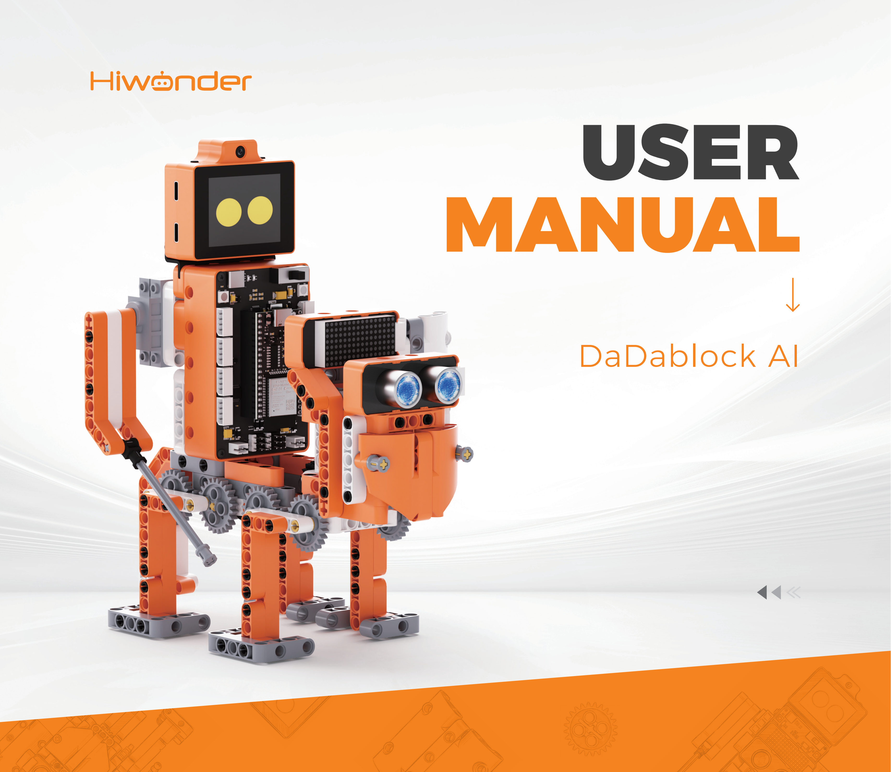
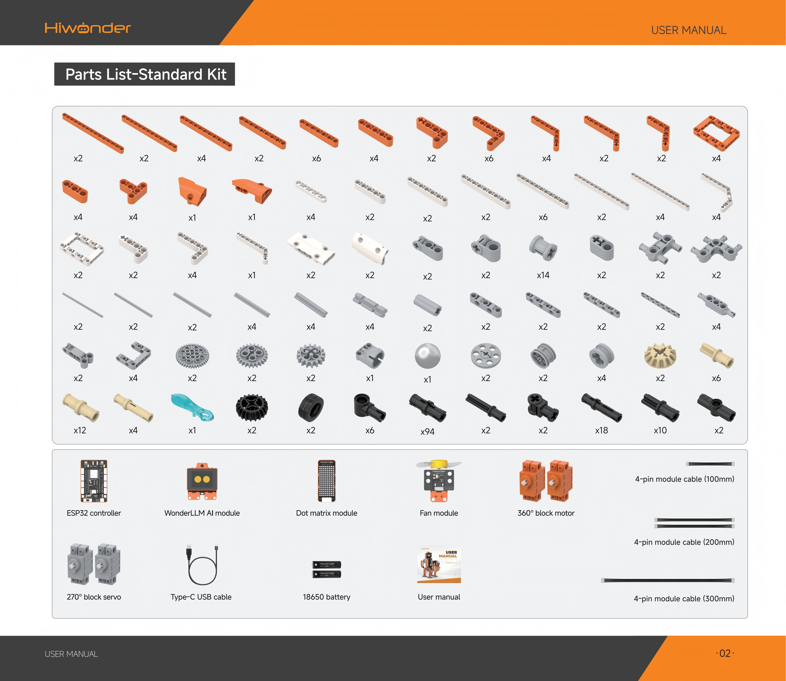

# 1. Kit Introduction

## 1.1 Kit Overview

The DaDablock AI Vision Kit is an AI vision building block system designed specifically for young makers and STEAM learners. Powered by the WonderLens vision module, the kit provides an intelligent visual core capable of recognizing faces, distinguishing colors, identifying tags, and performing intelligent line following. Paired with an extensive array of electronic execution modules, the kit supports building over ten robotic projects. Hands-on assembly enables the exploration of machine vision concepts and practical AI robotics.

## 1.2 Packing List

## 1.3 Precautions

- The products described in this guide, including hardware and software, are provided on an **"as-is"** basis. While every effort has been made to ensure accuracy during preparation, this manual does not guarantee complete freedom from errors or omissions. Documentation undergoes periodic review, and constructive feedback for improvement is welcome.

- Product contents may change across version upgrades. Contact customer support during ordering to obtain the latest product specifications and updates.

- Hiwonder assumes no liability for losses resulting from malfunction or damage under extreme operating conditions, unless Hiwonder explicitly designates the product for such specific applications.
