# 2. Quick Start

## 2.1 Basic Experience with the Vision Module

### 2.1.1 Powering the Device

Connect the module using a Type-C data cable connected to a computer port or a phone charger. The connection method is shown below:

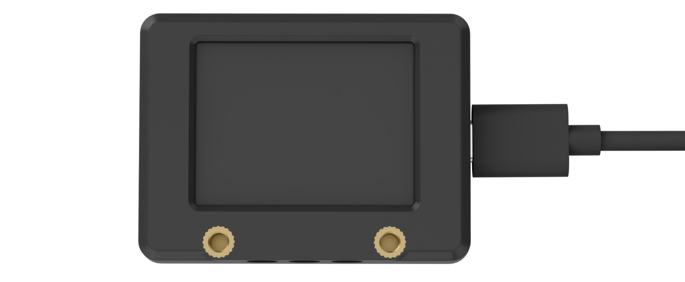

> [!NOTE]
>
> * **The supply voltage for the WonderLens vision module must not exceed 5 V. Select a charger or lithium battery that does not exceed 5 V.**
>
> * **Ensure sufficient supply voltage and power. Otherwise, the WonderLens vision module may encounter screen flickering, incorrect detection results, or other malfunctions.**

### 2.1.2 Operation Instructions

#### (1) Basic Operations

The WonderLens vision module features two joysticks located on the left and right. Each joystick supports left, right, and press actions. Functionally, these are divided into the navigation joystick and the function joystick. The joystick at the upper left of the screen serves as the navigation joystick, while the joystick at the upper right serves as the function joystick, as shown below:

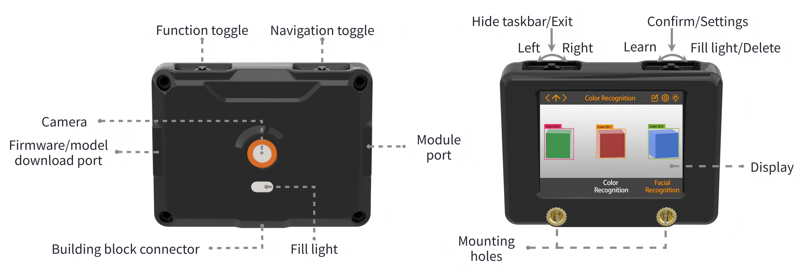

| Action | Navigation Joystick | Function Joystick |
| :---: | :---: | :---: |
| Push left | Switch menu items left | Enter learning mode |
| Press down | Collapse taskbar / Exit | Confirm / Settings |
| Push right | Switch menu items right | Fill light switch / Delete |

#### (2) Color Recognition

1. **Entering the Mode**

   * Upon the initial startup, the screen stays on the Color Recognition function bar.
   
   * Return to the main interface and push the **navigation joystick** until the top of the screen displays the Color Recognition menu bar.

2. **Learning and Recognizing New Colors**

   To use the color recognition feature, colors must first be learned. Follow the steps below:

   (1) On the color recognition main interface, push the **function joystick** toward the pen icon  to enter the learning interface.

   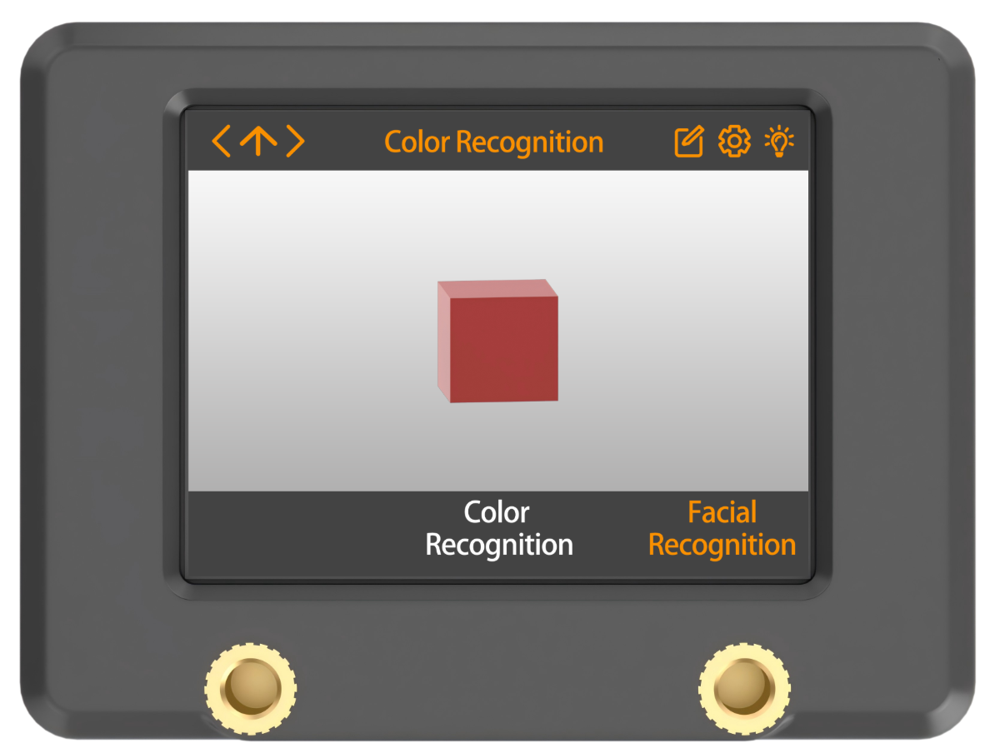

   (2) Align the crosshair at the center of the screen with the color swatch to learn. The selected color swatch is highlighted with a white bounding box.

   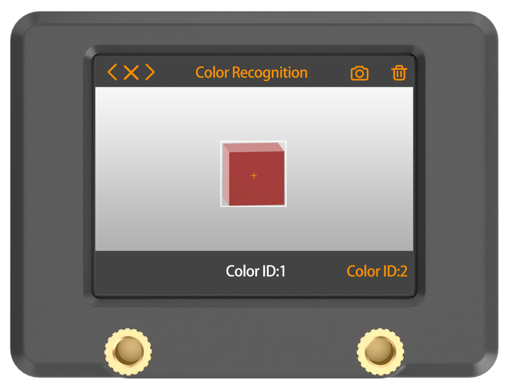

   (3) Push the joystick to the left, then press the camera icon  on the **function joystick** to start learning. Once learning succeeds, a confirmation prompt appears on the screen.

   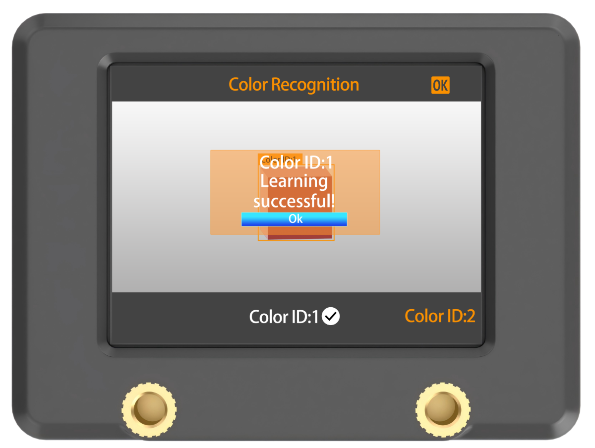

   (4) After successful learning, when the vision module detects the recognized color in the frame, it immediately marks the largest object matching that color and displays the corresponding color ID.

   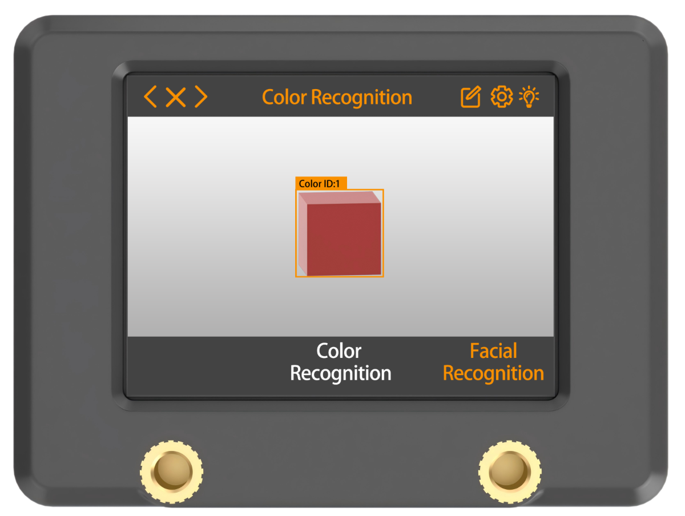

   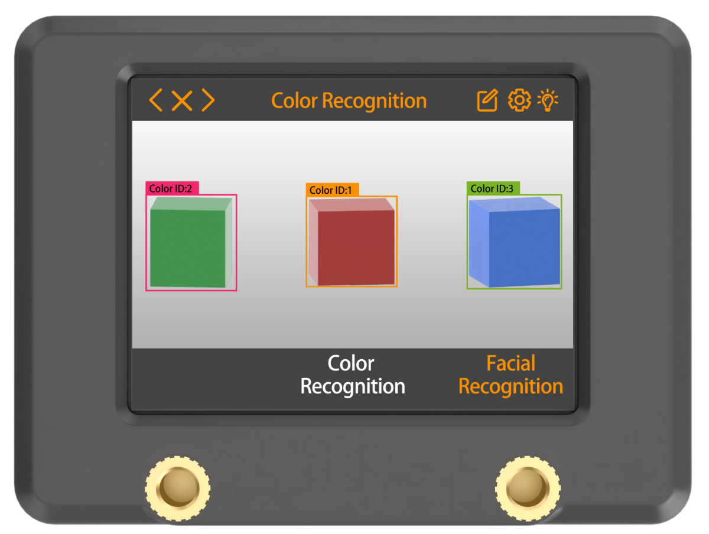

* **For instructions on deleting color IDs and configuring related parameters, refer to [4. Software_and_Hardware_Guide / 4.4 WonderLens vision module / 4.4.4 Feature Overview](https://wiki.hiwonder.com/projects/DaDablock-AI-Vision-Kit/en/advanced-kit/docs/4.%20Software%20and%20Hardware%20Guide.html#_4-4-4-feature-overview).**

  

#### (3) Facial Recognition

1. **Entering the Mode**

   Return to the main interface and push the **navigation joystick** until the top of the screen displays the Face Recognition menu bar.

2. **Detecting Faces**

   Upon entering this mode, face detection starts running automatically. When detection succeeds, a white bounding box outlines the detected face.

   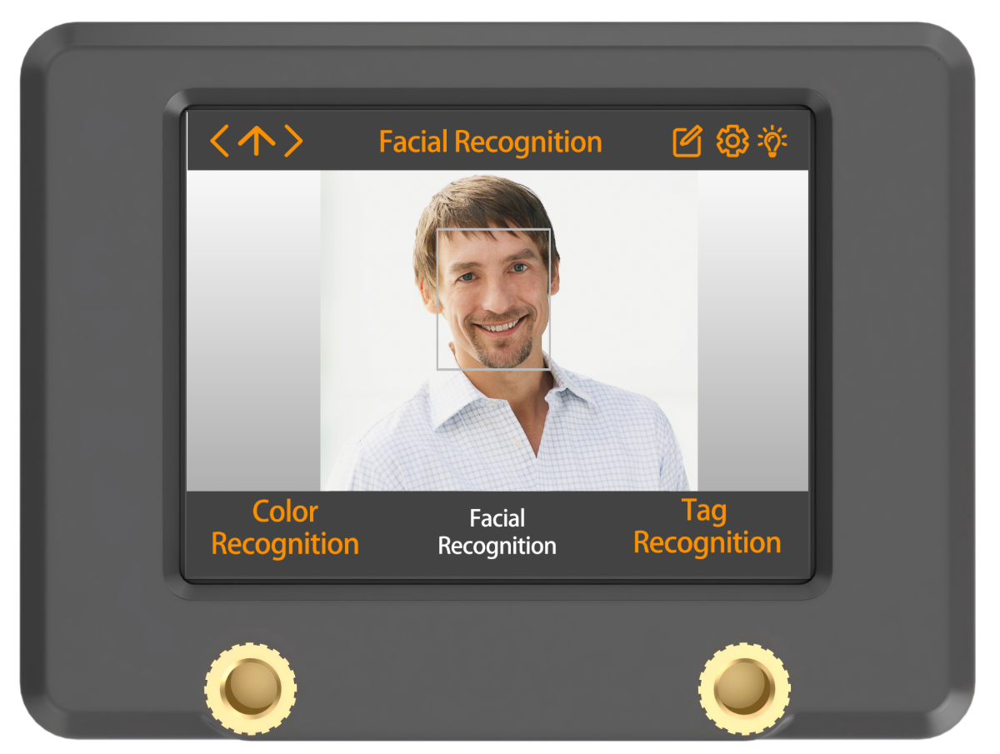

   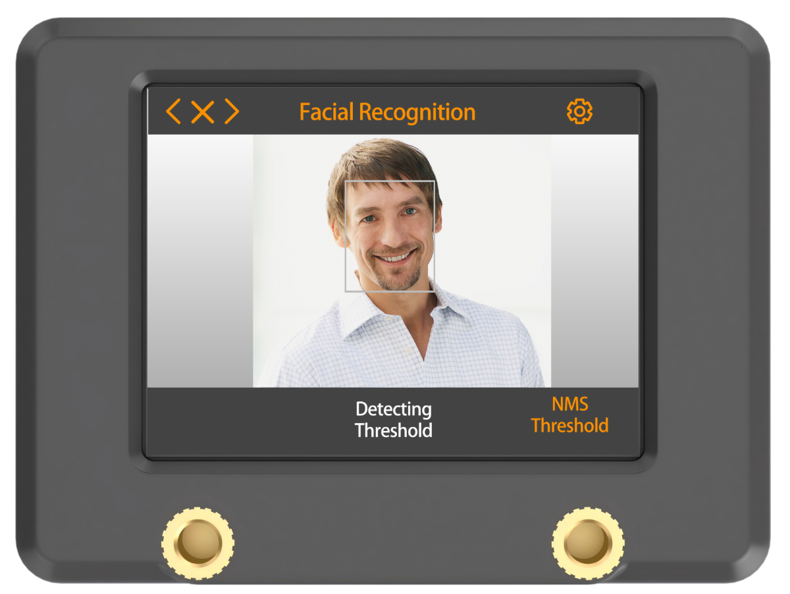

* **For instructions on face recognition learning steps and parameter configuration, refer to** [**4. Software_and_Hardware_Guide / 4.4 WonderLens vision module / 4.4.4 Feature Overview**](https://wiki.hiwonder.com/projects/DaDablock-AI-Vision-Kit/en/advanced-kit/docs/4.%20Software%20and%20Hardware%20Guide.html#_4-4-4-feature-overview).

#### (4) Tag Recognition

1. **Entering the Mode**

   Return to the main interface and push the **navigation joystick** until the top of the screen displays the Tag Recognition menu bar.

2. **Recognizing Tags**

   Point the camera toward the tag. The screen outlines the tag with an orange bounding box and displays a crosshair at the center.

   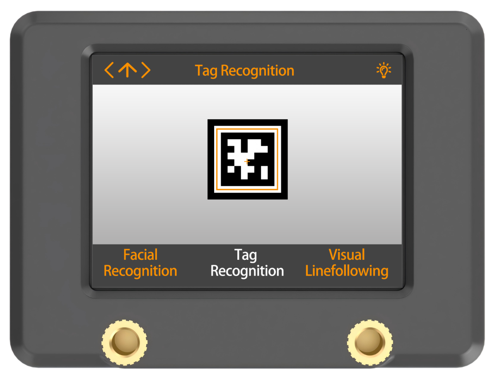

   The WonderLens vision module can recognize multiple tags with identical or different IDs simultaneously.

   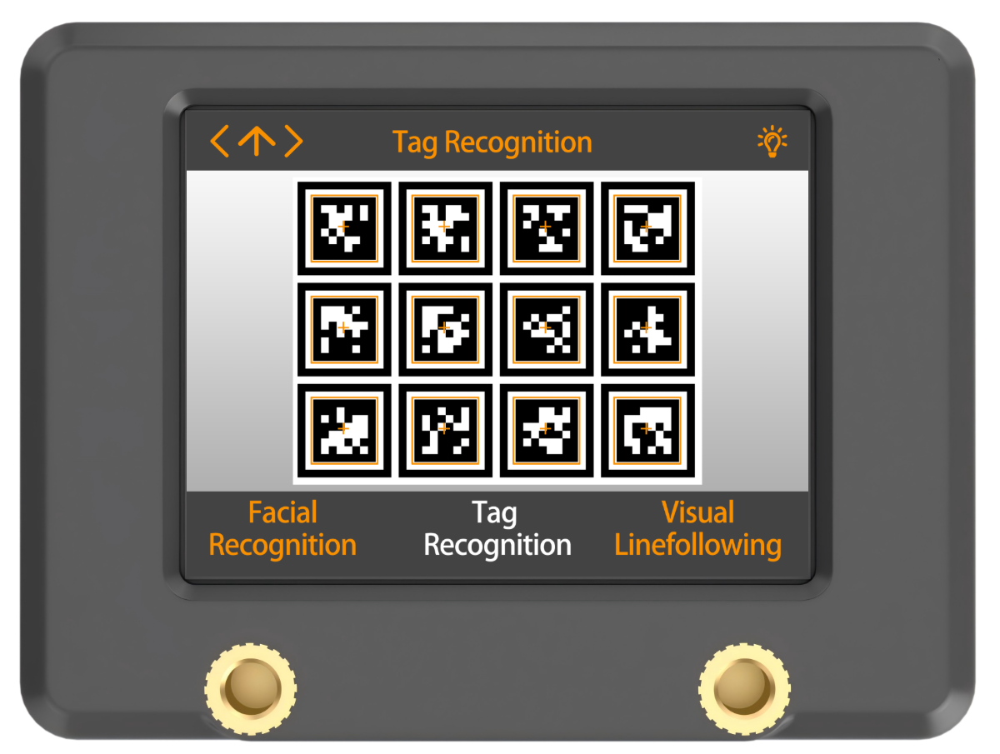

   > [!NOTE]
   >
   > **Maintain an appropriate distance from the tag. The tag is recognized as long as the module displays a bounding box around it. If the tag is positioned too far from the WonderLens vision module and appears too small in the frame, the module cannot perform recognition.**

#### (5) Line Following

1. **Entering the Mode**

   Return to the main interface and push the **navigation joystick** to the right until the top of the screen displays the Line Following menu bar.

2. **Learning and Recognizing New Lines**

   This feature operates similarly to color recognition. The target line must be learned before recognition can begin:

   (1) On the line following main interface, push the **function joystick** to the left, then short-press the button corresponding to the pen icon .

   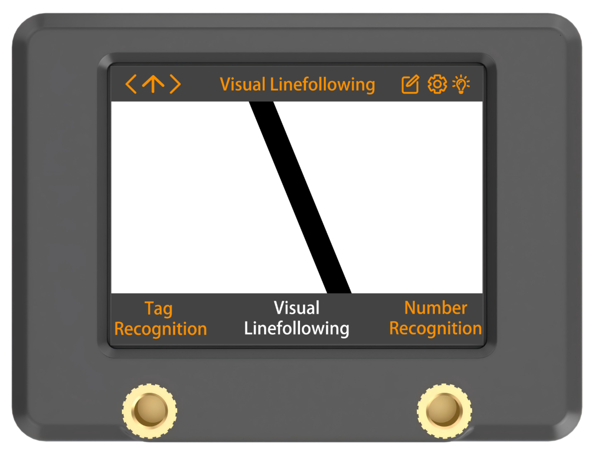

   (2) Align the crosshair at the center of the screen with the line to learn. Ensure the line appears as straight or vertical as possible in the frame, and adjust the white arrow on the screen to align with the direction of the target line.

   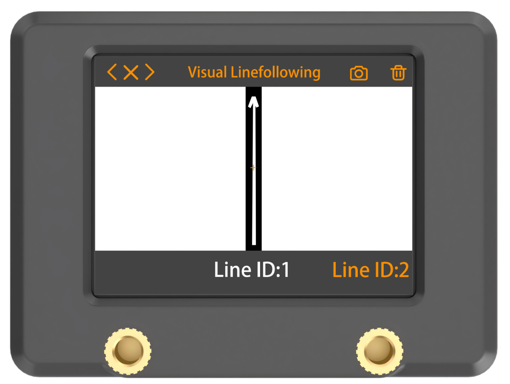

   (3) Short-press the button corresponding to the camera icon  to begin learning. Adjust lighting and angle to ensure the white arrow remains stable without jitter. Wait for the learning result prompt. If learning fails, adjust lighting conditions or use a more vivid color to stabilize the arrow before attempting again.

   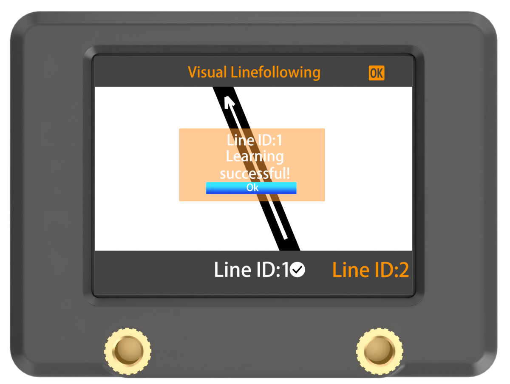

   (4) After successful learning, when the corresponding line color appears in the frame, the WonderLens vision module calculates the colored area and renders a directional arrow.

   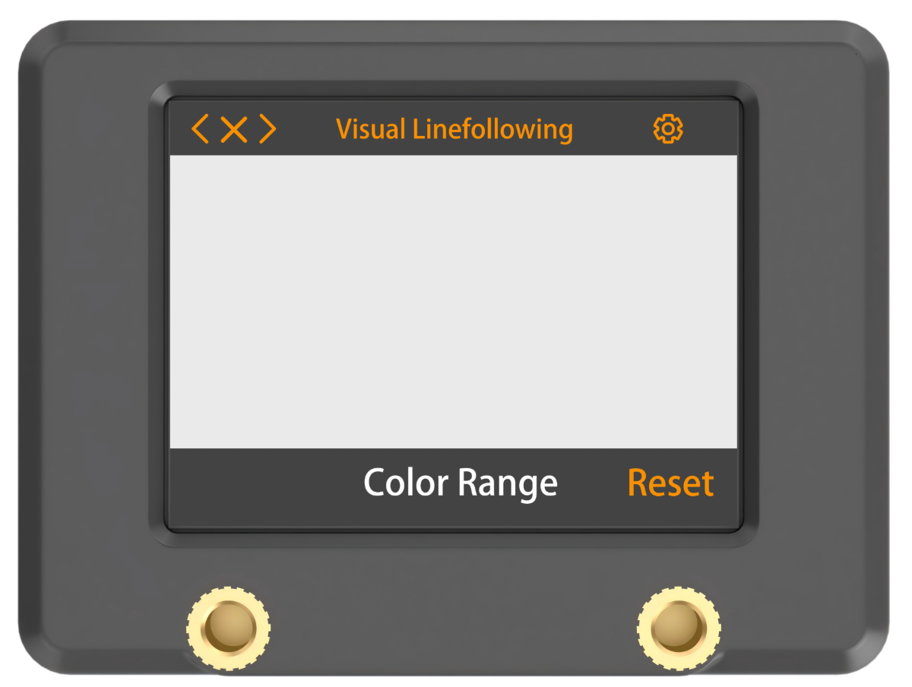

   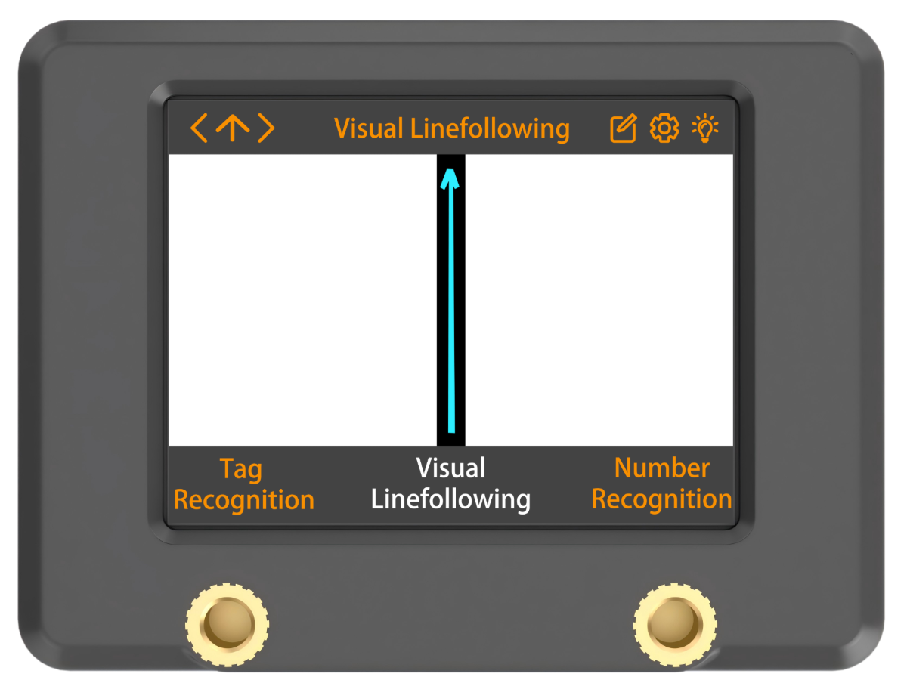

* **For instructions on deleting line IDs and configuring related parameters, refer to [4. Software_and_Hardware_Guide / 4.4 WonderLens vision module / 4.4.4 Feature Overview](https://wiki.hiwonder.com/projects/DaDablock-AI-Vision-Kit/en/advanced-kit/docs/4.%20Software%20and%20Hardware%20Guide.html#_4-4-4-feature-overview).**

#### (6) Number Recognition

1. **Entering the Mode**

   Return to the main interface and push the **navigation joystick** to the right until the top of the screen displays the Number Recognition menu bar.

2. **Recognizing Numbers**

   Point the camera toward the number cards for classification testing. Each card corresponds to a specific number. During operation, the screen displays the number with the highest confidence along with its confidence value. A confidence value closer to 1.0 indicates a more reliable recognition result.

   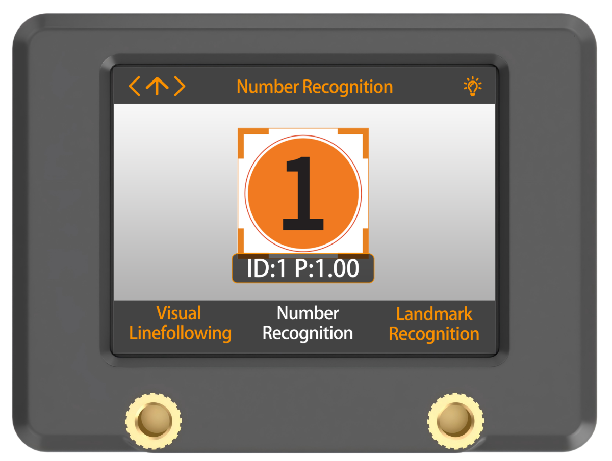

   | Number Card | Number | Number Card | Number |
   | :---: | :---: | :---: | :---: |
   |  | 1 |  | 2 |
   |  | 3 |  | 4 |
   |  | 5 | | |

   > [!NOTE]
   >
   > **Maintain a distance of approximately 15 to 20 cm between the card and the camera. Avoid dim ambient lighting, and use a solid background such as white for optimal recognition.**

#### (7) Traffic Sign Recognition

1. **Entering the Mode**

   Return to the main interface and push the **navigation joystick** to the right until the top of the screen displays the Traffic Sign Recognition menu bar.

2. **Recognizing Traffic Signs**

   Point the camera toward the traffic sign cards for classification testing. Each card corresponds to a different ID. During operation, the screen displays the ID with the highest confidence along with its confidence value. A confidence value closer to 1.0 indicates a more reliable recognition result.

   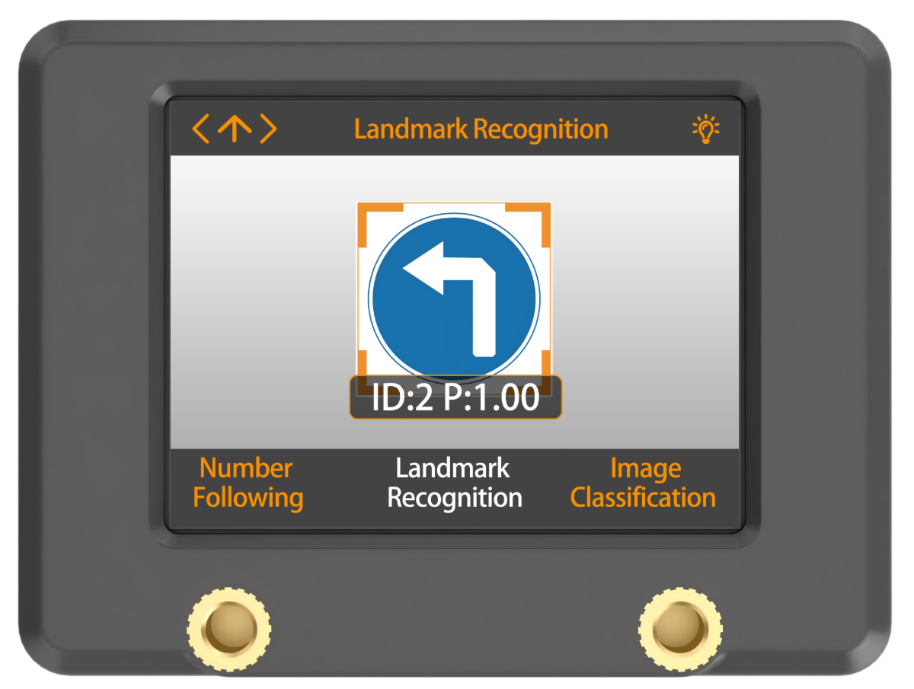

   | Traffic Sign Card | ID | Traffic Sign Card | ID |
   | :---: | :---: | :---: | :---: |
   |  | 1 |  | 2 |
   |  | 3 |  | 4 |
   |  | 5 | | |

#### (8) Image Classification

1. **Entering the Mode**

   Return to the main interface and push the **navigation joystick** to the right until the top of the screen displays the Image Classification menu bar.

2. **Classifying Images**

   Once image classification starts, classification testing can be conducted using the waste classification cards provided in the kit. Each card corresponds to a unique ID. During operation, the screen displays the ID with the highest confidence along with its confidence value. A confidence value closer to 1.0 indicates a more reliable recognition result.

   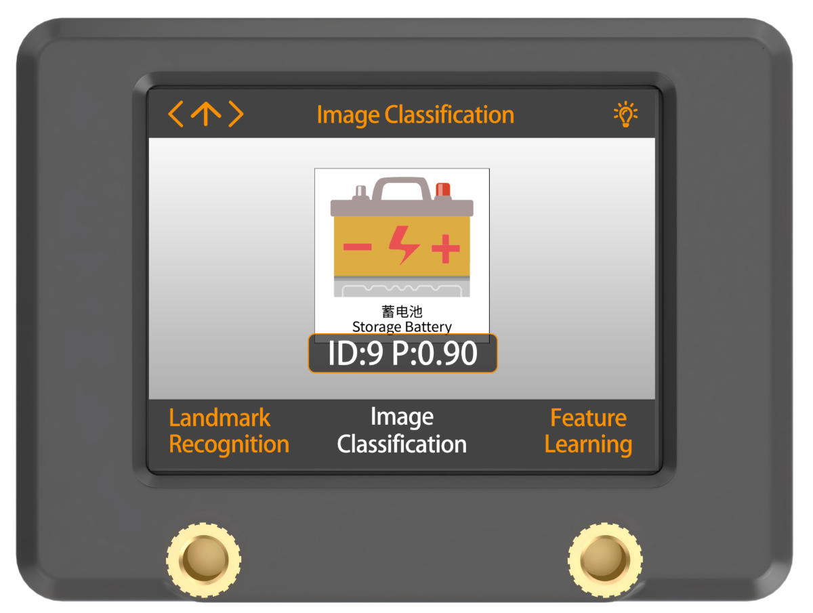

   | Waste Classification Card | ID | Waste Classification Card | ID |
   | :---: | :---: | :---: | :---: |
   | White background | 1 |  | 2 |
   | 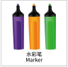 | 3 | 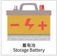 | 4 |
   | 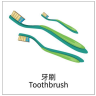 | 5 |  | 6 |
   |  | 7 |  | 8 |
   |  | 9 | 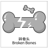 | 10 |
   |  | 11 |  | 12 |
   |  | 13 | | |

#### (9) Feature Learning

1. **Entering the Mode**

   Return to the main interface and push the **navigation joystick** to the right until the top of the screen displays the Feature Learning menu bar.

2. **Learning Features**

   (1) On the feature learning main interface, push the **function joystick** to the left to select the pen icon  and enter the learning interface.

   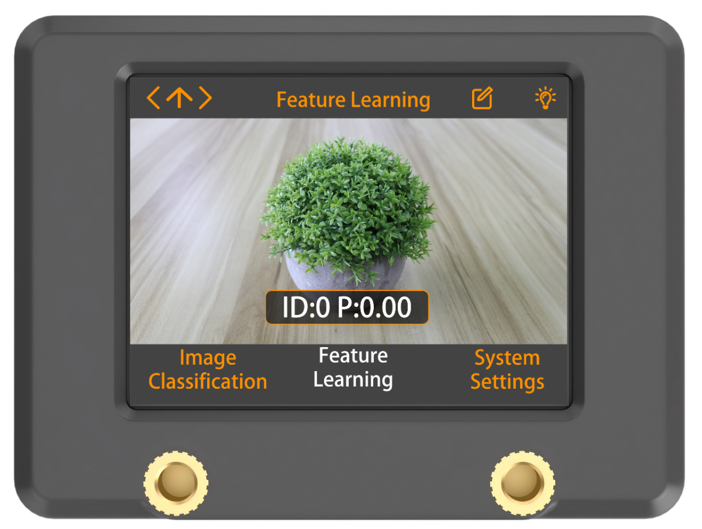

   (2) Move the WonderLens vision module to adjust framing, then press the button corresponding to the camera icon  and wait for the module to complete learning.

   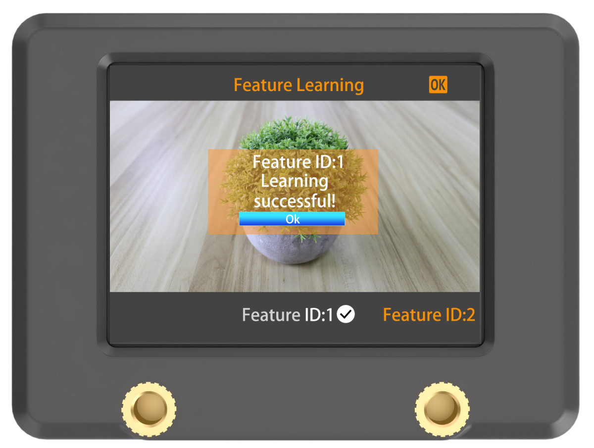

   (3) Once learning completes, the ID and P values in the result display area update to non-zero values. Here, P represents confidence, where a value closer to 1 indicates greater similarity. The ID corresponds to the learned reference image that most closely matches the current scene.

   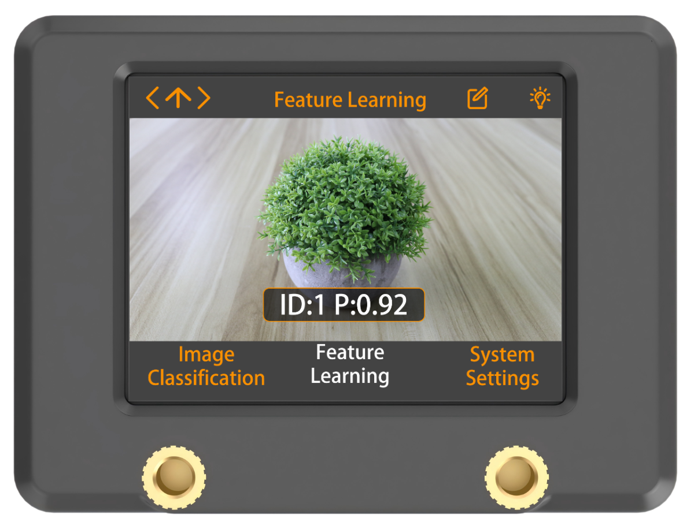

* **For steps on deleting feature learning IDs, refer to [4. Software_and_Hardware_Guide / 4.4 WonderLens vision module / 4.4.4 Feature Overview](https://wiki.hiwonder.com/projects/DaDablock-AI-Vision-Kit/en/advanced-kit/docs/4.%20Software%20and%20Hardware%20Guide.html#_4-4-4-feature-overview).**

## 2.2 Hardware Preparation

### 2.2.1 Powering On

1. Insert the batteries into the battery compartment at the bottom of the controller. 

   > [!NOTE]
   >
   > **Ensure correct polarity when inserting the batteries.**

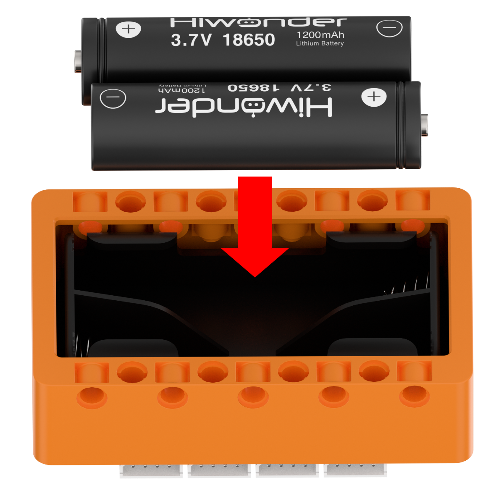

2. Turn on the power switch. The power indicator on the controller illuminates red, indicating successful startup.

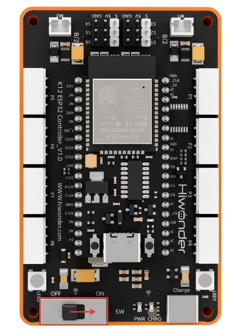

> [!NOTE]
>
> **When powering on for the first time, follow the steps in 2.2.2 Charging to charge the controller via the charge port for approximately 5 s. This activates the built-in battery protection chip. Once activated, re-activation is not required as long as the batteries remain installed.**

### 2.2.2 Charging

1. Ensure the power switch of the controller is set to **OFF**. Connect one end of the USB cable to the charging port of the controller, and connect the other end to a charger.

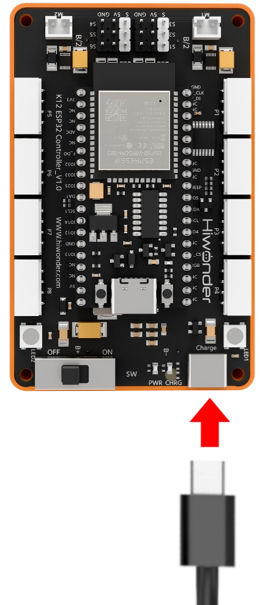

2. During charging, the LED indicator on the controller illuminates blue. When charging is complete, the LED indicator turns off. Disconnect the power cable promptly after charging to avoid overcharging.

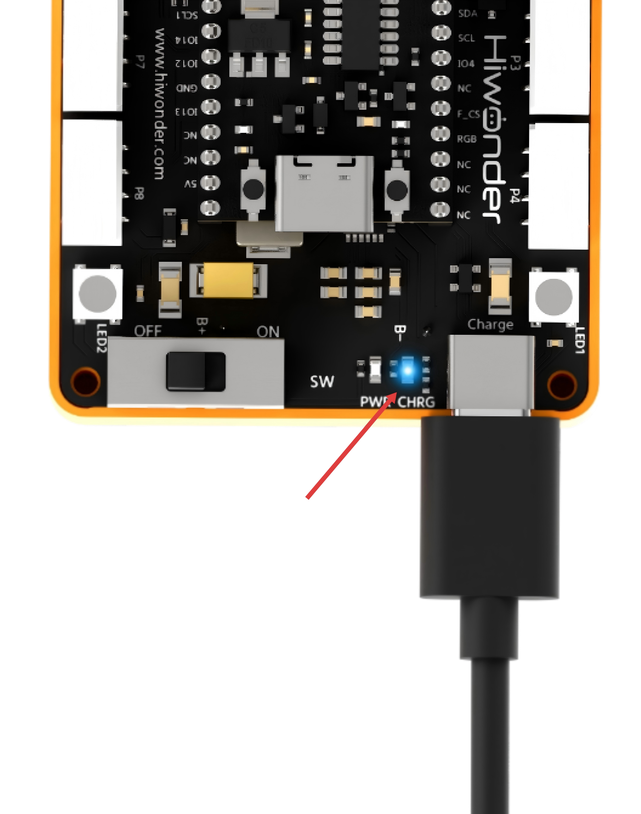

> [!NOTE]
>
> **The power switch must be turned off during charging. Otherwise, the batteries cannot be fully charged. Disconnect the charger and power cable promptly once charging completes to avoid damaging the batteries through overcharging. Adult supervision is required during charging.**

## 2.3 Software Configuration

### 2.3.1 Downloading the Programming Software

- [WonderCode (Windows Version)](https://hiwonder.com.cn/download/pcSoftware?get_pc=1&os=windows)

- [WonderCode (Mac Version)](https://hiwonder.com.cn/download/pcSoftware?get_pc=1&os=mac)

### 2.3.2 Installing WonderCode

1. Open the installation package **WonderCode setup.exe**.

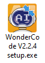

2. Select the language, then click **OK**.

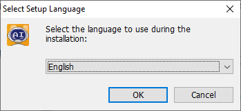

3. Select the installation directory, then click **Next**.

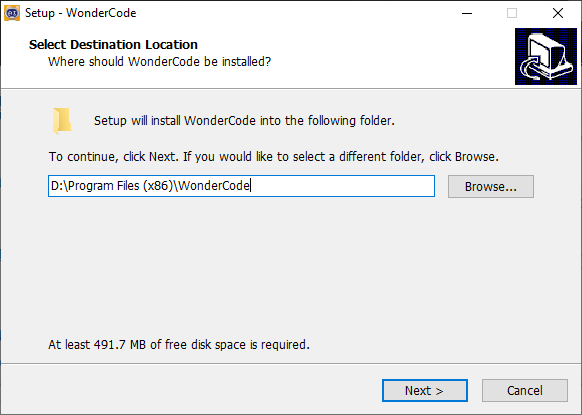

4. Click **Next**.

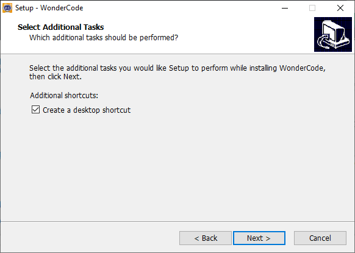

5. Click **Install**.

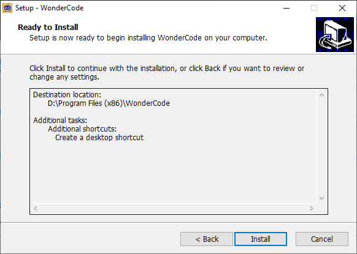

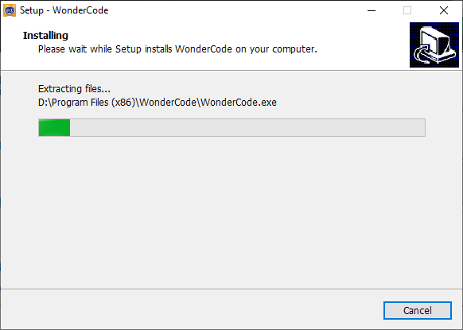

6. Once the installation completes successfully, click **Finish**.

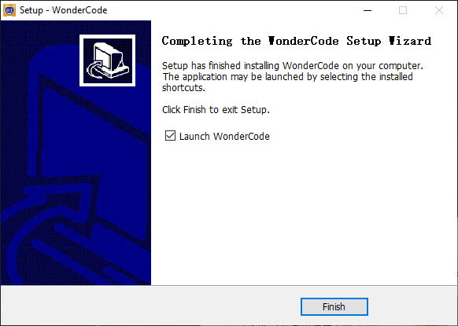

## 2.4 Starter Project 1: Onboard RGB LED Blinking

### 2.4.1 Program Writing

1. Create a new file: Open the programming software and create a new project.

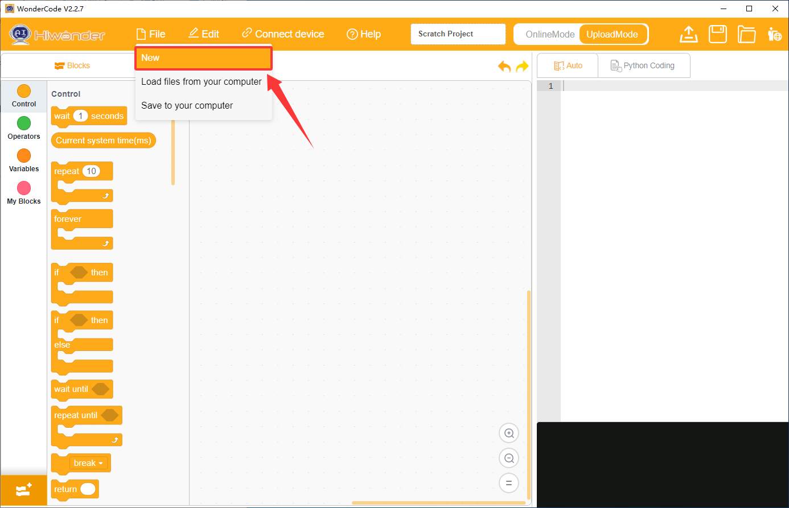

2. Add extensions:

- Click the **Extensions** button in the lower-left corner.

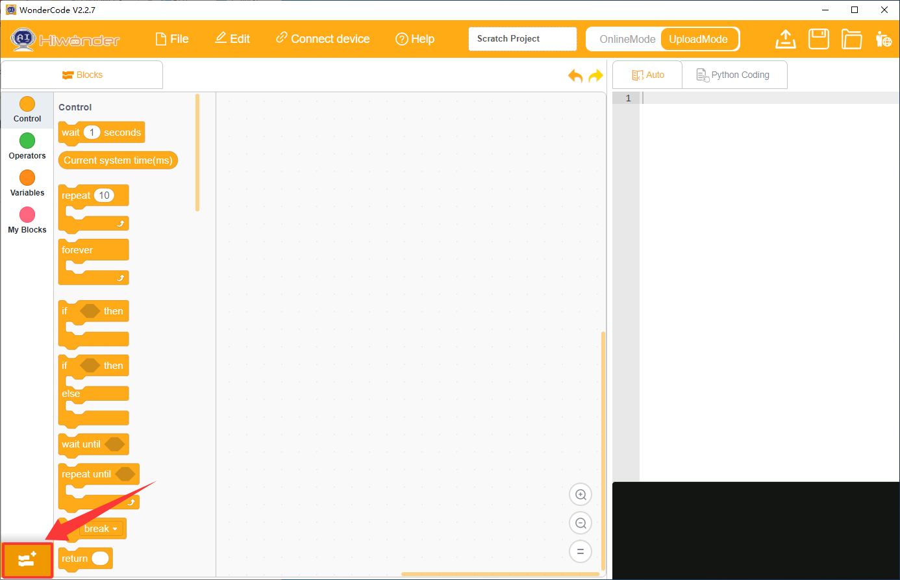

- Click the **Extensions** button and select **K12 ESP32** under the **Controller** category.

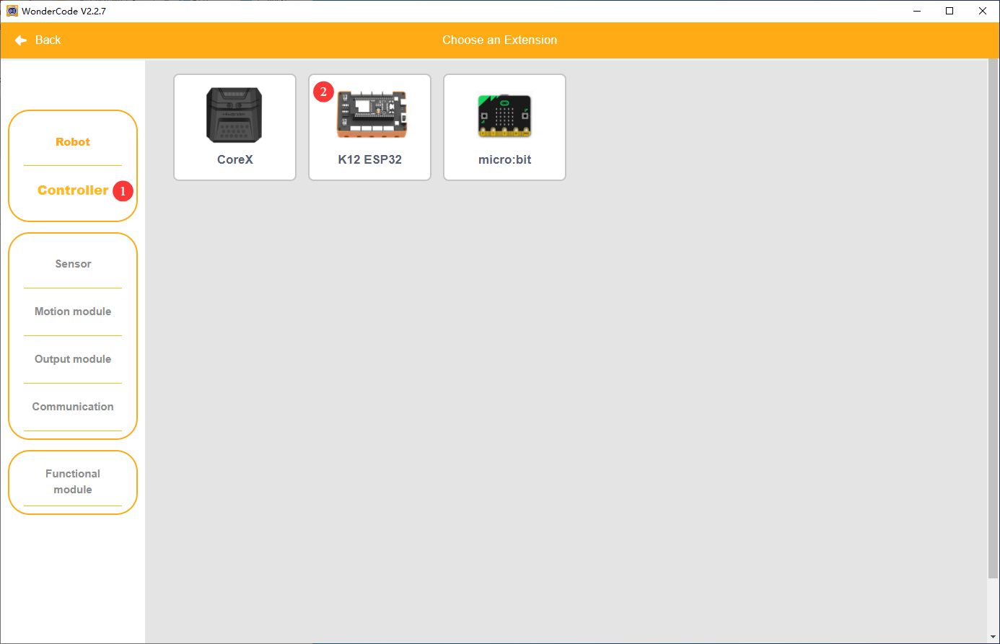

- Once added successfully, the loaded extension package appears in the WonderCode interface.

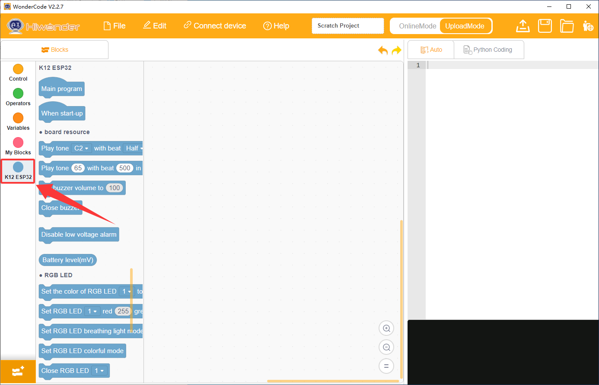

3. Build the program: Drag the corresponding blocks from the block palette to the script area. Once programmed successfully, the Python program converted from the blocks can be viewed in the code display and upload area.

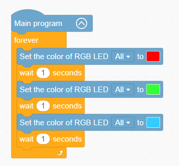

> [!NOTE]
>
> **The source files are available for download under [Program Files](https://drive.google.com/drive/folders/1Gm720L1dNkjlZoJDk2cL1KvjGKAc9D4I?usp=sharing).**

### 2.4.2 Program Upload

> [!NOTE]
>
> **The connected port number varies across computers. The port used in this section is COM3. Do not connect to COM1, as COM1 is typically reserved for system communications. If multiple COM ports appear and the correct port cannot be identified, right-click This PC, select Properties -> Device Manager, and locate the port corresponding to the controller, labeled with CH340.**

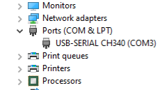

### 2.4.3 Program Outcome

After the program is uploaded successfully, the two onboard RGB LEDs on the controller toggle colors every 1 s in the sequence of red, green, and blue.

> [!NOTE]
>
> **The following starter projects guide familiarization with the electronic modules included in this kit. For detailed module descriptions, refer to [4. Software and Hardware Guide / 4.3 Electronic Modules Tutorials](https://drive.google.com/drive/folders/1Gm720L1dNkjlZoJDk2cL1KvjGKAc9D4I?usp=sharing).**

## 2.5 Starter Project 2: Traffic Sign Recognition Status Indication

### 2.5.1 Learning Objectives

1. Master loop structures and conditional statements in block-based programming. Read and modify the traffic sign recognition program logic.

2. Understand how to call traffic sign recognition functions, control RGB lights, and use audio playback blocks.

3. Provide sound and light feedback based on traffic sign commands such as forward and stop. Complete the intelligent recognition alert function and understand the principles of machine vision interaction.

### 2.5.2 Wiring Diagram

Connect the WonderLens vision module to port **P1** on the ESP32 controller.

The wiring diagram is shown below:

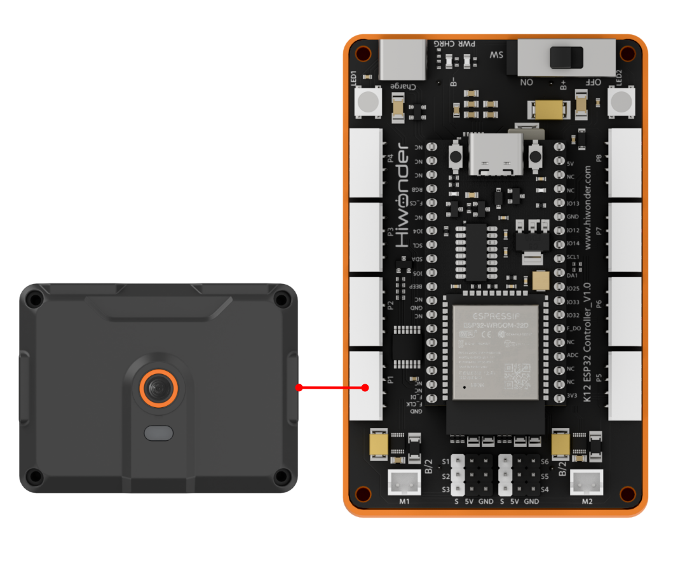

### 2.5.3 Program Writing

#### (1) Adding Extensions

Select **WonderLens** under the **Sensor** category in the **Extensions**.

#### (2) Complete Program

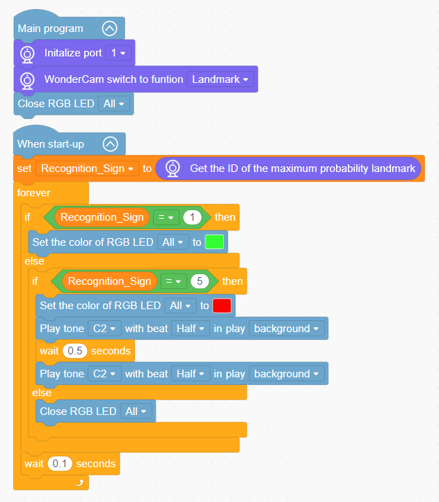

> [!NOTE]
>
> **The source files are available for download under [Program Files](https://drive.google.com/drive/folders/1Gm720L1dNkjlZoJDk2cL1KvjGKAc9D4I?usp=sharing).**

### 2.5.4 Program Upload

### 2.5.5 Program Outcome

The program continuously reads the traffic sign recognition results. When the ID 1 forward traffic sign is detected, the green light illuminates. When the ID 5 stop traffic sign is detected, the red light illuminates and a prompt tone plays twice. In all other cases, the lights remain off. Rapid loop detection provides continuous feedback on traffic sign commands.

## 2.6 Starter Project 3: Servo Direction Indication

### 2.6.1 Learning Objectives

1. Master the initialization and basic usage of the dot matrix display module and servo module. Understand the function of delay blocks.

2. Read and comprehend sequential logic in block-based programming. Master programming methods for servo clockwise rotation, counterclockwise rotation, and stopping.

3. Coordinate servo rotation with text prompts on the dot matrix display such as Left, right, and stop. Learn to provide visual feedback on device operating states using on-screen information.

### 2.6.2 Wiring Diagram

Connect the dot matrix module to port **P5** of the ESP32 controller using a 4-pin sensor cable.

Connect the 360° block motor to port **S1** of the ESP32 controller using a 3-pin servo cable. Ensure the **orange** signal wire of the servo aligns with the **white** pin of port **S1**.

The wiring diagram is shown below:

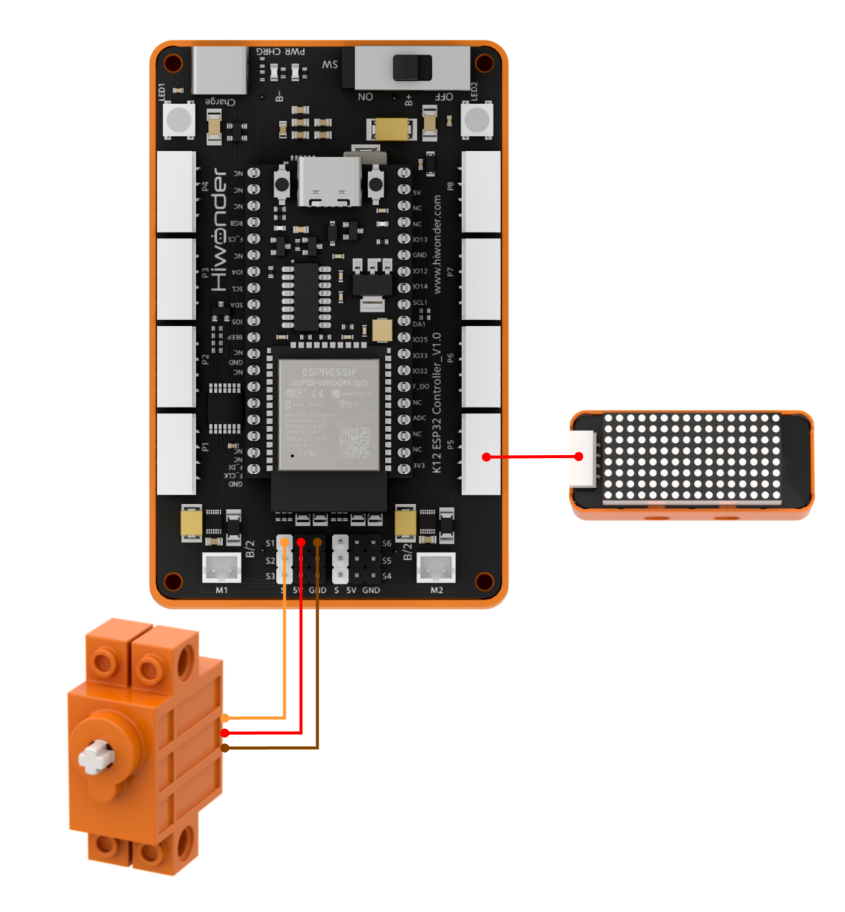

### 2.6.3 Program Writing

#### (1) Adding Extensions

Select **Dot matrix module** under the **Output module** category in the **Extensions**.

#### (2) Complete Program

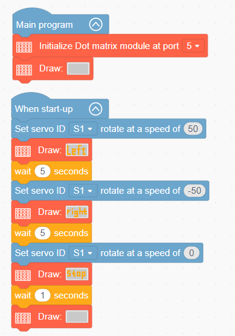

> [!NOTE]
>
> **The source files are available for download under [Program Files](https://drive.google.com/drive/folders/1Gm720L1dNkjlZoJDk2cL1KvjGKAc9D4I?usp=sharing).**

### 2.6.4 Program Upload

### 2.6.5 Program Outcome

The program drives the 360° block motor to rotate clockwise for 5 s while the dot matrix display shows Left. Next, the servo rotates counterclockwise for 5 s while the dot matrix display shows right. Then, the servo stops and the dot matrix display shows stop. Finally, the dot matrix display clears.

## 2.7 Starter Project 4: Comprehensive Control with Line Follower and Ultrasonic Sensor

### 2.7.1 Learning Objectives

1. Understand the functions of the glowy ultrasonic sensor. Learn to read obstacle distance values and control RGB lighting effects.

2. Understand the functions of the 4-channel line follower sensor. Learn to read tracking status data from the sensor.

3. Understand the servo module. Learn to adjust the servo angle based on sensor detection results.

### 2.7.2 Wiring Diagram

Connect the 4-channel line follower to port **P1** on the ESP32 main controller.

Connect the glowy ultrasonic sensor to port **P2** on the ESP32 main controller.

Connect the 270° block servo to port **S1** on the ESP32 main controller, plugging the servo's **orange** wire into the **white** pin of S1.

The wiring diagram is shown below:

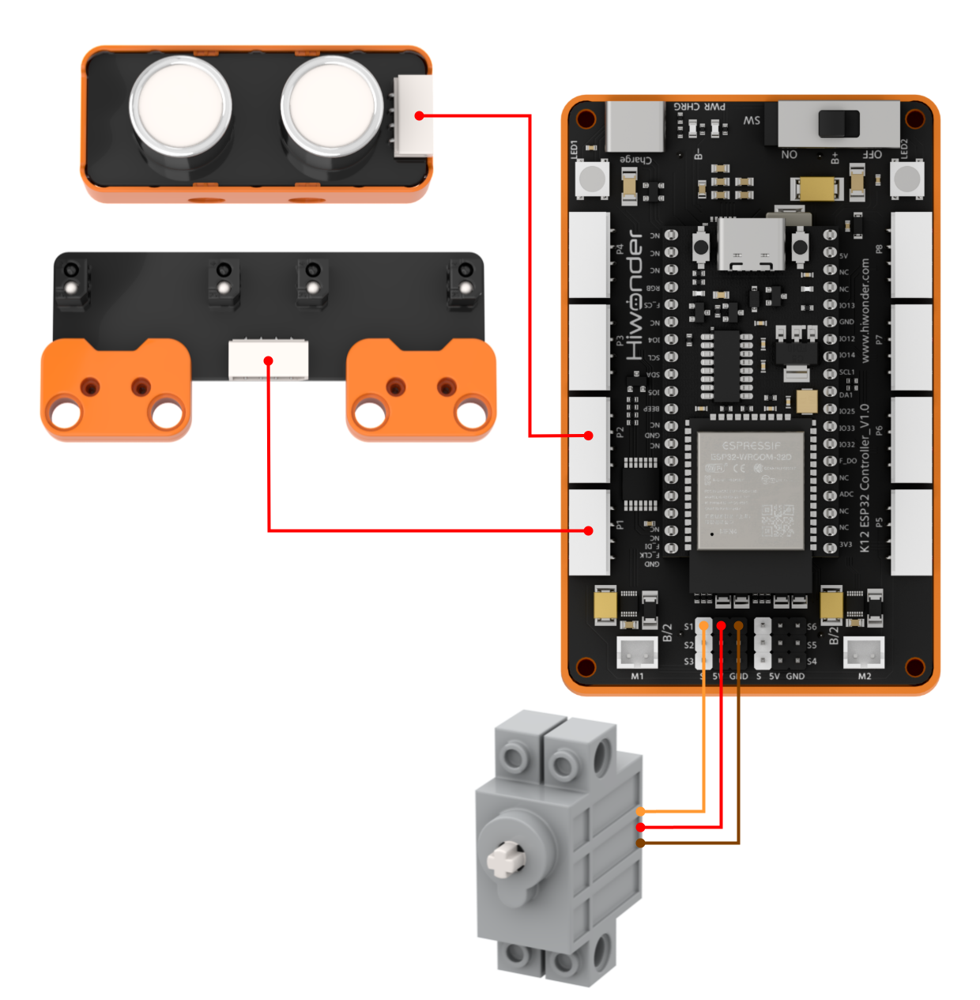

### 2.7.3 Program Writing

#### (1) Adding Extensions

Select **Glowy ultrasonic sensor** and **4-ch line follower sensor** under the **Sensor** category in the **Extensions**.

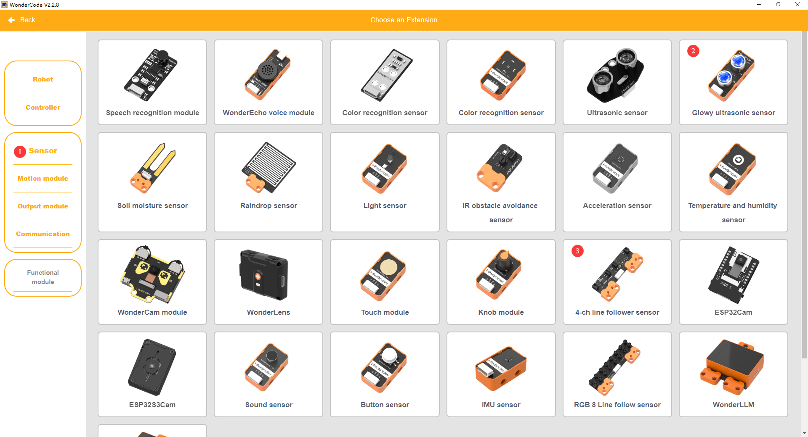

#### (2) Complete Program

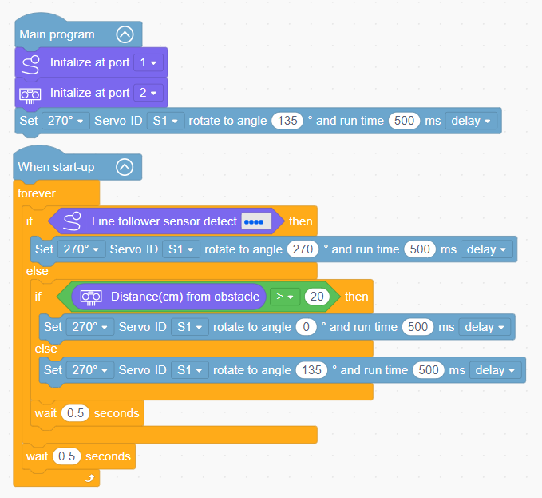

> [!NOTE]
>
> **The source files are available for download under [Program Files](https://drive.google.com/drive/folders/1Gm720L1dNkjlZoJDk2cL1KvjGKAc9D4I?usp=sharing).**

### 2.7.4 Program Upload

### 2.7.5 Program Outcome

Upon initialization after powering on, servo S1 rotates to 135°. During loop execution after startup, when a line-following signal is detected, servo S1 rotates to 270°. When no line-following signal is detected, if the distance measured by the ultrasonic sensor exceeds 20 cm, the servo rotates to 0°. Otherwise, the servo remains at 135°. Each loop cycle concludes with a 0.5 s delay.
