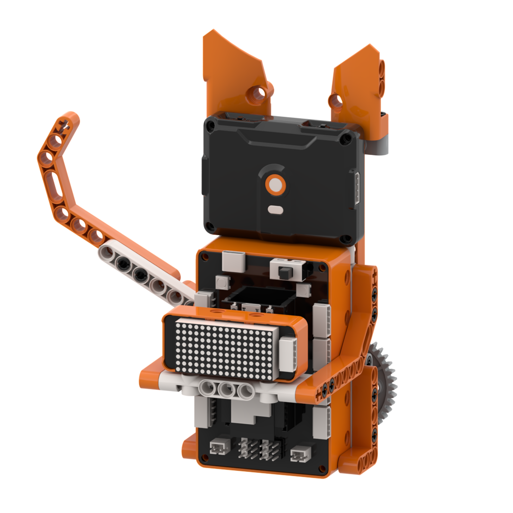
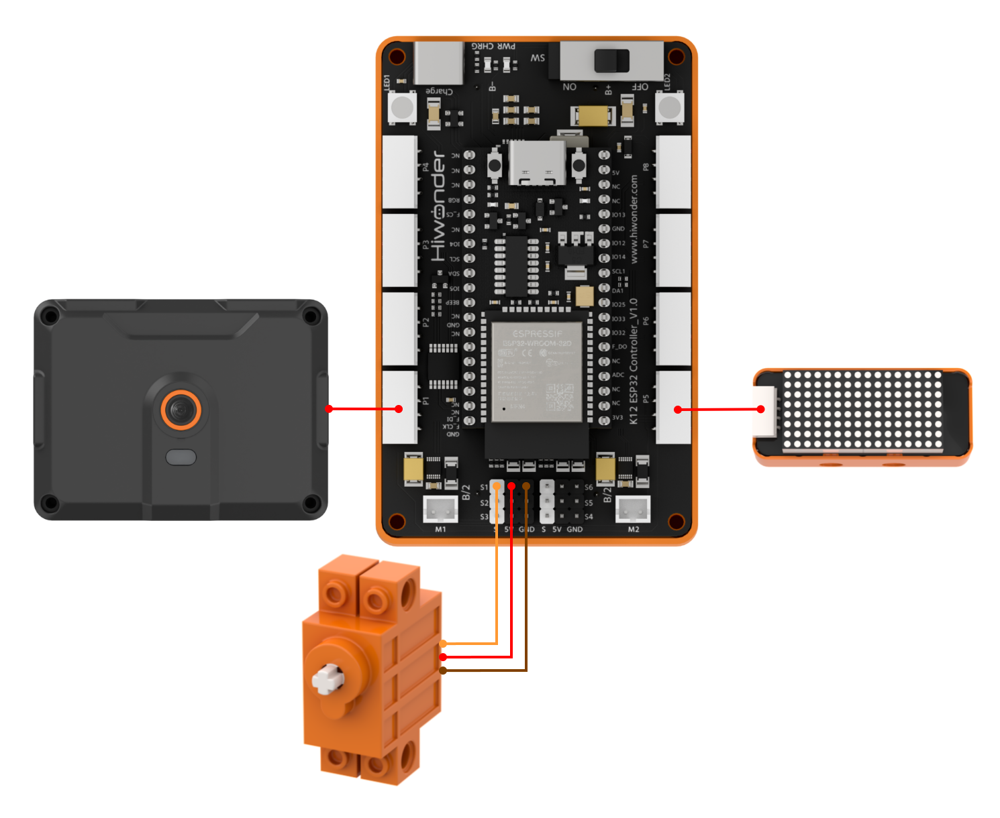
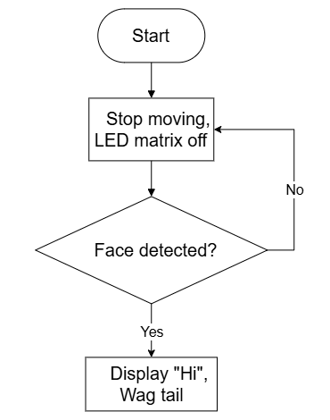
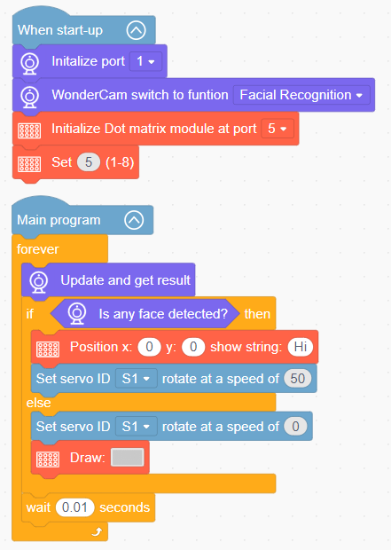

# 3.1 Smart Beckoning Cat

## 3.1.1 Lesson Introduction

The Smart Beckoning Cat is an intelligent robotic building block model. The feline head is equipped with the WonderLens vision module as its visual input, while the chest features a dot matrix display for visual feedback. A 360° block motor connects to the tail mechanism to drive reciprocal swinging motion. The modular mechanical structure ensures straightforward assembly and accessible wiring. When the camera detects a face approaching, the dot matrix display outputs the greeting "Hi" and the tail swings synchronously to greet visitors. This project demonstrates practical AI face detection and intuitive human-robot interaction, also known as HRI.

## 3.1.2 Learning Objectives

1. Master face detection using the WonderLens vision module. Learn methods for acquiring and parsing face recognition data.
2. Program reciprocal swing routines for the 360° block motor. Implement precise motion control for the robotic tail.
3. Master character display programming on the dot matrix module. Establish synchronized interaction linking face detection, display output, and servo motion.
4. Assemble the robotic model and debug the program. Develop foundational skills in building interactive AI robotic projects.

## 3.1.3 Assembly Guide

<pdf src="../../../../docs/_static/shared/pdf/chapter_3/1.pdf" />

## 3.1.4 Hardware Wiring

Connect the WonderLens vision module cable to the **P1** port of the ESP32 controller.

Connect the dot matrix module cable to the **P5** port of the ESP32 controller.

Connect the 360° block motor cable to the **S1** port of the ESP32 controller, with the servo's **orange** wire plugged into the **white** pin of S1.

Wiring diagram:

## 3.1.5 Programming

### (1) Program Schematic

### (2) Adding Extensions

- Click the **Extensions** button and select the **WonderLens** under the **Sensor** category.

- Click the **Extensions** button and select **Dot matrix module** under the **Output module** category.

### (3) Core Blocks

| Block | Category | Function Description |
| :---: | :---: | :--- |
|  |  | Controls the servo connected to the specified port to rotate at the set speed. |
|  |  | Adjusts the brightness of the dot matrix display to a specified level from 1 to 8. |
|  |  | Displays custom text at the specified coordinates on the dot matrix display. |
|  |  | Draws the selected pattern on the dot matrix display. |
|  |  | Switches the AI vision operating mode of the vision module. |
|  |  | Refreshes the camera feed and reads recognition data for the current vision mode. |
|  |  | Detects whether a face appears in the camera frame and returns a boolean result. |

### (4) Complete Program

1. Initialization: At startup, initialize the WonderLens vision module at port **P1** and switch the operating mode to face recognition. Initialize the dot matrix module at port **P5** and set its display brightness.

2. Main Loop: The program continuously updates and retrieves recognition data from the WonderLens vision module, then evaluates whether any face is detected. If a face is detected, the dot matrix module displays the text "Hi" at coordinates (0, 0), and servo **S1** rotates at a speed of 50. Otherwise, the speed of servo **S1** is set to 0, and the dot matrix module displays a default icon. Each loop iteration pauses for 0.01 s.

> [!NOTE]
>
> **The program source files can be downloaded from [Program Files](https://drive.google.com/drive/folders/1gpd83ho-Cf-T1LV6VETKvwf1mI7A8Bfg?usp=sharing).**

## 3.1.6 Program Upload

## 3.1.7 Expansion and Challenge

**Challenge Task 1: Multi-Person Tiered Greeting Effect**

1. Project Goal: Differentiate between single-person and multi-person scenarios in the camera frame to produce tiered greeting behaviors. When only one person is detected, the display shows "Hi" and the tail swings slowly. When multiple people appear simultaneously, the display switches to "Welcome" and the tail swings rapidly at a higher frequency.

2. Implementation Strategy: Call the block that reads the detected face count, create a numerical variable to store the count, and nest two levels of conditional branch logic. Add blocks to scroll multi-character text on the dot matrix display, and adjust the servo delay values to alter swing speeds.

3. Key Challenges: Reliably reading multi-target recognition data, preventing logical conflicts across nested conditions, and eliminating screen flickering during text transitions.

**Challenge Task 2: Delayed Reset After Face Departure**

1. Project Goal: When a person walks away, the robot does not halt immediately. Instead, it sustains tail-swinging and screen illumination for 3 s before clearing the display and returning the tail to its home position, simulating real-world storefront greeting delays.

2. Implementation Strategy: Introduce a timer variable to start a countdown when the face disappears. Maintain greeting actions while the timer remains active. Turn off the display and halt the servo once the timer reaches zero.

3. Key Challenges: Ensuring the non-blocking timer routine does not interrupt vision processing so that both tasks execute smoothly without lag.

**Challenge Task 3: Creative Applications of Face Detection**

1. Automated Greeting Lamp: Retain the camera face detection setup, replace the servo with an RGB light module, and automatically illuminate the lamp upon detecting a person.

2. Smart Access Control: Replace the servo with an electric lock mechanism to unlock a barrier automatically when an authorized face is detected.

3. Universal Adaptation Strategy: Keep the core face detection algorithm unchanged and swap out the output hardware. By implementing new peripheral control blocks under the logic of triggering actions upon detection, diverse smart applications can be developed.

## 3.1.8 Q&A

**Question 1: During servo wiring, the orange signal wire must connect to the white pin of port S1. What problems occur if it is wired incorrectly?**

**Answer**: The white pin of port **S1** is dedicated to transmitting PWM control signals, which the servo relies on to determine rotation angle and speed. If the orange signal wire connects to the power or ground pins, the controller cannot transmit control instructions. Two primary failures occur: either the servo remains completely motionless with no tail swing, or the servo vibrates erratically and rotates erratically, potentially overheating and causing hardware damage. Furthermore, all program code designated to control tail motion becomes ineffective, failing to achieve the greeting function.

**Question 2: After detecting a face, the screen displays "Hi" normally, but the tail does not swing at all. What are the most common causes and troubleshooting steps?**

**Answer**:

1. Wiring Fault: The orange signal wire of the servo is not plugged into the white signal pin of port **S1**. Troubleshooting: Disconnect the power, then verify the three-pin sequence against the wiring diagram.

2. Program Fault: The servo rotation code is placed outside the condition branch for detecting a face. Troubleshooting: Open the program and verify that the servo motion and delay blocks reside inside the conditional block that executes when face detection succeeds.

3. Hardware Damage: The servo itself is defective or port **S1** of the ESP32 controller is damaged. Troubleshooting: Connect a known working servo to port **S1** for testing. If it still fails to move, connect the servo to an alternative servo port on the controller to isolate the issue.

## 3.1.9 Technical Support and Product Discussion

Share project ideas and connect with other makers on the [Hiwonder community](https://forum.hiwonder.com):

