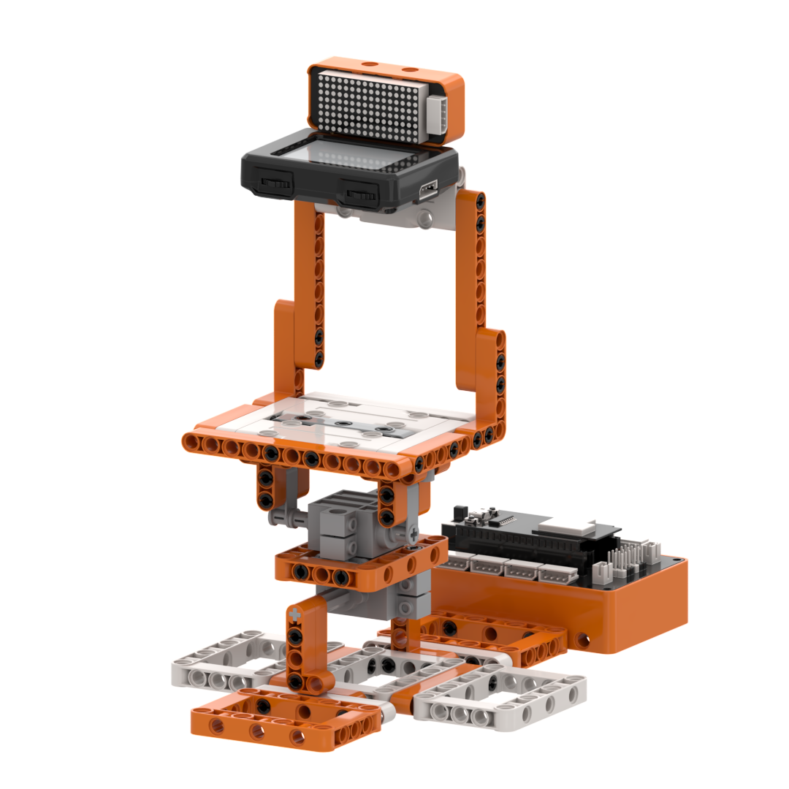
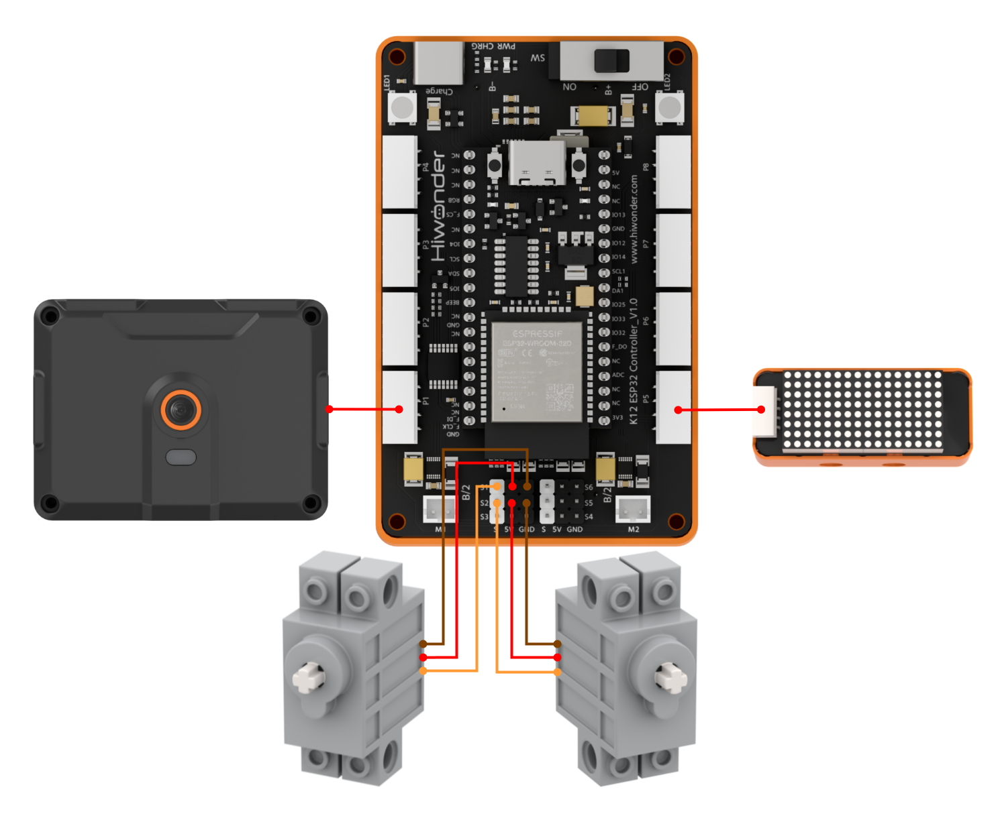
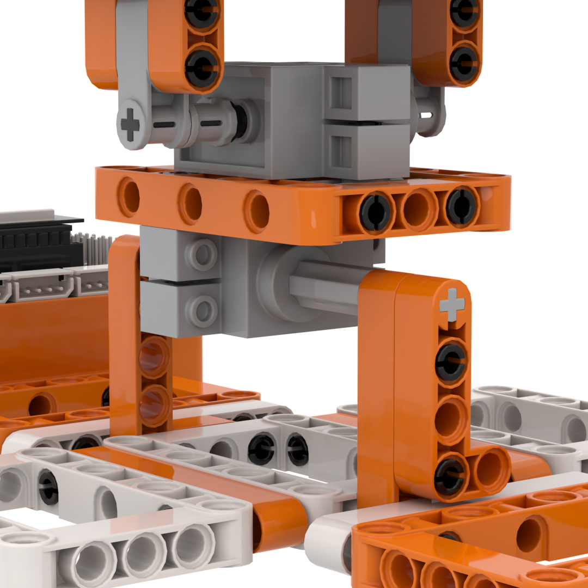
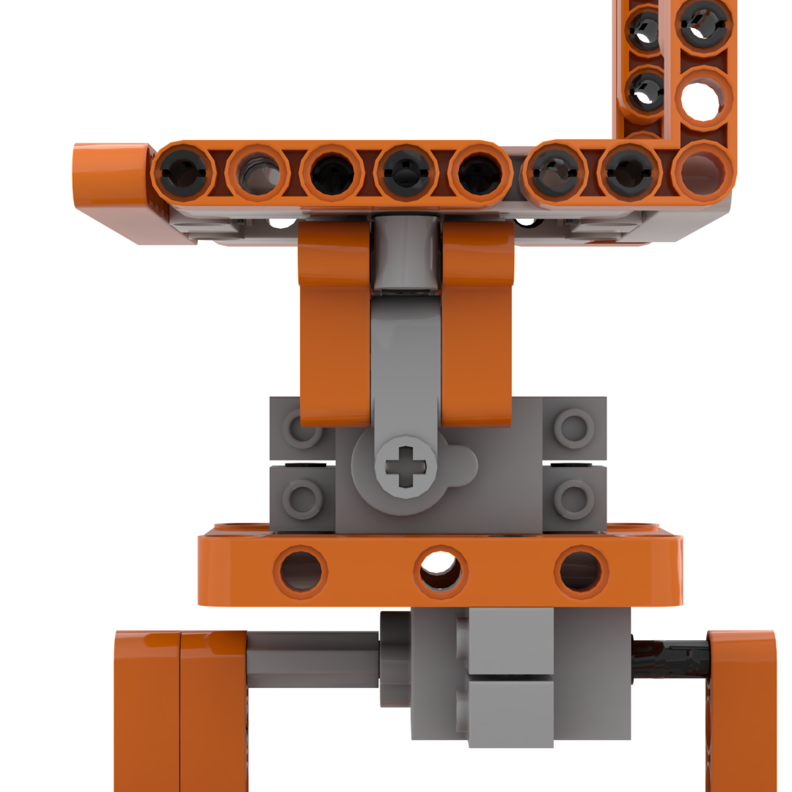
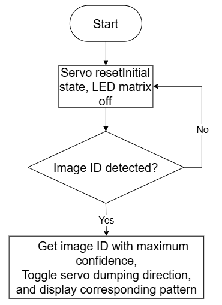
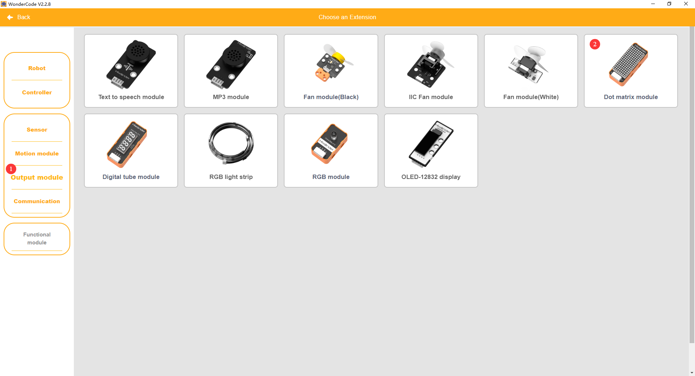
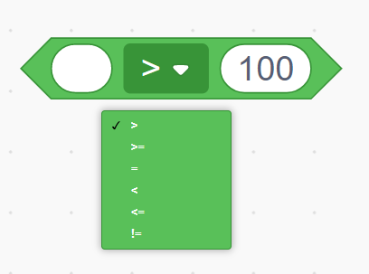
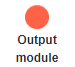
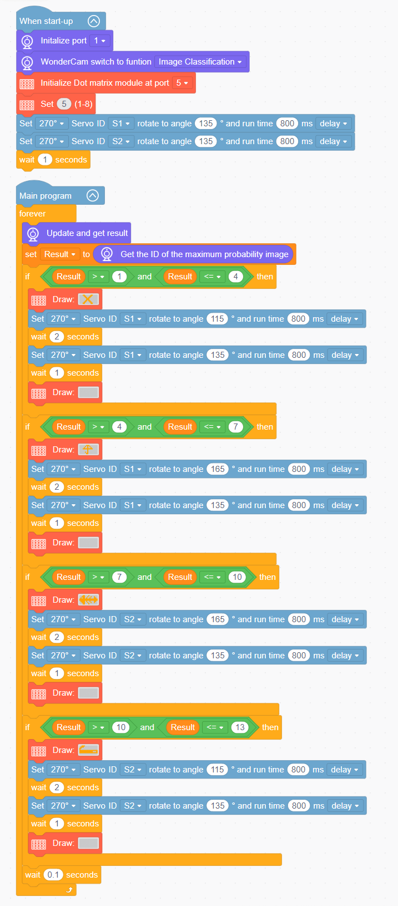

# 3.10 Smart Recycling Station

## 3.10.1 Lesson Introduction

The Smart Recycling Station is an intelligent educational robotic building block model designed for automated waste sorting. The front of the model is equipped with the WonderLens vision module as its visual input, while the two sorting bins on the left and right sides use 270° block servos to tilt the loading platform and deposit items. The main chassis incorporates a dot matrix display to show category icons. The modular mechanical design ensures straightforward assembly and accessible wiring. When the camera identifies a waste classification card, the corresponding servo drives the platform to dump the material into the designated bin, while the dot matrix display synchronously outputs the sorting icon. This project delivers an automated card recognition and disposal experience, integrating AI image classification, dual-servo linkage, and visual display feedback.

## 3.10.2 Learning Objectives

1. Master image classification using the WonderLens vision module. Learn methods for reading recognition signals from waste classification cards.
2. Program angle control routines for dual 270° block servos on the ESP32 controller. Master graphics and text display programming on the dot matrix module.
3. Complete system linkage debugging across visual recognition, dual-servo tilt direction control, and dot matrix feedback to achieve synchronized operation.
4. Assemble the complete waste sorting model and debug the program. Develop foundational skills in building multi-servo AI visual classification projects.

## 3.10.3  Assembly Guide

<pdf src="../../_static/shared/pdf/chapter_3/10.pdf" />

## 3.10.4 Hardware Wiring

Connect the WonderLens vision module cable to port **P1** of the ESP32 controller.

Connect the dot matrix display module cable to port **P5** of the ESP32 controller.

Connect the left 270° block servo cable to port **S1** of the ESP32 controller, ensuring the **orange** wire is plugged into the **white** pin of S1.

Connect the right 270° block servo cable to port **S2** of the ESP32 controller, ensuring the **orange** wire is plugged into the **white** pin of S2.

Wiring diagram:

> [!NOTE]
>
> **When using the 270° block servo for the first time, detach the gear and its attached building block components from the servo before uploading the program. Upload the lesson program to the ESP32 controller and wait for the servo to rotate to its initial home position, 135°. Once initialized, reattach the components. This step can be skipped if a servo homing routine has already been executed.**

## 3.10.5 Programming

### (1)  Program Schematic

### (2) Adding Extensions

- Click the **Extensions** button and select the **WonderLens** under the **Sensor** category.

- Click the **Extensions** button and select **Dot matrix module** under the **Output module** category.

### (3) Core Blocks

| Block | Category | Function Description |
| :---: | :---: | :--- |
|  |  | Compares the left value with a specified value and returns a boolean result for the greater-than condition. |
|  |  | Performs a logical AND operation on two boolean values and returns the result. |
|  |  | Creates a custom variable for data storage. |
|  |  | Reads the data stored in the specified custom variable. |
|  |  | Assigns a custom value to the specified variable. |
|  |  | Rotates the specified servo to the target angle within a set duration and selects the delay mode. |
|  |  | Adjusts the brightness of the dot matrix display to a specified level between 1 and 8. |
|  |  | Draws the selected graphic pattern on the dot matrix display. |
|  |  | Switches the AI vision operating mode of the vision module. |
|  |  | Refreshes the camera feed and reads recognition data for the current vision mode. |
|  |  | Extracts the classification ID with the highest confidence from the image classification recognition results. |

### (4) Complete Program

1. Initialization: At startup, initialize the WonderLens vision module at port **P1** and switch its operating mode to image classification. Initialize the dot matrix module at port **P5** and set the brightness to 5. Set 270° block servos **S1** and **S2** to rotate to 135° with an execution duration of 800 ms, then wait for 1 s.

2. Main Loop: The program continuously updates and retrieves recognition results from the vision module. The classification ID with the highest confidence is stored in the variable `Result`.

   - When `Result` is greater than 1 and less than or equal to 4, the dot matrix module displays a cross pattern. Servo **S1** rotates to 115° and holds for 2 s, then resets to 135°, and the dot matrix display clears.

   - When `Result` is greater than 4 and less than or equal to 7, the dot matrix module displays an up arrow. Servo **S1** rotates to 165° and holds for 2 s, then resets to 135°, and the dot matrix display clears.

   - When `Result` is greater than 7 and less than or equal to 10, the dot matrix module displays a right arrow. Servo **S2** rotates to 165° and holds for 2 s, then resets to 135°, and the dot matrix display clears.

   - When `Result` is greater than 10 and less than or equal to 13, the dot matrix module displays a wrench pattern. Servo **S2** rotates to 115° and holds for 2 s, then resets to 135°, and the dot matrix display clears.

   Each loop iteration pauses for 0.1 s.

> [!NOTE]
>
> **The program source files can be downloaded from [Program Files](https://drive.google.com/drive/folders/1gpd83ho-Cf-T1LV6VETKvwf1mI7A8Bfg?usp=sharing).**

## 3.10.6 Program Upload

## 3.10.7 Expansion and Challenge

**Challenge Task 1: Category RGB Indicator and Sorting Error Alert**

1. Project Goal: Assign dedicated RGB light colors to the four waste categories. When a card is identified, illuminate the corresponding RGB color. When an unrecognized or erroneous card is presented, prompt an error correction message on the dot matrix display to reinforce correct waste sorting habits.

2. Implementation Strategy: Construct multi-branch conditional statements. Map each waste category to its specific servo angle, RGB indicator color, and display pattern. Add an error-handling branch that closes the bins, displays error text on the dot matrix, and flashes the RGB light as a warning.

3. Key Challenges: Preventing cross-category recognition confusion, synchronizing servo motion, lighting, and screen feedback, and ensuring error-handling routines do not disrupt regular classification workflows.

**Challenge Task 2: Timed Automatic Bin Lid Closure**

1. Project Goal: After identifying a waste card and opening the bin lid, maintain the open position for 5 s to allow item disposal. Once the countdown expires, automatically close the lid, turn off the RGB light, and return the dot matrix display to its standby icon.

2. Implementation Strategy: Introduce a timer variable to start a countdown upon detecting a valid card. Keep the lid open and the RGB light illuminated during the countdown. When the timer reaches zero, reset the servo to close the lid, extinguish the light, and switch the display back to the standby screen.

3. Key Challenges: Ensuring the timer routine does not block the camera from recognizing new cards, and achieving smooth, coordinated motion across dual servos, lighting, and screen updates without lag.

**Challenge Task 3: Creative Applications of Image Classification**

1. Smart Material Sorter: Retain the core image classification code, replace the bin lid servos with sorting flippers, and automatically push different materials into designated storage bins upon identification.

2. Educational Sorting Sign: Remove the servo mechanism and combine the camera with RGB lights and a dot matrix display. Display category text and illuminate corresponding lights upon card detection for classroom demonstrations.

3. Universal Adaptation Strategy: Keep the core vision classification routine unchanged and swap out the output hardware. By implementing new peripheral control blocks under the logic of triggering actions upon detection, diverse sorting projects can be created.

## 3.10.8 Q&A

**Question 1: During servo wiring, the orange signal wire of the 270° block servo must connect to the white pin of the corresponding servo port. What problems occur if it is wired incorrectly?**

**Answer**: The white pin of ports **S1** and **S2** is dedicated to transmitting control signals, which the 270° block servo relies on to regulate the opening and closing angles of the bin lids. If the orange signal wire connects to the power or ground pins, the controller cannot transmit angle instructions. Two primary failures occur. First, the servo on the affected side remains completely motionless, preventing the lid from opening. Second, the servo vibrates erratically and rotates uncontrollably, which can generate excessive heat and cause hardware damage. In addition, all program code designed to open the lids and reset them to the initial 135° home position becomes ineffective, disrupting the automatic sorting function.

**Question 2: The vision module recognizes waste cards correctly and the dot matrix display shows patterns as expected, but the servos do not move at all. What are the most common causes and troubleshooting steps?**

**Answer**:

1. Wiring Fault: The orange signal wires of the left and right 270° block servos are not connected to the white signal pins of ports **S1** and **S2**. Troubleshooting: Disconnect the power, then verify the three-pin sequence of both servos against the wiring diagram.

2. Program Fault: The angle control blocks for the 270° block servos are placed outside the conditional branch that executes upon card detection, or the initial servo homing routine was omitted. Troubleshooting: Execute the servo homing routine first. Then ensure that the angle control and delay blocks reside inside the conditional branch triggered by successful card recognition.

3. Hardware Damage: One or both 270° block servos are defective, or ports **S1** and **S2** on the ESP32 controller are damaged. Troubleshooting: Connect known functional servos to ports **S1** and **S2** for testing. If they still do not respond, test the servos on alternative servo ports on the controller to isolate the issue.

## 3.10.9 Technical Support and Product Discussion

Share project ideas and connect with other makers on the [Hiwonder community](https://forum.hiwonder.com):

