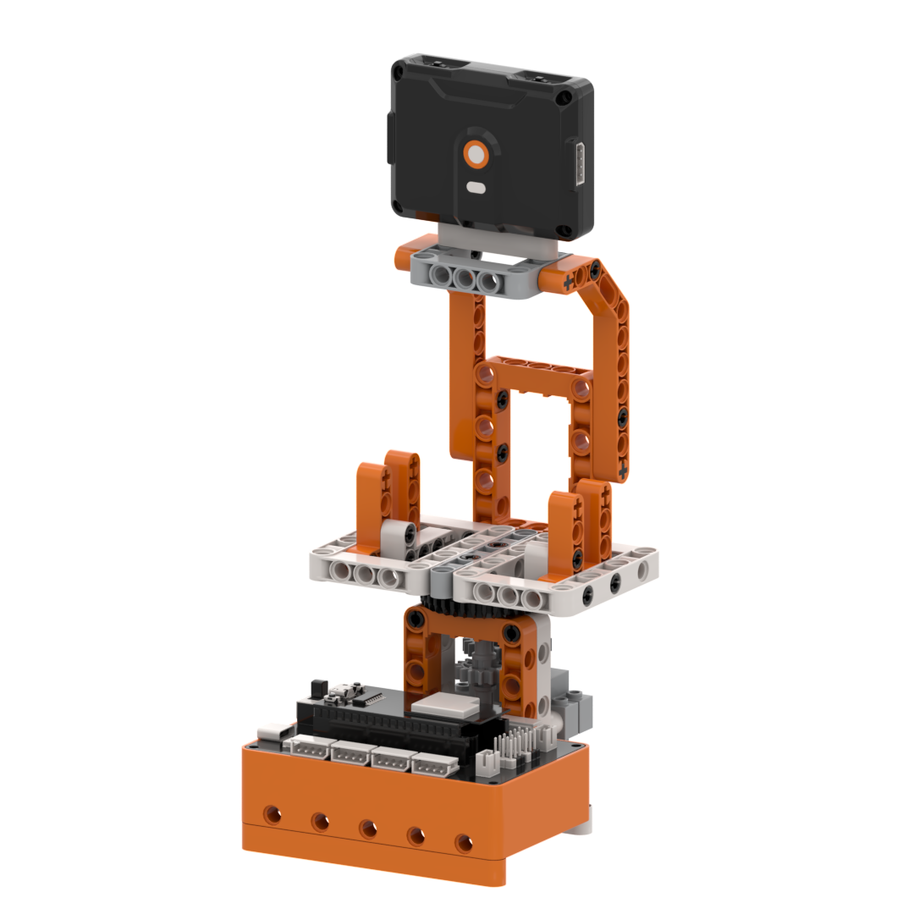
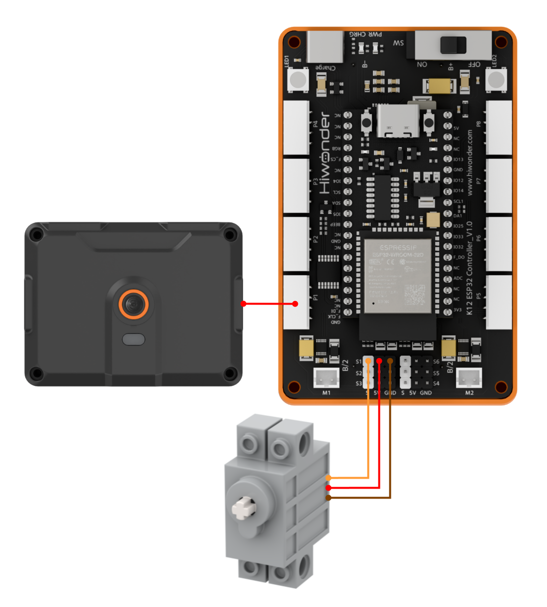
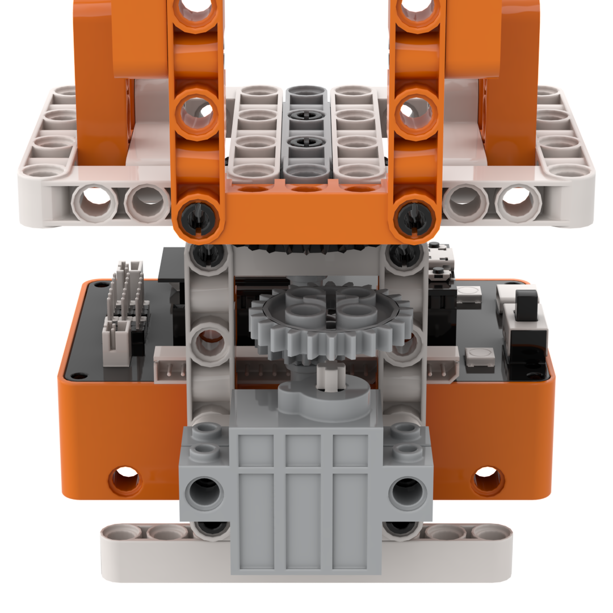
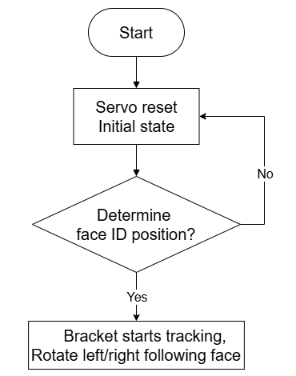
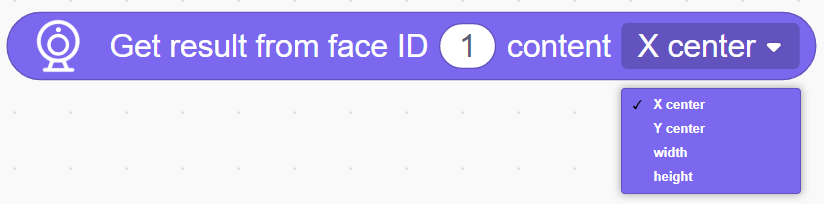
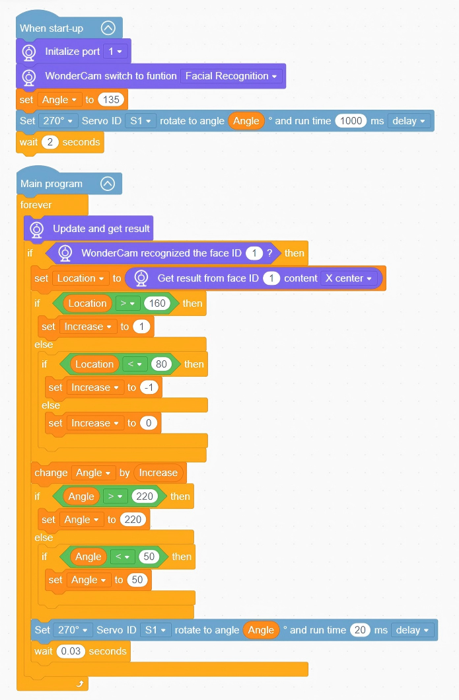

# 3.11 AI Phone Stand

## 3.11.1 Lesson Introduction

The AI Phone Stand is a practical and intelligent robotic building block project designed for automated face tracking. The top of the stand incorporates the WonderLens vision module as its visual camera, while the base employs a 270° block servo to support and rotate the phone cradle. The modular mechanical design ensures straightforward assembly and accessible wiring. When the camera captures a face and reads its horizontal position in the frame, the servo drives the cradle to rotate left and right synchronously, automatically aligning its orientation with the detected face. This project provides hands-on exploration of AI face coordinate tracking and closed-loop servo angle control.

## 3.11.2 Learning Objectives

1. Master face position tracking using the WonderLens vision module. Learn methods for reading horizontal face coordinates and writing face detection routines.
2. Program angle mapping control routines for the 270° block servo, adjusting the left-right rotation angles based on detected face coordinate offsets.
3. Complete system linkage debugging across face tracking recognition and servo rotation to achieve synchronized tracking between face motion and stand orientation.
4. Assemble the complete stand model and debug the tracking program. Develop foundational skills in building AI vision-based robotic tracking projects.

## 3.11.3 Assembly Guide

<pdf src="../../../../docs/_static/shared/pdf/chapter_3/11.pdf" />

## 3.11.4 Hardware Wiring

Connect the WonderLens vision module cable to port **P1** of the ESP32 controller.

Connect the 270° block servo cable to port **S1** of the ESP32 controller, ensuring the **orange** wire is plugged into the **white** pin of S1.

Wiring diagram:

> [!NOTE]
>
> **When using the 270° block servo for the first time, detach the gear and its attached building block components from the servo before uploading the program. Upload the lesson program to the ESP32 controller and wait for the servo to rotate to its initial home position, 135°. Once initialized, reattach the components. This step can be skipped if a servo homing routine has already been executed.**

## 3.11.5 Programming

### (1)  Program Schematic

### (2) Adding Extensions

- Click the **Extensions** button and select the **WonderLens** under the **Sensor** category.

### (3) Core Blocks

| Block | Category | Function Description |
| :---: | :---: | :--- |
|  |  | Compares the left value with a specified value and returns a boolean result for the greater-than condition. |
|  |  | Creates a custom variable for data storage. |
|  |  | Reads the data stored in the specified custom variable. |
|  |  | Assigns a custom value to the specified variable. |
|  |  | Rotates the specified servo to the target angle within a set duration and selects the delay mode. |
|  |  | Switches the AI vision operating mode of the vision module. |
|  |  | Refreshes the camera feed and reads recognition data for the current vision mode. |
|  |  | Determines whether the specified face ID is detected in the camera frame and returns a boolean result. |
|  |  | Reads frame data for the specified face ID, including center coordinates, width, and height. |

### (4) Complete Program

1. Initialization: At startup, initialize the WonderLens vision module at port **P1** and switch its operating mode to face recognition. Define the variable `Angle` and assign it an initial value of 135. Set 270° block servo **S1** to rotate to `Angle` over an execution duration of 1,000 ms, then wait for 2 s.

2. Main Loop: The program continuously updates and retrieves recognition data from the WonderLens vision module. When face ID 1 is recognized, the horizontal X-coordinate of the face center is retrieved and stored in the variable `Location`. The value of `Increase` is evaluated based on `Location`. When `Location` is greater than 160, `Increase` is set to 1. When `Location` is less than 80, `Increase` is set to -1. Otherwise, `Increase` is set to 0. The program adds `Increase` to `Angle`, constrains `Angle` within 50° to 220°, and drives 270° block servo **S1** to the updated angle over 20 ms. Each loop iteration pauses for 0.03 s, achieving smooth horizontal face tracking.

> [!NOTE]
>
> **The program source files can be downloaded from [Program Files](https://drive.google.com/drive/folders/1gpd83ho-Cf-T1LV6VETKvwf1mI7A8Bfg?usp=sharing).**

## 3.11.6 Program Upload

## 3.11.7 Expansion and Challenge

**Challenge Task 1: Tiered Face ID Tracking and RGB Indication**

1. Project Goal: Differentiate between four operational scenarios: authorized face ID, unregistered passerby, blank frame, and designated face ID 2. Produce distinct tracking speeds and lighting effects. When the authorized face ID is detected, the stand follows the face rapidly and smoothly while the RGB LED flashes continuously. When an unregistered passerby is detected, the stand tracks at a lower, gentler speed. When no face is detected or face ID 2 is recognized, the servo returns the stand to its centered home position, and the RGB LED turns off.

2. Implementation Strategy: Call blocks that read face IDs and coordinates, define identity evaluation variables, and construct multi-tier conditional branches. Configure dedicated servo tracking speeds and RGB lighting logic for authorized faces, ordinary passersby, and absent faces. Program servo homing angles into the centering branch.

3. Key Challenges: Ensuring stable coordinate readings without jitter during tracking, and synchronizing lighting updates with speed transitions when switching between different face identities.

**Challenge Task 2: Delayed Centering Standby on Face Departure**

1. Project Goal: When a face moves out of camera view, the stand does not return to the center immediately. Instead, it maintains its current angle for 3 s. Once the countdown expires, the servo automatically resets the stand to its centered standby position, and the RGB LED turns off.

2. Implementation Strategy: Introduce a timer variable to start a countdown upon face disappearance. Maintain the existing tracking angle while the countdown remains active. Reset the servo to the center and extinguish the RGB LED once the timer reaches zero.

3. Key Challenges: Ensuring the timer routine executes without blocking the camera from resuming face detection, and keeping the servo homing motion smooth without mechanical impact.

**Challenge Task 3: Creative Applications of Face Position Tracking**

1. Face-Tracking Gimbal Camera: Retain the core face coordinate tracking logic and mount the camera on a servo-driven pan-tilt mechanism to follow faces dynamically during filming.

2. Face-Sensing Follow Fill Light: Replace the phone cradle with an LED fill light to automatically adjust lighting angles based on face offset positions.

3. Universal Adaptation Strategy: Keep the core face tracking code unchanged and swap out the mechanical mechanism. By implementing new servo angle mapping commands under the logic of adjusting angles based on face coordinates, diverse interactive tracking devices can be developed.

## 3.11.8 Q&A

**Question 1: During servo wiring, the orange signal wire must connect to the white pin of port S1. What problems occur if it is wired incorrectly?**

**Answer**: The white pin of port **S1** is dedicated to transmitting control signals, which the servo relies on to adjust the left-right rotation angle of the stand. If the orange signal wire connects to the power or ground pins, the controller cannot transmit angle commands. Two primary failures occur. First, the servo remains completely motionless, preventing the stand from following face motion. Second, the servo vibrates erratically and rotates uncontrollably, which can cause overheating and hardware damage. In addition, all program code designated for face tracking, angle following, and home resetting becomes ineffective, preventing the automatic tracking function from operating.

**Question 2: The vision module recognizes faces and outputs face coordinates normally, but the phone stand servo does not rotate at all. What are the most common causes and troubleshooting steps?**

**Answer**:

1. Wiring Fault: The orange signal wire of the servo is not connected to the white signal pin of port **S1**. Troubleshooting: Disconnect the power, then verify the three-pin sequence of the servo cable against the wiring diagram.

2. Program Fault: The servo angle following and mapping code is placed outside the conditional loop branch that executes when a face is detected. Troubleshooting: Open the program and verify that the coordinate-to-angle conversion and rotation delay blocks reside inside the valid face detection branch.

3. Hardware Damage: The servo itself is defective, or port **S1** of the ESP32 controller is damaged. Troubleshooting: Connect a known functional servo to port **S1** for testing. If it still does not rotate, connect the servo to an alternative servo port on the controller to isolate the issue.

## 3.11.9 Technical Support and Product Discussion

Share project ideas and connect with other makers on the [Hiwonder community](https://forum.hiwonder.com):

