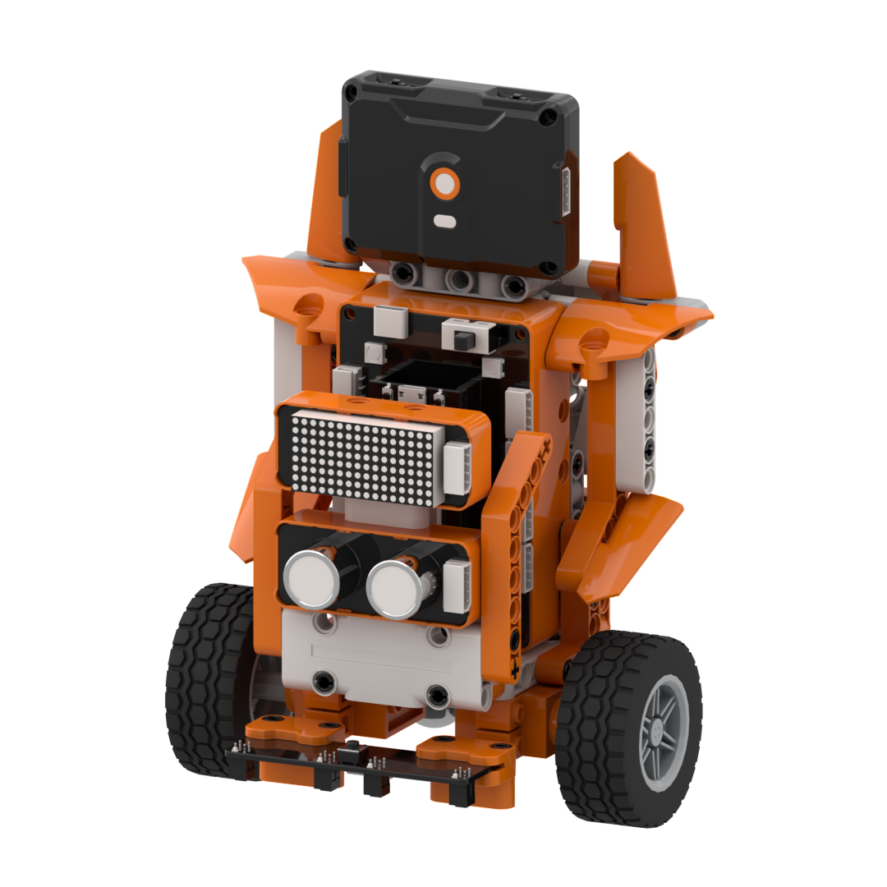
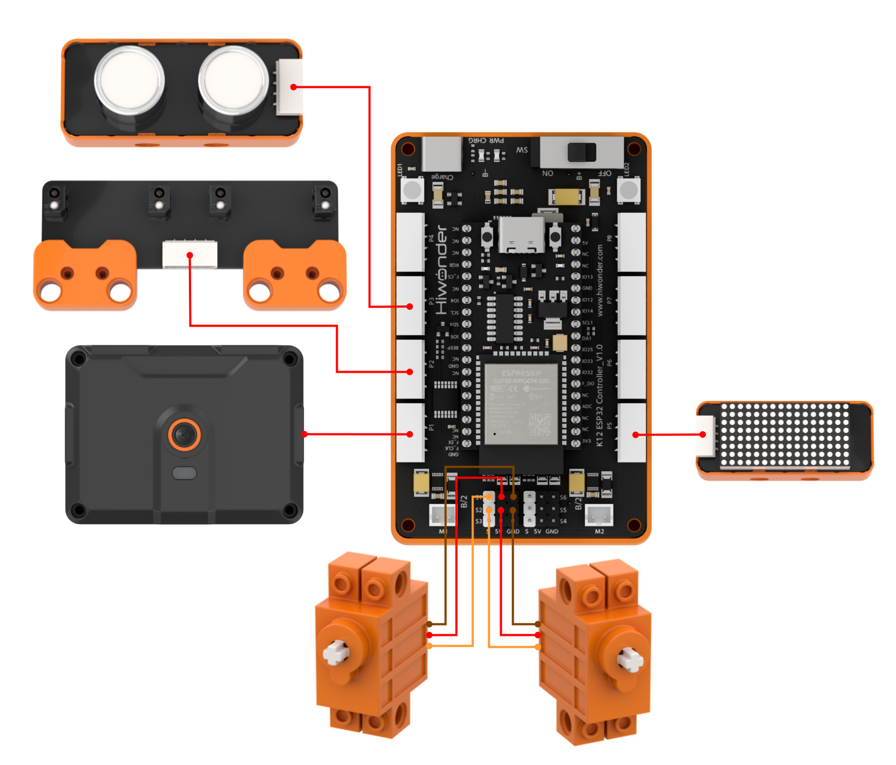
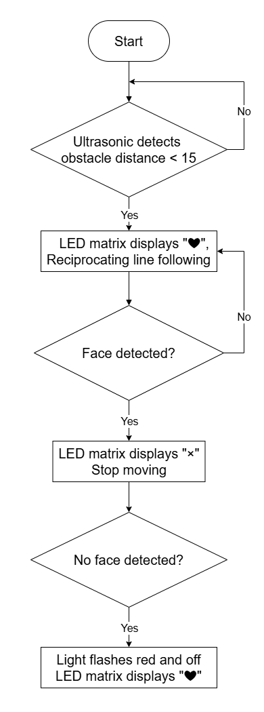
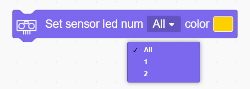
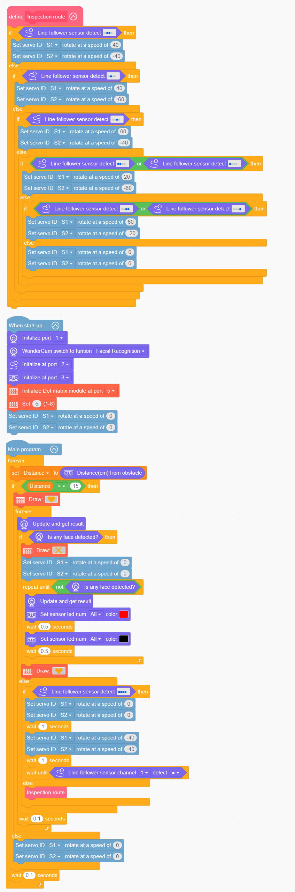
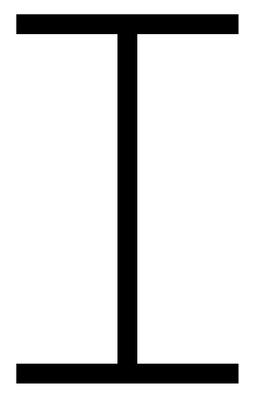

# 3.12 Patrol Bot

## 3.12.1 Lesson Introduction

The Patrol Bot is an intelligent differential-drive robotic car built with modular building blocks. The front of the vehicle features the WonderLens vision module as its visual camera, while the chassis incorporates a 4-channel line follower sensor and a glowy ultrasonic sensor. Dual 360° block motors independently drive the left and right wheels to execute differential steering. The modular mechanical design ensures straightforward assembly and accessible wiring. The robotic car follows preset tracks using the line follower sensor, while the ultrasonic sensor detects frontal obstacles to adjust travel posture accordingly. Through the coordination of multiple onboard sensors, the vehicle performs autonomous patrolling routines. This project provides hands-on exploration of multi-sensor fusion, differential drive mechanics, and active obstacle avoidance.

## 3.12.2 Learning Objectives

1. Master data acquisition and function programming for the WonderLens vision module, 4-channel line follower sensor, and glowy ultrasonic sensor.
2. Program differential drive control routines for dual 360° block motors to achieve forward line following, steering adjustments, and obstacle avoidance maneuvers.
3. Complete system linkage debugging across vision recognition, line following, ultrasonic ranging, and dual-servo drive to achieve synchronized tracking and automatic avoidance.
4. Assemble the complete robotic car and debug the multi-sensor fusion program. Develop foundational skills in building multifunctional autonomous robotic vehicles.

## 3.12.3 Assembly Guide

<pdf src="../../_static/shared/pdf/chapter_3/12.pdf" />

## 3.12.4 Hardware Wiring

Connect the WonderLens vision module cable to port **P1** of the ESP32 controller.

Connect the 4-channel line follower sensor cable to port **P2** of the ESP32 controller.

Connect the glowy ultrasonic sensor cable to port **P3** of the ESP32 controller.

Connect the dot matrix module cable to port **P5** of the ESP32 controller.

Connect the left 360° block motor cable to port **S1** of the ESP32 controller, ensuring the **orange** wire is plugged into the **white** pin of S1.

Connect the right 360° block motor cable to port **S2** of the ESP32 controller, ensuring the **orange** wire is plugged into the **white** pin of S2.

Wiring diagram:

## 3.12.5 Programming

### (1)  Program Schematic

### (2) Adding Extensions

- Click the **Extensions** button and select **Glowy ultrasonic sensor**, **WonderLens**, and **4-ch line follower sensor** under the **Sensor** category.

- Click the **Extensions** button and select **Dot matrix module** under the **Output module** category.

### (3) Core Blocks

| Block | Category | Function Description |
| :---: | :---: | :--- |
|  |  | Repeatedly executes the enclosed blocks until the specified condition becomes true. |
|  |  | Creates a custom function block template. |
|  |  | Defines the internal execution logic for the custom function. |
|  |  | Calls and executes the defined custom function. |
|  |  | Controls the servo connected to the specified port to rotate at the set speed. |
|  |  | Reads the obstacle distance detected by the glowy ultrasonic sensor in centimeters. |
|  |  | Sets the specified RGB light on the glowy ultrasonic sensor to a custom color. |
|  |  | Determines whether an individual line-following channel detects the specified black or white state. |
|  |  | Determines whether the overall 4-channel line follower sensor matches the configured 4-bit state pattern. |
|  |  | Adjusts the brightness of the dot matrix display to a specified level between 1 and 8. |
|  |  | Draws the selected graphic pattern on the dot matrix display. |
|  |  | Switches the AI vision operating mode of the vision module. |
|  |  | Refreshes the camera feed and reads recognition data for the current vision mode. |
|  |  | Determines whether a face appears in the camera frame and returns a boolean result. |

### (4) Complete Program

1. Subroutine Definition: Encapsulate a custom line-following subroutine containing multi-tier conditional branches. The subroutine reads real-time signals from each channel of the 4-channel line follower sensor and assigns rotation parameters to drive servos **S1** and **S2** at corresponding speeds based on black line detection patterns. When no detection conditions match, the speeds of servos **S1** and **S2** are set to 0, bringing the vehicle to a halt.

2. Initialization: At startup, initialize the WonderLens vision module at port **P1** and switch its operating mode to face recognition. Initialize the 4-channel line follower sensor at port **P2**, the glowy ultrasonic sensor at port **P3**, and the dot matrix module at port **P5** with brightness set to 5. Concurrently, initialize servos **S1** and **S2** with speeds set to 0 so the vehicle remains stationary upon power-up.

3. Main Loop: The program continuously monitors the obstacle distance measured by the glowy ultrasonic sensor. When the distance is less than 15 cm, the dot matrix displays a heart pattern, and the program refreshes recognition data from the WonderLens vision module. If a face is detected, the display switches to a cross pattern, servos **S1** and **S2** halt immediately, and the program polls continuously until the face departs. Once the face disappears, the ultrasonic RGB lights flash red with alternating 0.5 s on and 0.5 s off intervals, and the dot matrix restores the heart pattern. When the obstacle distance is greater than or equal to 15 cm, the program reads the 4-channel line follower sensor. If the specified black line pattern is detected, the vehicle stops for 1 s, drives for 1 s, and waits for channel 1 to detect a black line. If that branch condition is not met, the program executes the line-following subroutine. When no conditions trigger, servos **S1** and **S2** remain stopped. Each loop iteration pauses for 0.1 s.

> [!NOTE]
>
> **The program source files can be downloaded from [Program Files](https://drive.google.com/drive/folders/1gpd83ho-Cf-T1LV6VETKvwf1mI7A8Bfg?usp=sharing).**

### (5) Track Preparation

Prepare electrical tape and paste the corresponding line-following track on the desktop according to the diagram. After laying out the track, upload the program to the controller and place the car on the black line for testing and verification.

> [!NOTE]
>
> **Using black electrical tape on a white or light-colored wooden desktop is recommended for optimal contrast.**

## 3.12.6 Program Upload

## 3.12.7 Expansion and Challenge

**Challenge Task 1: Dual-Mode Switching and RGB Status Light Indication**

1. Project Goal: Implement one-button switching between two operating modes: automated line-following obstacle avoidance and face-following patrol. Use RGB lighting to distinguish operating states. In face-following mode, the car follows an authorized face autonomously and prioritizes obstacle avoidance if an obstruction is detected in its path. The RGB lights indicate the active operational mode in real time.

2. Implementation Strategy: Introduce a mode-switching variable and build a dual-branch main control logic. The line-following avoidance branch reads line sensor and ultrasonic ranging data to regulate differential drive motion. The face-following branch reads face coordinates to adjust heading direction while evaluating obstacle distance with top priority given to collision avoidance. Assign distinctive RGB colors to each mode for intuitive status feedback.

3. Key Challenges: Reading multi-sensor data concurrently without conflicts, enforcing higher priority for obstacle avoidance over line following and face tracking, achieving seamless mode transitions, and synchronizing lighting updates.

**Challenge Task 2: Automatic Standby Reset at Patrol Destination**

1. Project Goal: When the robotic car detects a finish line marker at the end of the patrol route, it halts line-following and face-tracking routines. The vehicle remains stationary for 5 s, centers its actuators, switches the RGB lights to a standby color, and waits for the next operating cycle.

2. Implementation Strategy: Introduce a destination marker detection check and a timer variable. When the destination mark is recognized, initiate a countdown. Keep the standby lights illuminated during the countdown, and reset all drive servos once the timer expires.

3. Key Challenges: Ensuring destination recognition does not interfere with regular line following, obstacle avoidance, or face detection, and verifying that the timer routine does not block continuous sensor sampling.

**Challenge Task 3: Creative Applications of Multi-Sensor Fusion**

1. Smart Warehouse Sorting Cart: Retain the core line-following and ultrasonic avoidance routines, combine them with tag recognition, and navigate along tracks while avoiding obstacles and identifying material tags for automated bin routing.

2. Indoor Companion Robot: Remove the line follower sensor and rely on visual face tracking combined with ultrasonic ranging to follow a person while autonomously avoiding furniture and obstacles.

3. Universal Adaptation Strategy: Keep the low-level sensor reading routines unchanged, adjust multi-branch condition priorities, and modify drive execution blocks. Under the logic of collaborative multi-sensor sampling and prioritized motion execution, diverse mobile robotic systems can be developed.

## 3.12.8 Q&A

**Question 1: During servo wiring, the orange signal wire must connect to the white pin of the corresponding servo port. What problems occur if it is wired incorrectly?**

**Answer**: The white pin of ports **S1** and **S2** is dedicated to transmitting control signals, which the servos rely on to regulate wheel speed and rotational direction. If the orange signal wire connects to the power or ground pins, the controller cannot transmit differential drive commands. Two primary failures occur. First, the servo on the affected wheel remains completely motionless, preventing the vehicle from following lines, turning, or avoiding obstacles. Second, the servo vibrates erratically and rotates uncontrollably, which can cause overheating and hardware damage. In addition, all program code designated for line-following speed regulation and avoidance maneuvers becomes ineffective, preventing intelligent patrol operations.

**Question 2: The line follower sensor, ultrasonic sensor, and vision module collect data normally, but the wheels remain completely stationary and the vehicle does not move. What are the most common causes and troubleshooting steps?**

**Answer**:

1. Wiring Fault: The orange signal wires of the left and right servos are not connected to the white signal pins of ports **S1** and **S2**. Troubleshooting: Disconnect the power, then verify the three-pin sequence of both servos against the wiring diagram.

2. Program Fault: The differential drive code blocks are placed outside the active loop branches for line following and face detection, or baseline driving speed parameters are missing. Troubleshooting: Move the servo speed and direction commands into the main control loop and specify proper differential speed parameters for straight driving and steering maneuvers.

3. Hardware Damage: One or both servos are defective, or ports **S1** and **S2** on the ESP32 controller are damaged. Troubleshooting: Connect known functional servos to ports **S1** and **S2** for testing. If they still fail to rotate, test the servos on alternative servo ports on the controller to isolate the issue.

## 3.12.9 Technical Support and Product Discussion

Share project ideas and connect with other makers on the [Hiwonder community](https://forum.hiwonder.com):

