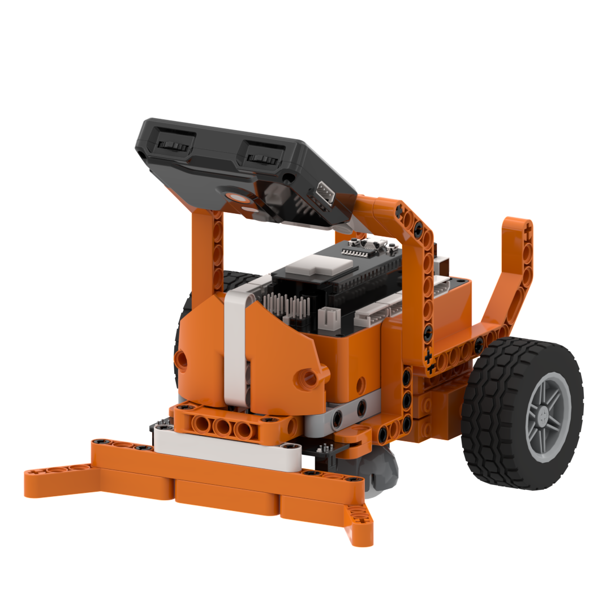
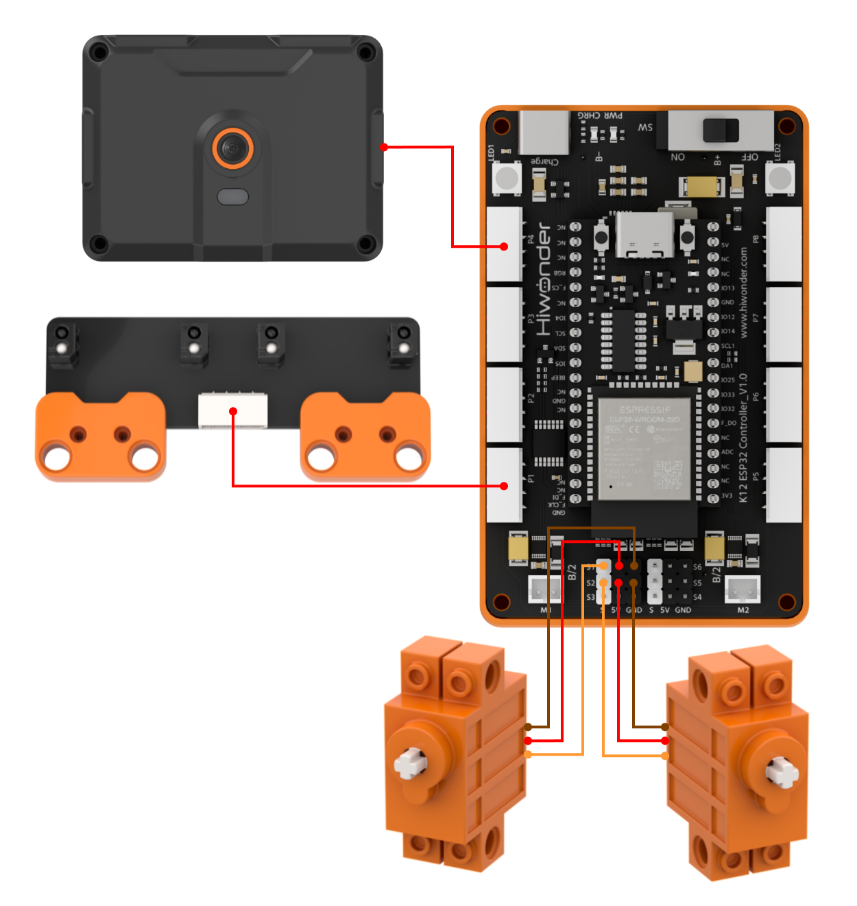
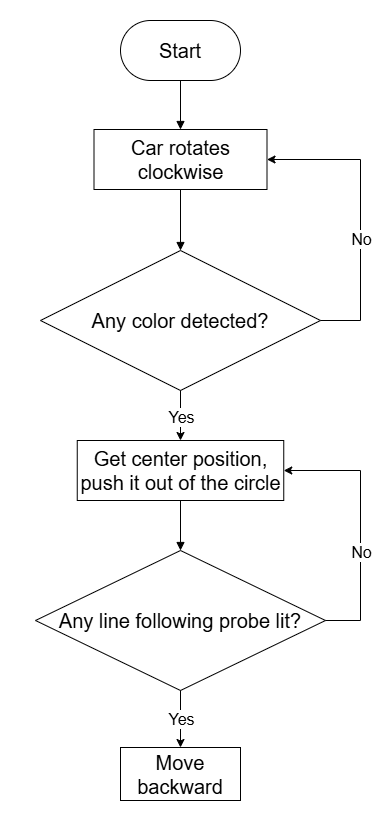
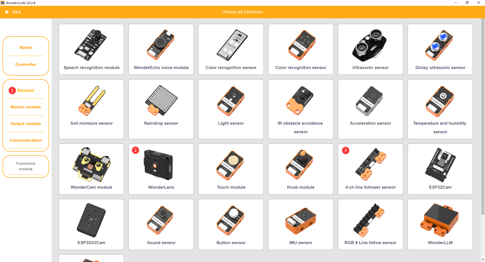
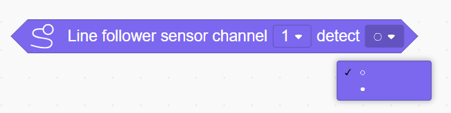
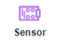
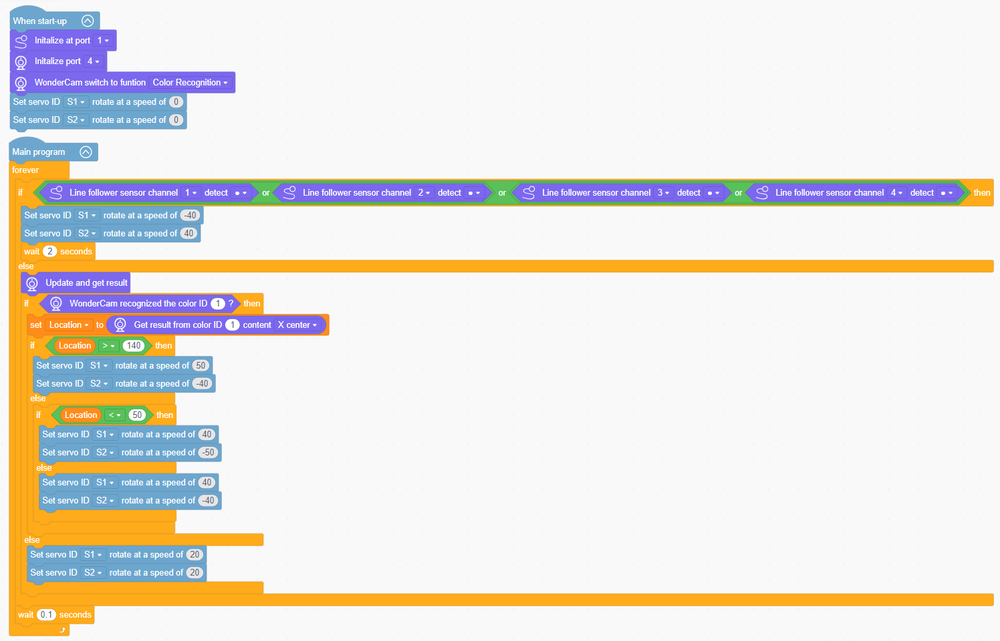
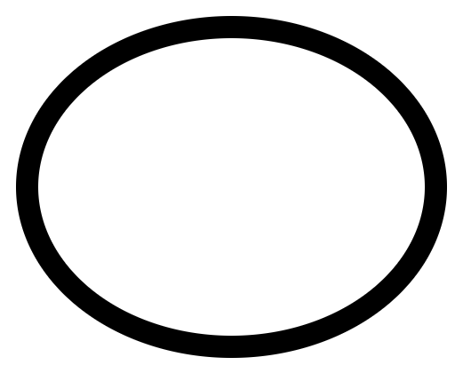

# 3.13 Ring Obstacle Clearer

## 3.13.1 Lesson Introduction

The Ring Obstacle Clearer is an interactive robotic car built with modular building blocks. The front of the vehicle features the WonderLens vision module as its visual camera, while the chassis incorporates a 4-channel line follower sensor. Dual 360° block motors independently drive the wheels to execute differential steering, and a front-mounted bulldozer blade clears colored block obstacles. The modular mechanical design ensures straightforward assembly and accessible wiring. The robotic car follows black boundary lines to restrict its operating area, visually detects colored blocks within the arena, and pushes them outside using the front blade to complete automated clearing operations. This project provides hands-on exploration of color recognition, line-following boundary restriction, and multi-sensor coordination.

## 3.13.2 Learning Objectives

1. Master data acquisition and function programming for the WonderLens vision module color recognition and the 4-channel line follower sensor.
2. Program differential drive control routines for dual 360° block motors to achieve boundary-restricted travel, target alignment, and obstacle pushing maneuvers.
3. Complete system linkage debugging across visual color recognition, line-following boundary detection, and dual-servo drive to achieve synchronized boundary protection and automated obstacle clearing.
4. Assemble the complete robotic car and debug the multi-sensor fusion program. Develop foundational skills in building intelligent robotic vehicles featuring boundary restriction and visual target sorting.

## 3.13.3 Assembly Guide

<pdf src="../../_static/shared/pdf/chapter_3/13.pdf" />

## 3.13.4 Hardware Wiring

Connect the WonderLens vision module cable to port **P4** of the ESP32 controller.

Connect the 4-channel line follower sensor cable to port **P1** of the ESP32 controller.

Connect the left 360° block motor cable to port **S1** of the ESP32 controller, ensuring the **orange** wire is plugged into the **white** pin of S1.

Connect the right 360° block motor cable to port **S2** of the ESP32 controller, ensuring the **orange** wire is plugged into the **white** pin of S2.

Wiring diagram:

## 3.13.5 Programming

### (1)  Program Schematic

### (2) Adding Extensions

- Click the **Extensions** button and select the**WonderLens** and **4-ch line follower sensor** under the **Sensor** category.  

### (3) Core Blocks

| Block | Category | Function Description |
| :---: | :---: | :--- |
|  |  | Compares two numerical values and returns a boolean result. |
|  |  | Performs a logical OR operation on two boolean conditions and outputs the result. |
|  |  | Controls the servo connected to the specified port to rotate at the set speed. |
|  |  | Determines whether an individual line-following channel detects a black line or white line. |
|  |  | Switches the AI vision operating mode of the vision module. |
|  |  | Refreshes the camera frame and acquires recognition data for the current vision mode. |
|  |  | Determines whether a specified color target ID is recognized in the frame and returns a boolean result. |
|  |  | Reads the center coordinates, width, and height data for the specified color target ID. |

### (4) Complete Program

1. Initialization: At startup, initialize the 4-channel line follower sensor at port **P1**, initialize the WonderLens vision module at port **P4**, and switch its operating mode to color recognition. Initialize servos **S1** and **S2** with speeds set to 0.

2. Main Loop: The program executes continuously. When any channel of the 4-channel line follower sensor detects a line, servos **S1** and **S2** are configured to rotate at preset speeds for 2 s to steer away from the boundary. When no line is detected, the program refreshes and retrieves recognition results from the WonderLens vision module. When color ID 1 is recognized, the horizontal X-coordinate of the color block center is stored in the position variable. The program regulates servo steering based on this coordinate value. When the position value exceeds 140, the vehicle steers right. When the position value is below 50, the vehicle steers left. For intermediate values, the vehicle maintains a straight course. When no corresponding color block is recognized, servos **S1** and **S2** advance at a low speed of 20. Each loop cycle pauses for 0.1 s.

> [!NOTE]
>
> **The program source files can be downloaded from [Program Files](https://drive.google.com/drive/folders/1gpd83ho-Cf-T1LV6VETKvwf1mI7A8Bfg?usp=sharing).**

### (5) Track Preparation

Prepare electrical tape and paste the corresponding line-following track on the desktop according to the diagram. After laying out the track, upload the program to the controller and place the car on the black line for testing and verification.

> [!NOTE]
>
> **Using black electrical tape on a white or light-colored wooden desktop is recommended for optimal contrast.**

## 3.13.6 Program Upload

## 3.13.7 Expansion and Challenge

**Challenge Task 1: RGB Status Light Indication for Target Color Blocks**

1. Project Goal: When recognizing obstacle blocks of different colors, the onboard RGB lights illuminate in corresponding colors synchronously. This visually displays the active target color and enhances human-robot interaction, also known as HRI.

2. Implementation Strategy: Construct multi-branch conditional statements that associate each recognizable color block with a dedicated RGB color pattern. Upon recognizing a color block, the vehicle illuminates the corresponding RGB color. After the block is pushed outside the boundary circle, the RGB lights turn off.

3. Key Challenges: Ensuring stable color recognition without confusion, preventing flickering during light transitions, and eliminating logic conflicts among boundary line following, distance sensing, and lighting control.

**Challenge Task 2: Standby Reset After Clearing Completion**

1. Project Goal: Once all colored blocks within the arena are cleared, the robotic car halts searching actions, remains stationary for 5 s, switches the RGB lights to a completion indicator color, and enters a centered standby state awaiting new tasks.

2. Implementation Strategy: Introduce an obstacle count variable to tally each successfully cleared obstacle. When the counter reaches the preset target value, initiate a countdown timer. After the countdown completes, halt all actuators and reset the vehicle.

3. Key Challenges: Accurately counting cleared blocks without duplicate accumulation, and ensuring timer execution does not interrupt continuous boundary line detection or color recognition.

**Challenge Task 3: Creative Applications of Color Recognition and Boundary Restriction**

1. Partitioned Material Sorting Cart: Retain the core routines for line-following boundary restriction and color recognition, and navigate to push different colored materials into designated sorting zones.

2. Track-Based Color Scoring Robot: Follow track lines, recognize colored scoring markers to increment point counters automatically, and display total scores on the dot matrix screen.

3. Universal Adaptation Strategy: Keep the low-level camera color recognition and line follower sensor routines unchanged, and adjust only the servo drive and pushing logic. Using the collaborative logic of pushing detected target blocks while restricting movement via black line detection, diverse area-restricted visual sorting vehicles can be developed.

## 3.13.8 Q&A

**Question 1: During servo wiring, the orange signal wire must connect to the white pin of the corresponding servo port. What problems occur if it is wired incorrectly?**

**Answer**: The white pin of ports **S1** and **S2** is dedicated to transmitting control signals, which the servos rely on to regulate straight driving, differential steering, and obstacle pushing. If the orange signal wire connects to power or ground pins, the controller cannot transmit differential drive commands. Two primary failures occur. First, the servo on the affected wheel remains completely motionless, preventing the vehicle from driving along lines or pushing blocks. Second, the servo vibrates erratically and rotates uncontrollably, which can cause overheating and hardware damage. In addition, all program routines for boundary restriction and obstacle pushing become ineffective, preventing automated clearing operations.

**Question 2: The vision module and line follower sensor collect data normally, but both wheels remain completely stationary, preventing the vehicle from searching for and pushing blocks. What are the most common causes and troubleshooting steps?**

**Answer**: 1. Wiring Fault: The orange signal wires of the left and right servos are not connected to the white signal pins of ports **S1** and **S2**. Troubleshooting: Disconnect the power, then verify the three-pin sequence of both servos against the wiring diagram.

2. Program Fault: The differential driving and block-pushing code blocks are placed outside the active loop branches for color recognition and line detection. Troubleshooting: Move the servo speed, direction, and delay commands into the main control loop, and configure appropriate differential speed parameters for searching and pushing maneuvers.

3. Hardware Damage: One or both servos are defective, or ports **S1** and **S2** on the ESP32 controller are damaged. Troubleshooting: Connect known functional servos to ports **S1** and **S2** for testing. If they still fail to rotate, test the servos on alternative servo ports on the controller to isolate the issue.

## 3.13.9 Technical Support and Product Discussion

Share project ideas and connect with other makers on the [Hiwonder community](https://forum.hiwonder.com):

