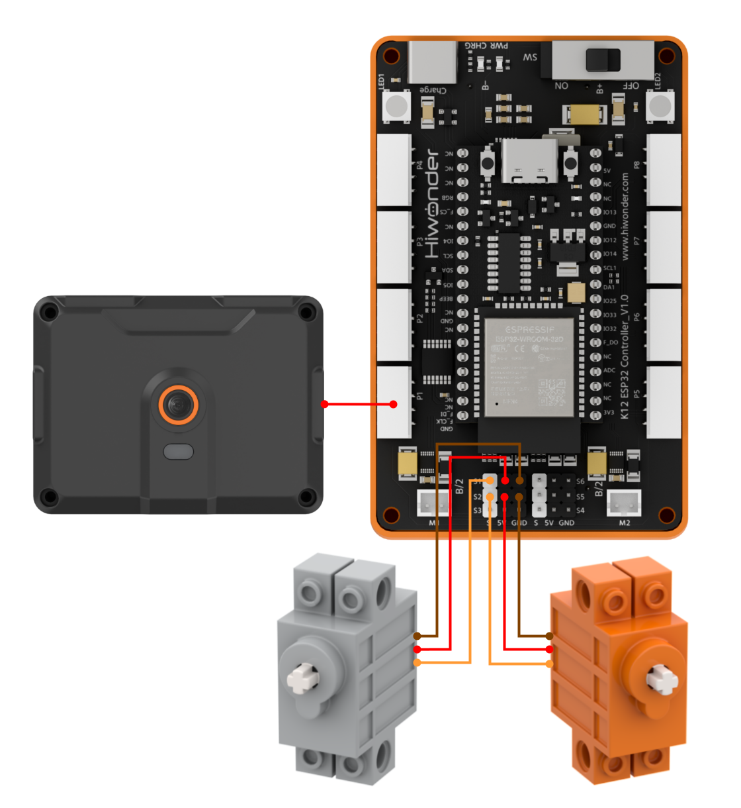
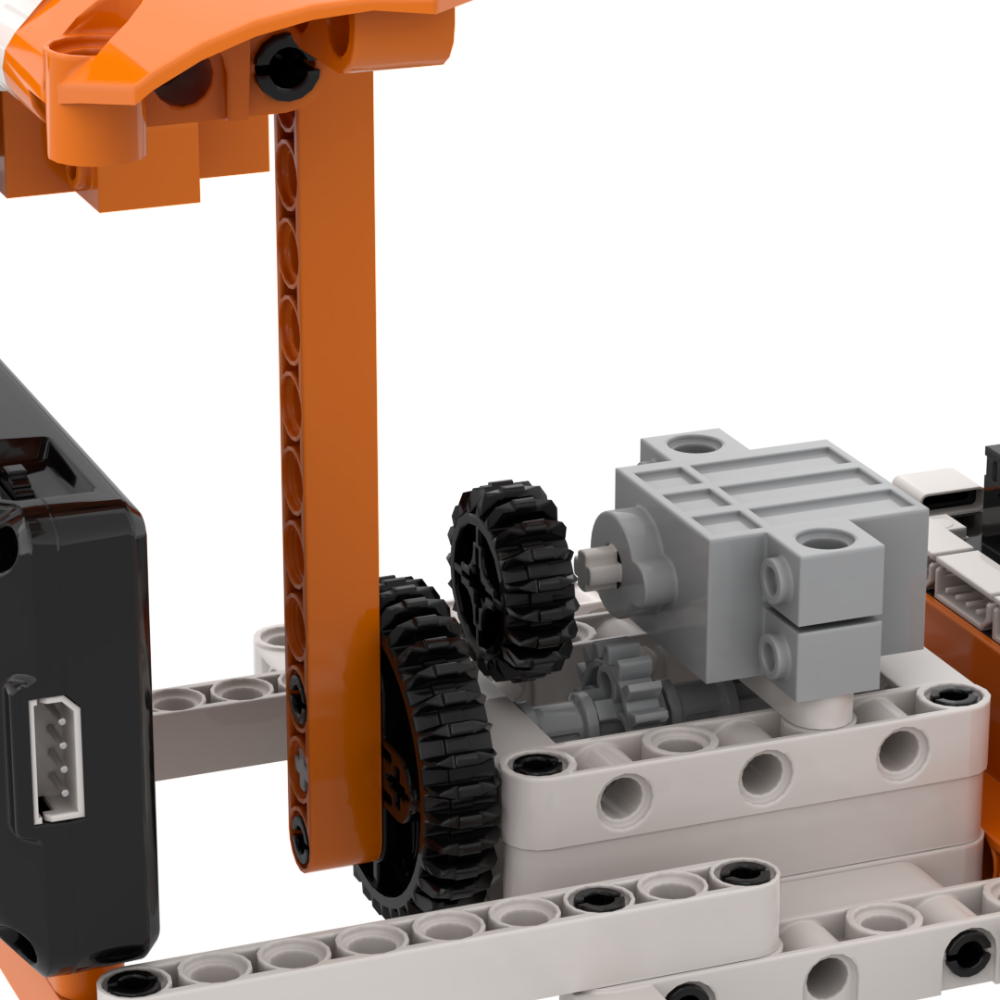
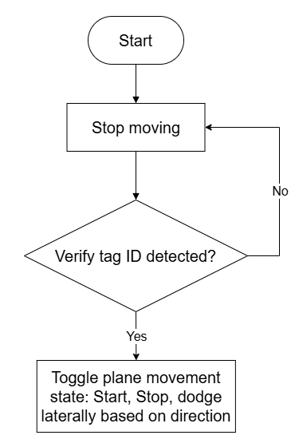
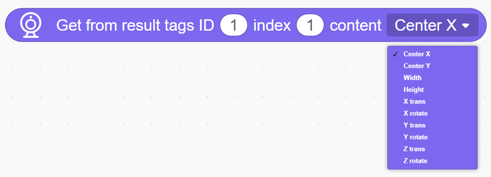
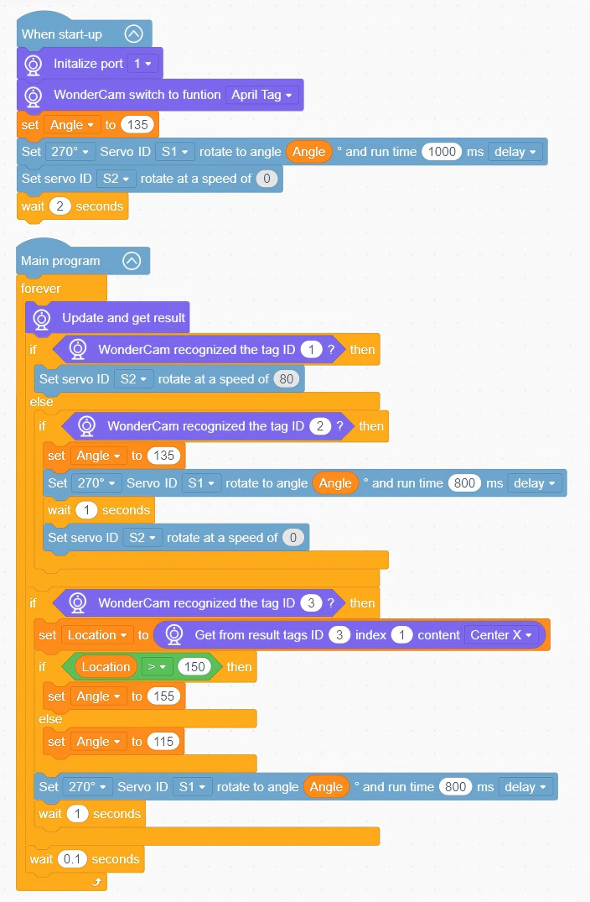

# 3.14 Avoidance Flyer

## 3.14.1 Lesson Introduction

The Avoidance Flyer is an engaging robotic building block model designed for interactive aerial simulation. The front of the fuselage incorporates the WonderLens vision module as its visual camera, while a 360° block motor governs lateral obstacle avoidance translation and a 270° block servo controls altitude elevation and descent. The modular mechanical design ensures straightforward assembly and accessible wiring. The camera recognizes different tag IDs to execute corresponding flight maneuvers: tag 1 triggers takeoff elevation, tag 2 initiates landing homing, and tag 3 commands lateral avoidance based on detected position, shifting right when the tag appears on the left. This project provides hands-on exploration of AI tag recognition and multi-servo motion linkage.

## 3.14.2 Learning Objectives

1. Master data acquisition and function programming for tag recognition using the WonderLens vision module, including reading tag IDs and detecting tag orientations.
2. Program speed control routines for the 360° block motor and precision angle positioning routines for the 270° block servo to execute takeoff, landing, and lateral avoidance maneuvers.
3. Complete system linkage debugging across tag recognition and dual-servo motions to achieve synchronized flight responses to detected tag commands.
4. Assemble the complete flyer model and debug the interaction program. Develop foundational skills in building robotic projects combining diverse servos with AI vision command interactions.

## 3.14.3 Assembly Guide

<pdf src="../../../../docs/_static/shared/pdf/chapter_3/14.pdf" />

## 3.14.4 Hardware Wiring

Connect the WonderLens vision module cable to port **P1** of the ESP32 controller.

Connect the 270° block servo cable to port **S1** of the ESP32 controller, ensuring the **orange** wire is plugged into the **white** pin of S1.

Connect the 360° block motor cable to port **S2** of the ESP32 controller, ensuring the **orange** wire is plugged into the **white** pin of S2.

Wiring diagram:

> [!NOTE]
>
> **When using the 270° block servo for the first time, detach the gear and its attached building block components from the servo before uploading the program. Upload the lesson program to the ESP32 controller and wait for the servo to rotate to its initial home position, 135°. Once initialized, reattach the components. This step can be skipped if a servo homing routine has already been executed.**

## 3.14.5 Programming

### (1)  Program Schematic

### (2) Adding Extensions

- Click the **Extensions** button and select the **WonderLens** under the **Sensor** category.

### (3) Core Blocks

| Block | Category | Function Description |
| :---: | :---: | :--- |
|  |  | Compares the left value with a specified value and returns a boolean greater-than result. |
|  |  | Creates a custom variable to store data. |
|  |  | Reads data stored in the specified variable. |
|  |  | Assigns a specified value to the custom variable. |
|  |  | Controls the servo connected to the specified port to rotate at the set speed. |
|  |  | Controls the angle servo to rotate to a target angle within the specified time and configures delay mode. |
|  |  | Switches the AI vision operating mode of the vision module. |
|  |  | Refreshes the camera frame and acquires recognition data for the current vision mode. |
|  |  | Determines whether a specified tag ID is recognized in the frame and returns a boolean result. |
|  |  | Reads coordinates, size, 3-axis translation, and rotation data for the specified tag ID. |

### (4) Complete Program

1. Initialization: At startup, initialize the WonderLens vision module at port **P1**, switch its operating mode to tag recognition, and initialize the variable `Angle` to 135. Configure the 270° block servo **S1** to rotate to `Angle` over 1,000 ms, set the speed of servo **S2** to 0, and pause for 2 s.

2. Main Loop: The program executes continuously. Update and retrieve recognition results from the WonderLens vision module. When tag ID 1 is recognized, configure servo **S2** to rotate at a speed of 80. When tag ID 2 is recognized, reset `Angle` to 135, command servo **S1** to rotate to `Angle`, pause for 1 s, and stop servo **S2**. When tag ID 3 is recognized, store the horizontal X-coordinate of the tag center in the variable `Location`. When `Location` exceeds 150, set `Angle` to 155. Otherwise, set `Angle` to 115. Command servo **S1** to rotate to the updated angle and pause for 1 s. Each loop cycle pauses for 0.1 s.

> [!NOTE]
>
> **The program source files can be downloaded from [Program Files](https://drive.google.com/drive/folders/1gpd83ho-Cf-T1LV6VETKvwf1mI7A8Bfg?usp=sharing).**

## 3.14.6 Program Upload

## 3.14.7 Expansion and Challenge

**Challenge Task 1: RGB Lighting Interaction Upgrades with Tag Linkage**

1. Project Goal: Retain the foundational maneuvers of tag 1 takeoff, tag 2 landing, and tag 3 lateral avoidance while introducing synchronized RGB lighting effects. Tag 1 triggers a rainbow gradient cycle. Tag 2 turns off the lighting. Tag 3 displays a red gradient for left offsets and a blue gradient for right offsets, enriching interactive feedback.

2. Implementation Strategy: Add RGB lighting control blocks within the existing multi-tag conditional branches. Preserve the elevation and lateral translation routines for tags 1, 2, and 3 while binding each branch to a dedicated lighting pattern, enabling synchronized flight and lighting transitions without mutual interference.

3. Key Challenges: Ensuring stable multi-tag discrimination without false triggers, preventing lighting cycles from blocking servo routines, and achieving smooth, synchronized transitions between servo motions and lighting states.

**Challenge Task 2: Delayed Automatic Landing and Homing Without Tags**

1. Project Goal: When no tags appear in the camera view for 5 s continuously, the model automatically executes a landing routine. The 270° block servo returns to the 135° home position, all RGB lights extinguish, and the system enters an idle standby state.

2. Implementation Strategy: Introduce a timer variable to start a countdown whenever no tag is detected. If a tag is detected during the countdown, corresponding flight routines resume. When the countdown reaches zero, execute the landing homing routine and turn off the lighting.

3. Key Challenges: Ensuring timer execution does not delay continuous tag recognition, and maintaining precise angle positioning when the 270° block servo homes to 135°.

**Challenge Task 3: Creative Applications of Tag Recognition**

1. Tag-Controlled Elevation Display Stand: Retain the tag recognition routines and use dual servos to elevate and translate exhibits horizontally, switching display poses based on different tags.

2. Multi-Mode Lighting Controller: Remove the servo mechanism and switch static, gradient, or flashing RGB effects solely by recognizing designated tag IDs.

3. Universal Adaptation Strategy: Keep the low-level camera tag recognition routines unchanged, and modify only the servo logic or swap output peripherals. Based on the logic of executing dedicated actions upon recognizing specific tag IDs, diverse multi-command robotic projects can be developed.

## 3.14.8 Q&A

**Question 1: During servo wiring, the orange signal wire must connect to the white pin of the corresponding servo port. What problems occur if it is wired incorrectly?**

**Answer**: The white pin of ports **S1** and **S2** is dedicated to transmitting control signals, which the 360° block motor and 270° block servos rely on to regulate fuselage translation and elevation angles. If the orange signal wire connects to power or ground pins, the controller cannot transmit control commands. Two primary failures occur. First, the affected servo remains completely motionless, preventing the aircraft from taking off, landing, or performing lateral avoidance. Second, the servo vibrates erratically and rotates uncontrollably, which can cause overheating and hardware damage. In addition, all program code for takeoff, landing, avoidance maneuvers, and 270° servo homing to 135° becomes ineffective, preventing command-guided flight operations.

**Question 2: The vision module recognizes tags normally, but the aircraft does not elevate or translate at all. What are the most common causes and troubleshooting steps?**

**Answer**: 1. Wiring Fault: The orange signal wires of the 360° block motor and 270° block servos are not connected to the white signal pins of ports **S1** and **S2**. Troubleshooting: Disconnect the power, then verify the three-pin sequence of both servos against the wiring diagram.

2. Program Fault: The servo control blocks are placed outside the conditional branches for tag recognition, or the 270° servo homing routine was omitted before assembly. Troubleshooting: Complete the servo homing routine first, then place the takeoff, landing, and lateral translation commands inside their corresponding tag recognition branches.

3. Hardware Damage: One or both servos are defective, or ports **S1** and **S2** on the ESP32 controller are damaged. Troubleshooting: Connect known functional servos to ports **S1** and **S2** for testing. If they still fail to rotate, test the servos on alternative servo ports on the controller to isolate the issue.

## 3.14.9 Technical Support and Product Discussion

Share project ideas and connect with other makers on the [Hiwonder community](https://forum.hiwonder.com):

