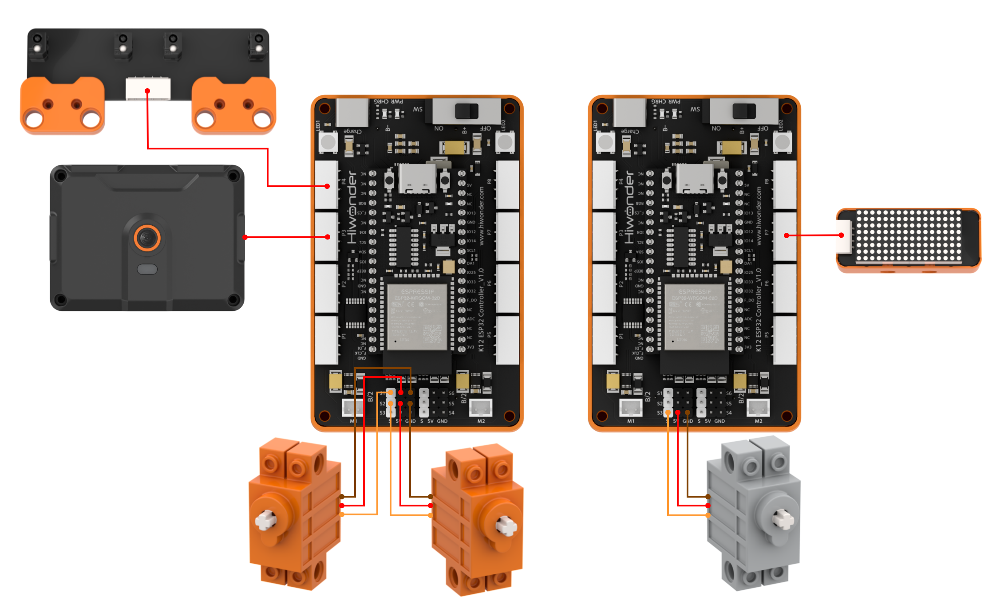
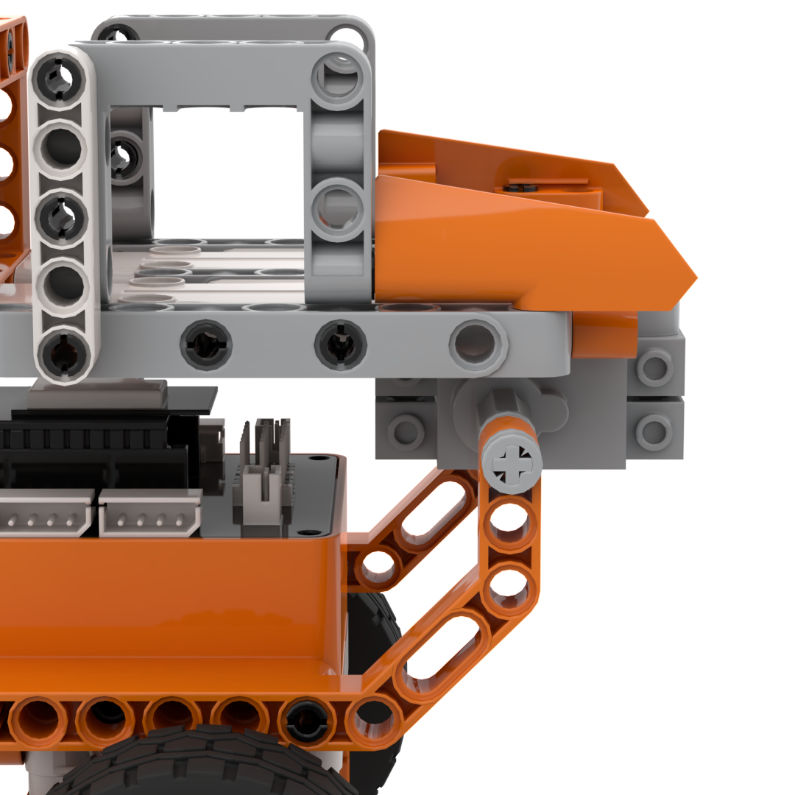
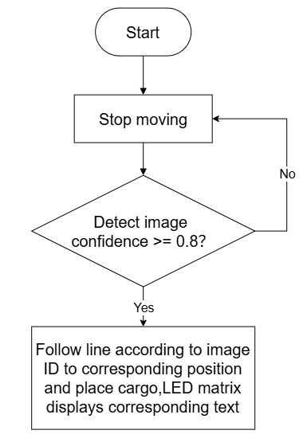
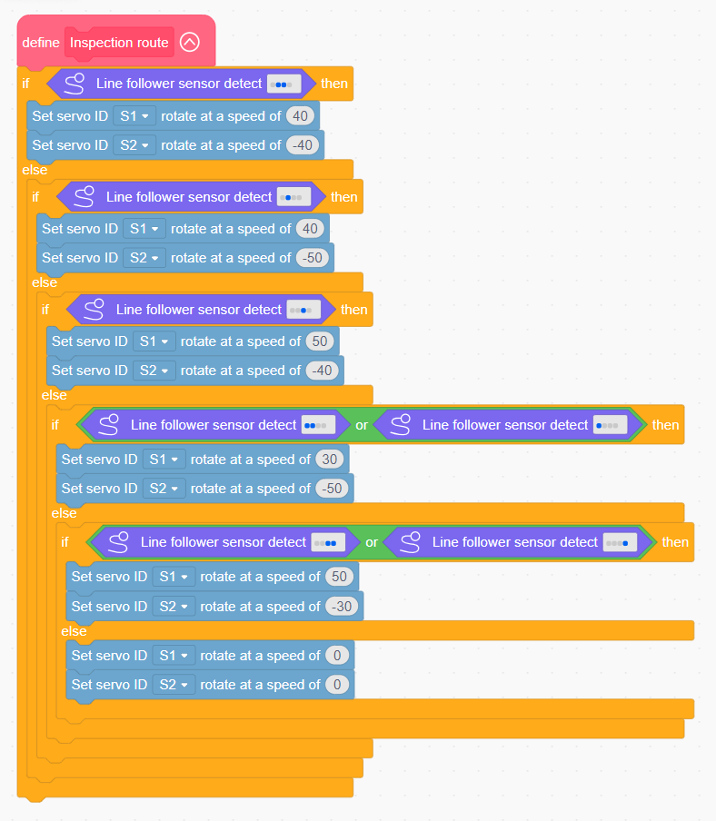
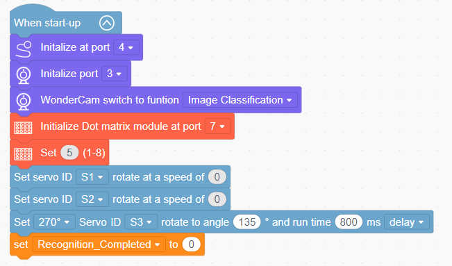
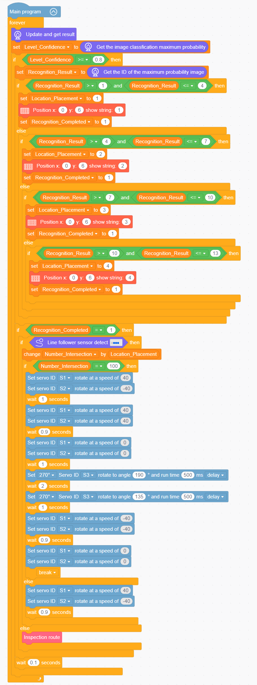
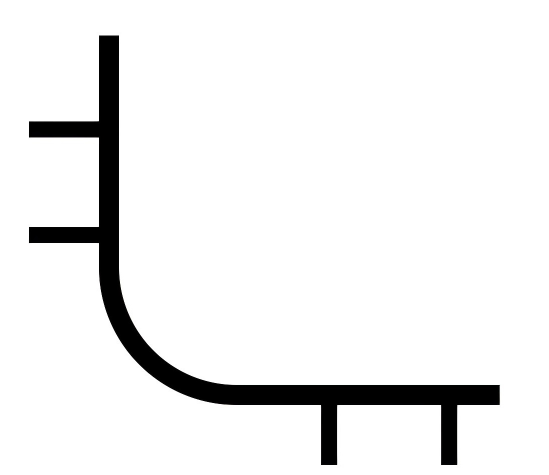

# 3.15 Tumble Transport Dumper

## 3.15.1 Lesson Introduction

The Tumble Transport Dumper is an intelligent sanitation transport model built with modular building blocks. The front of the vehicle features the WonderLens vision module as its visual camera, while the chassis incorporates a dot matrix module and a 4-channel line follower sensor. Dual 360° block motors execute differential drive steering, and a rear-mounted 270° block servo controls the tipper bucket for unloading. The modular mechanical design ensures straightforward assembly and accessible wiring. Upon recognizing a waste card, the dot matrix displays the corresponding sorting ID. The vehicle follows the line track to the designated drop-off station and tilts the bucket to dump the material automatically, simulating a full waste transfer workflow. This project provides hands-on exploration of waste recognition, line following, and multi-servo motion linkage.

## 3.15.2 Learning Objectives

1. Master waste card classification using the WonderLens vision module, and program data acquisition and numerical ID display on the dot matrix module.
2. Program differential line-following routines for dual 360° block motors and precision angle tilting routines for the 270° block servo bucket.
3. Complete system linkage debugging across visual recognition, line following, dot matrix notifications, and tipper unloading to automate a full transport operation.
4. Assemble the complete transport vehicle model and debug the multi-peripheral coordination program. Develop foundational skills in building automated conveyor and sorting robotic vehicles.

## 3.15.3 Assembly Guide

<pdf src="../../../../docs/_static/shared/pdf/chapter_3/15.pdf" />

## 3.15.4 Hardware Wiring

Connect the WonderLens vision module to port **P3** of the ESP32 controller.

Connect the 4-channel line follower to port **P4** of the ESP32 controller.

Connect the dot matrix module to port **P7** of the ESP32 controller.

Connect the left 360° block motor to port **S1** of the ESP32 controller, ensuring the servo's **orange** wire is plugged into the **white** pin of S1.

Connect the right 360° block motor to port **S2** of the ESP32 controller, ensuring the servo's **orange** wire is plugged into the **white** pin of S2.

Connect the 270° block servo to port **S3** of the ESP32 controller, ensuring the servo's **orange** wire is plugged into the **white** pin of S3.

Wiring diagram:

> [!NOTE]
>
> **When using the 270° block servo for the first time, detach the gear and its attached building block components from the servo before uploading the program. Upload the lesson program to the ESP32 controller and wait for the servo to rotate to its initial home position, 135°. Once initialized, reattach the components. This step can be skipped if a servo homing routine has already been executed.**

## 3.15.5 Programming

### (1)  Program Schematic

### (2) Adding Extensions

- Click the **Extensions** button and select the **WonderLens** and **4-ch line follower sensor** under the **Sensor** category.

- Click the **Extensions** button and select **Dot matrix module** under the **Output module** category.

### (3) Core Blocks

| Block | Category | Function Description |
| :---: | :---: | :--- |
|  |  | Repeatedly executes the enclosed blocks until the specified condition becomes true. |
|  |  | Creates a custom function block template. |
|  |  | Defines the internal execution logic for the custom function. |
|  |  | Calls and executes the defined custom function. |
|  |  | Controls the servo connected to the specified port to rotate at the set speed. |
|  |  | Controls the angle servo to rotate to a target angle within the specified time and configures delay mode. |
|  |  | Determines whether the overall 4-channel line follower sensor matches the configured 4-bit state pattern. |
|  |  | Adjusts the brightness of the dot matrix display to a specified level between 1 and 8. |
|  |  | Displays the specified text at the target coordinates on the dot matrix screen. |
|  |  | Switches the AI vision operating mode of the vision module. |
|  |  | Refreshes the camera frame and acquires recognition data for the current vision mode. |
|  |  | Returns the classification ID with the highest confidence in image classification. |
|  |  | Returns the highest confidence score in image classification. |

### (4) Complete Program

1. Initialization: At startup, initialize the 4-channel line follower sensor at port **P4**, initialize the WonderLens vision module at port **P3** in image classification mode, and initialize the dot matrix module at port **P7** with brightness set to 5. Concurrently, set the initial speeds of servos **S1** and **S2** to 0, configure the 270° block servo **S3** to rotate to 135° over 800 ms, and initialize the variable `Recognition_Completed` to 0. Define the line-following subroutine to regulate differential driving on servos **S1** and **S2** based on active sensor channels, stopping the motors when no line is detected.

2. Main Loop: The program executes continuously, refreshing recognition data from the WonderLens vision module and storing the maximum classification confidence in `Level_Confidence`. When `Level_Confidence` is greater than or equal to 0.8, the top classification ID is stored in `Recognition_Result`. Based on the classification ID, the program assigns target destination 1, 2, 3, or 4 to `Location_Placement`, displays the destination digit on the dot matrix module, and sets `Recognition_Completed` to 1. When `Recognition_Completed` equals 1, the variable `Number_Intersection` increments upon detecting route intersection marks. When `Number_Intersection` equals `Location_Placement`, the vehicle turns, drives forward, stops, and activates servo **S3** to dump the bucket, followed by reversing and terminating the loop. When `Number_Intersection` does not match, the vehicle continues advancing along the line. Prior to reaching an intersection, the vehicle calls the line-following subroutine. Each loop cycle pauses for 0.1 s.

> [!NOTE]
>
> **The program source files can be downloaded from [Program Files](https://drive.google.com/drive/folders/1gpd83ho-Cf-T1LV6VETKvwf1mI7A8Bfg?usp=sharing).**

### (5) Track Preparation

Prepare electrical tape and paste the corresponding line-following track on the desktop according to the diagram. After laying out the track, upload the program to the controller and place the car on the black line for testing and verification.

> [!NOTE]
>
> **Using black electrical tape on a white or light-colored wooden desktop is recommended for optimal contrast.**

## 3.15.6 Program Upload

## 3.15.7 Expansion and Challenge

**Challenge Task 1: RGB Lighting Indicators for Waste Sorting and Closed-Loop Return**

1. Project Goal: Assign dedicated RGB lighting colors to different waste categories. When recognizing a waste card, illuminate the corresponding color synchronously. After completing unloading at the designated station, the vehicle follows the track back to its starting point, establishing a closed-loop automated workflow.

2. Implementation Strategy: Construct multi-branch conditional statements linking each waste category to a unique dot matrix digit and RGB color scheme. Reaching the unloading station triggers the 270° block servo to dump the bucket. Once unloading finishes, switch to return line-following logic. Upon returning to the starting point, stop the vehicle, turn off the lighting, and clear the dot matrix display.

3. Key Challenges: Ensuring stable waste classification without category mismatch, maintaining precise bidirectional line following without drifting, and synchronizing bucket dumping, lighting, screen displays, and return routines without conflicts.

**Challenge Task 2: Automatic Standby Reset After Prolonged Inactivity**

1. Project Goal: When no waste cards are detected for an extended duration, the vehicle halts track-searching operations, clears the dot matrix display, turns off all RGB lights, resets the tipper servo to its 135° home position, and enters an idle standby state.

2. Implementation Strategy: Introduce a timer variable to start a countdown when no valid cards are detected. Recognizing a new card during the countdown restarts the transport workflow. When the countdown reaches zero, execute a complete system reset and enter standby.

3. Key Challenges: Ensuring timer execution does not block continuous camera recognition or line sensor sampling, and coordinating multiple servo resets smoothly.

**Challenge Task 3: Creative Applications of Waste Classification and Multi-Servo Coordination**

1. Material Sorting and Transfer Cart: Retain the core routines for card recognition, line following, and bucket unloading. Recognize diverse material tags to route shipments to corresponding sorting bins.

2. Exhibition Tour Robot: Remove the tipper mechanism, combine RGB lighting with the dot matrix display, and follow tracks while presenting exhibits accompanied by synchronized visual notifications.

3. Universal Adaptation Strategy: Keep the low-level camera classification and line sensor routines unchanged, and adjust only the servo timing and output peripherals. Based on the workflow of recognizing targets, following tracks, and executing designated station actions, diverse autonomous transport and sorting vehicles can be developed.

## 3.15.8 Q&A

**Question 1: During servo wiring, the orange signal wire must connect to the white pin of the corresponding servo port. What problems occur if it is wired incorrectly?**

**Answer**: The white pin of ports **S1**, **S2**, and **S3** is dedicated to transmitting control signals. The 360° block motor rely on these signals to regulate differential line following and steering, while the 270° block servo uses them to control bucket tilting angles. If the orange signal wire connects to power or ground pins, the controller cannot transmit control commands. Two primary failures occur. First, the affected servo remains completely motionless, preventing the vehicle from driving along lines or dumping the bucket. Second, the servo vibrates continuously and rotates uncontrollably, which can cause severe overheating and hardware damage. In addition, all program code for line-following speed regulation, bucket dumping, and 270° servo homing to 135° becomes ineffective, preventing the execution of automated transfer operations.

**Question 2: The vision module, line follower sensor, and dot matrix module operate normally, but the vehicle does not drive and the bucket does not dump. What are the most common causes and troubleshooting steps?**

**Answer**: 1. Wiring Fault: The orange signal wires of the three servos are not connected to the white signal pins of ports **S1**, **S2**, and **S3**. Troubleshooting: Disconnect the power, then verify the three-pin sequence of all three servos against the wiring diagram.

2. Program Fault: The differential line-following and bucket-dumping blocks are placed outside the active conditional branches for card recognition, or the 270° servo homing routine was omitted before assembly. Troubleshooting: Complete the servo homing routine first, then place the drive and unloading commands inside the valid card recognition branches.

3. Hardware Damage: One or more servos are defective, or ports **S1**, **S2**, or **S3** on the ESP32 controller are damaged. Troubleshooting: Connect known functional servos to ports **S1**, **S2**, and **S3** for testing. If they still fail to operate, test the servos on alternative servo ports on the controller to isolate the issue.

## 3.15.9 Technical Support and Product Discussion

Share project ideas and connect with other makers on the [Hiwonder community](https://forum.hiwonder.com):

