# 3.16 Agile Transporter

## 3.16.1 Lesson Introduction

The AI Agile Transporter is an industrial transport simulation building block car. The WonderLens camera on the front acts as the eyes, and the car body is equipped with a line follower sensor. Dual 360° block motors drive the car via differential control, while a 270° block servo on the front forms the gripping mechanism. The building block assembly is simple with a clear structure, facilitating hardware wiring and program debugging. The car follows the black line to reach the material area, recognizes road signs, and grips items. It then transports and unloads the items at the sorting point, completing the sorting process automatically. This model serves as a comprehensive hands-on project for intuitively learning the coordination of landmark recognition, line following, and servo gripping.

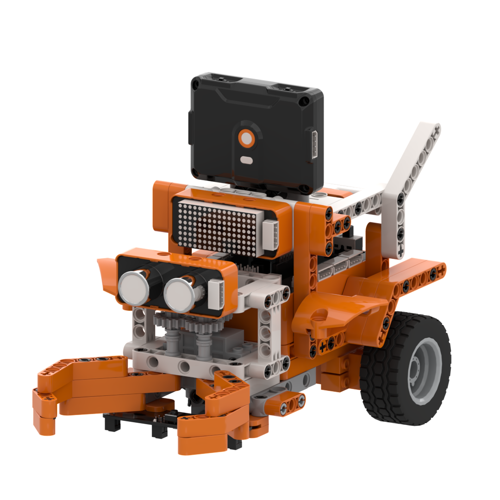

## 3.16.2 Learning Objectives

1. Use the WonderLens module to call the road sign recognition feature. Master the programming for reading road sign recognition data and collecting signals from the 4-channel line follower sensor.   

2. Master the differential control programming for line following with dual 360° block motors on the ESP32 controller. Program precise opening and closing angle control for the gripping mechanism using a 270° block servo.   

3. Complete the coordinated debugging of the complete system for visual road sign recognition, line-following driving, and dual-servo gripping and sorting. Achieve synchronous operation of the entire automated material sorting and transport process.   

4. Assemble the complete transporter car model and debug the multi-peripheral coordination program. Develop the ability to build intelligent sorting and transport projects that integrate multiple servos and sensors.  

## 3.16.3 Assembly Guide

<pdf src="../../_static/shared/pdf/chapter_3/16.pdf" />

## 3.16.4 Hardware Wiring

Connect the WonderLens vision module cable to port **P1** of the ESP32 controller.

Connect the 4-channel line follower sensor cable to port **P2** of the ESP32 controller.

Connect the glowy ultrasonic sensor cable to port **P3** of the ESP32 controller.

Connect the dot matrix module cable to port **P5** of the ESP32 controller.

Connect the left 360° block motor cable to port **S1** of the ESP32 controller, and insert the **orange** servo wire into the **white** pin of port S1.

Connect the right 360° block motor cable to port **S2** of the ESP32 controller, and insert the **orange** servo wire into the **white** pin of port S2.

Connect the 270° block servo cable to port **S3** of the ESP32 controller, and insert the **orange** servo wire into the **white** pin of port S3.

As shown in the figure:

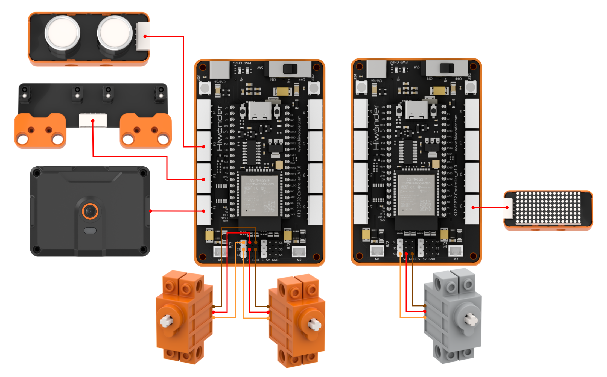

> [!NOTE]
>
> **When conducting a course related to the 270° block servo for the first time, first remove the gear and its attached building block parts together from the 270° servo, then upload the lesson program to the ESP32, wait for the 270° block servo to rotate to the initial position of 165°, and finally reattach the removed building blocks. This step can be skipped if a servo homing program has already been executed previously.**

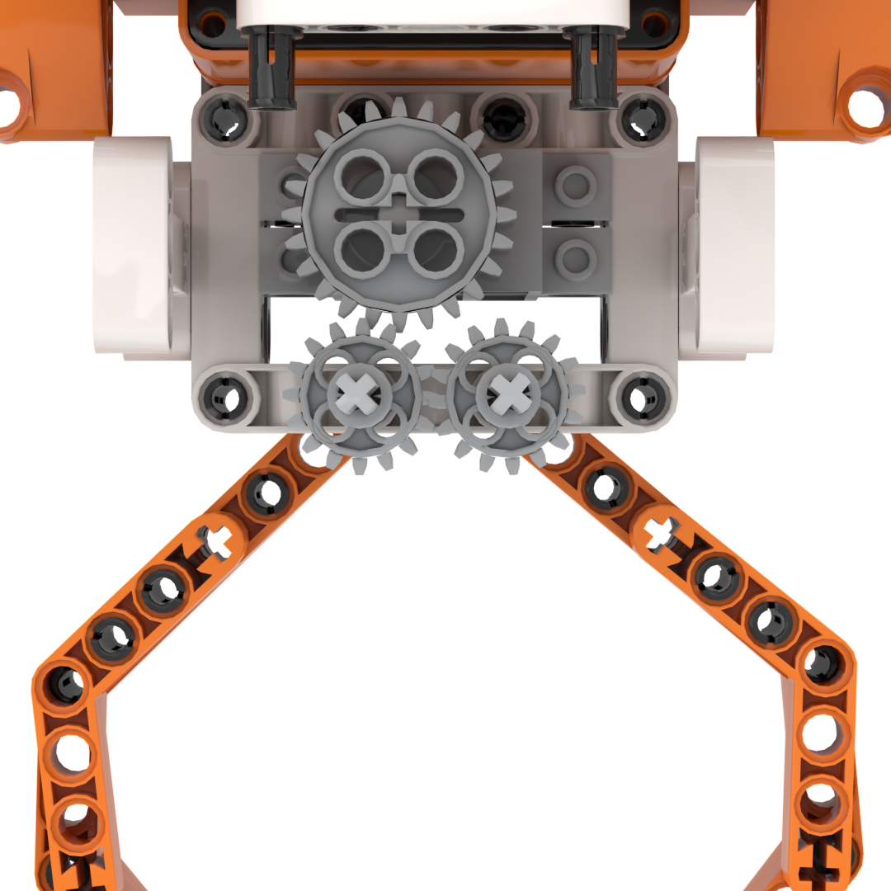

## 3.16.5 Programming

### (1) Program Schematic

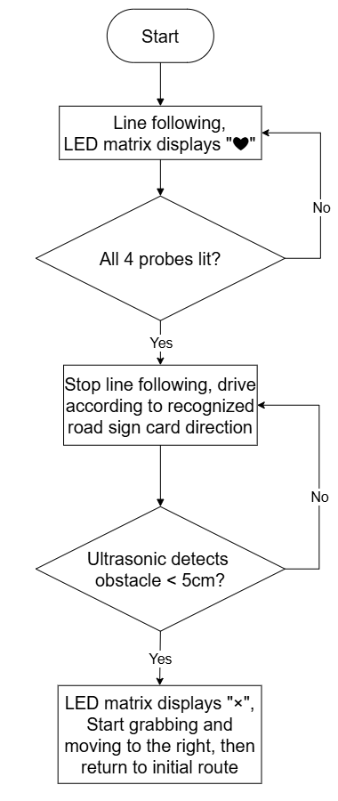

### (2) Adding Extensions

- Click the **Extensions** button and select **WonderLens**, **Glowy ultrasonic sensor**, and **4-ch line follower sensor** under the **Sensor** category.

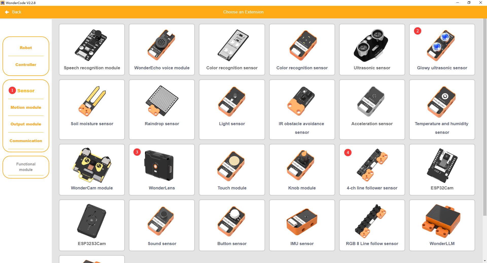

- Click the **Extensions** button and select **Dot matrix module** under the **Output module** category.

### (3) Core Blocks

| Block | Category | Function Description |
| :---: | :---: | :--- |
|  | 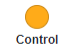 | Pauses program execution for a specified duration. |
| 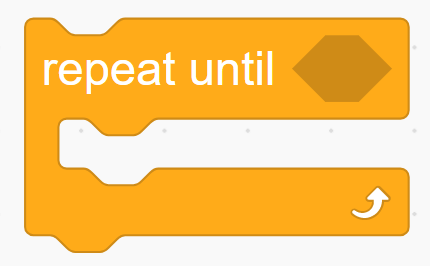 |  | Repeatedly executes the enclosed blocks until the specified condition becomes true. |
|  | 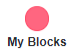 | Creates a custom function block template. |
|  |  | Defines the internal execution logic for the custom function. |
|  |  | Calls and executes the defined custom function. |
|  |  | Controls the servo connected to the specified port to rotate at the set speed. |
|  |  | Controls the angle servo to rotate to a target angle within the specified time and configures delay mode. |
|  |  | Reads the obstacle distance detected by the glowy ultrasonic sensor in centimeters. |
|  |  | Determines whether an individual line-following channel detects the specified black or white state. |
|  |  | Determines whether the overall 4-channel line follower sensor matches the configured 4-bit state pattern. |
|  |  | Adjusts the brightness of the dot matrix display to a specified level between 1 and 8. |
|  |  | Draws the selected graphic pattern on the dot matrix display. |
|  |  | Switches the AI vision operating mode of the vision module. |
|  |  | Refreshes the camera feed and reads recognition data for the current vision mode. |
|  |  | Returns the traffic sign ID with the highest confidence score in traffic sign recognition. |

### (4) Complete Program

1. Initialization: At startup, initialize the WonderLens vision module at port **P1** and switch its mode to traffic sign recognition. Initialize the 4-channel line follower sensor at port **P2**, the glowy ultrasonic sensor at port **P3**, and the dot matrix module at port **P5** with brightness set to 5. Set the initial speeds of servos **S1** and **S2** to 0. Command the 270° block servo **S3** to rotate to 135° over 800 ms, pause for 1 s, rotate to 165° over 800 ms, and pause for 1 s. Draw a heart icon on the dot matrix module. Define the custom subroutine `Lifting and moving`, which displays an X icon on the dot matrix display, coordinates forward and reverse vehicle movements with pauses, and operates the gripper servo **S3** to execute a full picking and placing sequence. Define the custom subroutine `Inspection_route` to regulate differential driving on servos **S1** and **S2** based on active line-following channels, stopping both servos when no line is detected.

2. Main Loop: In the main program loop, continuously read the obstacle distance detected by the glowy ultrasonic sensor and store the value in the variable `Distance`.

   - When `Distance` is less than 5 cm, call the subroutine `Lifting and moving`, clear the dot matrix pattern, and terminate the current loop iteration.

   - When `Distance` is greater than or equal to 5 cm, continuously call the subroutine `Inspection_route`. When the 4-channel line follower sensor detects intersection marks, stop the vehicle, refresh camera data to acquire traffic sign recognition results, and store the sign ID with the highest confidence in the variable `Recognition_Sign`.

     - When `Recognition_Sign` equals 2, execute a left turn followed by forward movement until channel 1 of the line follower sensor detects the black line, then mark recognition as complete.

     - When `Recognition_Sign` equals 3, execute a right turn followed by forward movement until channel 4 of the line follower sensor detects the black line, then mark recognition as complete.

   - In all other conditions, continuously call the subroutine `Inspection_route`. Each loop cycle pauses for 0.01 s.

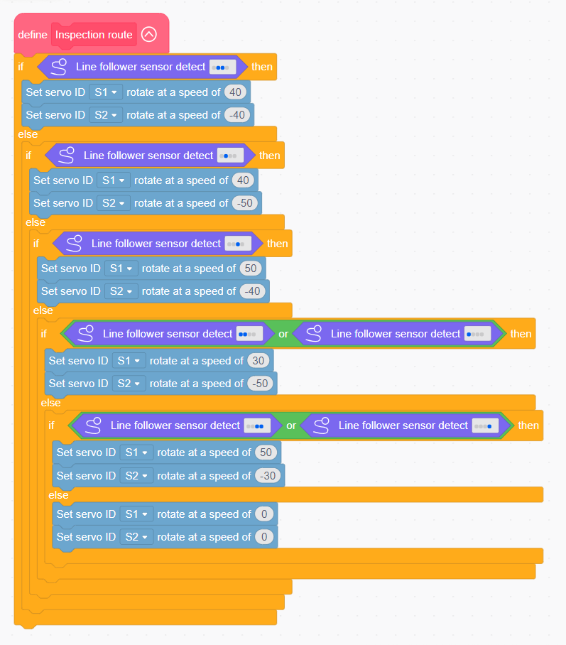

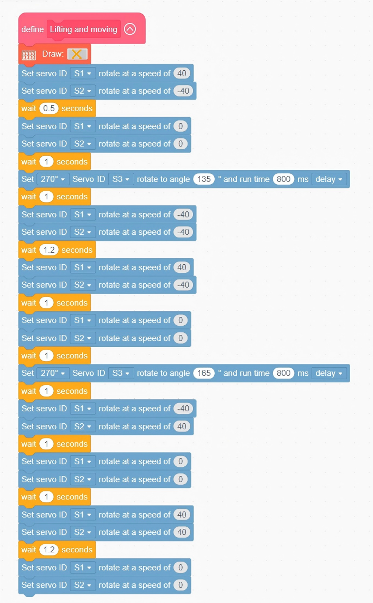

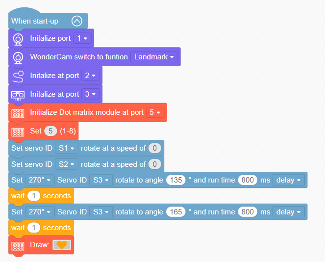

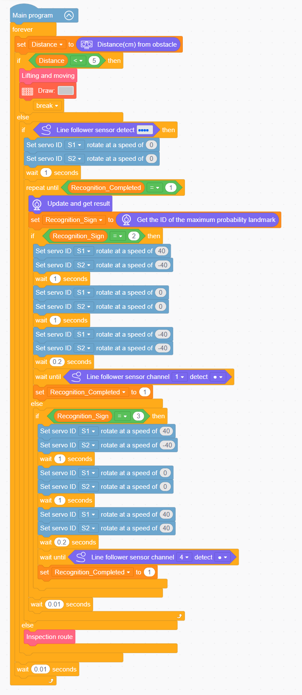

> [!NOTE]
>
> **The program source files can be downloaded from [Program Files](https://drive.google.com/drive/folders/1gpd83ho-Cf-T1LV6VETKvwf1mI7A8Bfg?usp=sharing).**
>

### (5) Track Preparation

Provide electrical tape, refer to the layout shown in the diagram, and stick the corresponding line-following route onto the desktop. After completing the route layout, upload the program to the controller, then place the vehicle on the black line for testing and verification.

> [!NOTE]
>
> **Using black electrical tape on a white or light-colored wooden desktop is recommended for optimal contrast.**

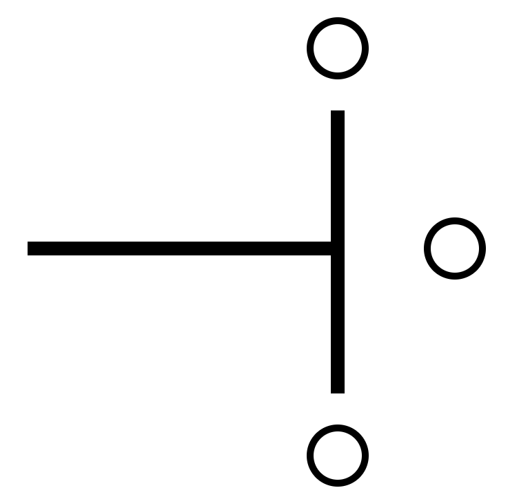

## 3.16.6 Program Upload

## 3.16.7 Expansion and Challenge

**Challenge Task 1: Three-Color RGB Status Lighting and Ultrasonic Obstacle Avoidance Alerts**

1. Project Goal: Add RGB lights and an ultrasonic sensor to distinguish three operating states through lighting. When the vehicle follows the black line normally, the white light illuminates steadily. When recognizing sign cards to perform turning and sorting, the light switches to the corresponding dedicated colored lighting. When the ultrasonic sensor detects an obstacle ahead, the RGB light flashes red as an alert, visually distinguishing the three operating modes of line following, sorting turns, and obstacle avoidance.

2. Implementation Strategy: Add ultrasonic distance reading blocks and construct multi-level conditional branches. Activate the white light in the normal line-following branch. Pair corresponding colored lights with turning and sorting logic in the sign recognition branch. Trigger flashing RGB lights and execute avoidance maneuvers in the obstacle detection branch, ensuring non-conflicting multi-mode logic.

3. Key Challenges: Reading line following, color block recognition, and distance measurement data synchronously without lagging, switching lighting without flickering, and ensuring obstacle avoidance logic takes priority over routine sorting and travel actions.

**Challenge Task 2: Returning to Starting Point for Standby After Sorting Completion**

1. Project Goal: After completing color block sorting and placement, the vehicle automatically returns to the initial starting point along the line-following path, the 270° gripper servo resets to an open state, and the RGB light switches to dim standby lighting to await the next sorting and handling task.

2. Implementation Strategy: Add a sorting completion flag variable to initiate return line-following logic once materials are unloaded. Upon returning to the starting point, reset the gripper mechanism and transition the RGB light into standby mode.

3. Key Challenges: Maintaining bidirectional line following without drifting off track, ensuring smooth sequence transitions across gripping, placement, and return phases, and preventing mutual interference among multiple servo groups.

**Challenge Task 3: Creative Extensions of Target Recognition, Line Following, and Multi-Servo Gripping**

1. Warehouse Sorting and Stacking Robot: Retain the core code for color block recognition, line following, and single-servo gripping, identifying materials of different colors to transport and stack them in corresponding warehouse partitions.

2. Classroom Teaching Aid Sorting Platform: Remove the drive servos, retain only visual recognition and the gripper servo, and automatically identify color blocks to grab and drop them into corresponding storage boxes.

3. Universal Modification Strategy: Keep the core code for camera color block recognition and line follower sensor readings unchanged, adjust only single-servo gripping and travel timing logic, and construct diverse automated sorting and transport equipment based on the pipelined logic of color block recognition, line-following gripping, and designated placement sorting.

## 3.16.8 Q&A

**Question1: When wiring the servos, the orange signal wire must be connected to the white pin of the corresponding S port. What problems will occur if it is connected incorrectly?**

**Answer**: The white pins of ports **S1**, **S2**, and **S3** are dedicated to transmitting control signals. The dual 360° driving block motors rely on these signals to control the car for line-following forward movement and turning. The single 270° gripping block servo relies on the signal to control the opening and closing of the gripper to grab materials. If the orange signal wire is connected to the power or ground pin, the controller cannot send control commands to the servo, resulting in two types of faults. First, the corresponding servo remains completely unresponsive, preventing the car from executing line-following driving or stopping the gripper from grabbing materials. Second, the servo jitters continuously and rotates erratically, which may cause overheating and hardware damage in severe cases. Meanwhile, all code for line-following speed regulation, gripping opening and closing, and sorting and transport in the program becomes invalid. Consequently, the automated color-block sorting and transport task cannot be completed.   

**Question 2: Both the vision module and the line follower sensor collect data normally, but the car fails to drive and the gripper cannot grab materials. What are the most common faults and troubleshooting methods?**

**Answer**: 1. Wiring Fault: The orange signal wires of the three servos are not plugged into the white signal pins of ports **S1**, **S2**, and **S3** respectively. **Troubleshooting:** Power off the device, then check the wiring sequence of the three wires for each of the three servos one by one against the wiring diagram.

2. Program Fault: The code for 360° line-following driving and 270° gripper opening and closing is not placed inside the conditional branch for recognizing a valid road sign. Troubleshooting: Open the program and move the car driving and gripper grabbing and releasing commands into the successful road sign recognition branch.

3. Hardware Damage: The driving servo or gripping servo is faulty, or ports **S1**, **S2**, and **S3** on the ESP32 controller are damaged. Troubleshooting: Connect a working servo to the corresponding **S** port for testing. If there is still no response, switch to another servo port on the controller for debugging. 

## 3.16.9 Technical Support and Product Discussion

Share project ideas and connect with other makers on the [Hiwonder community](https://forum.hiwonder.com):

