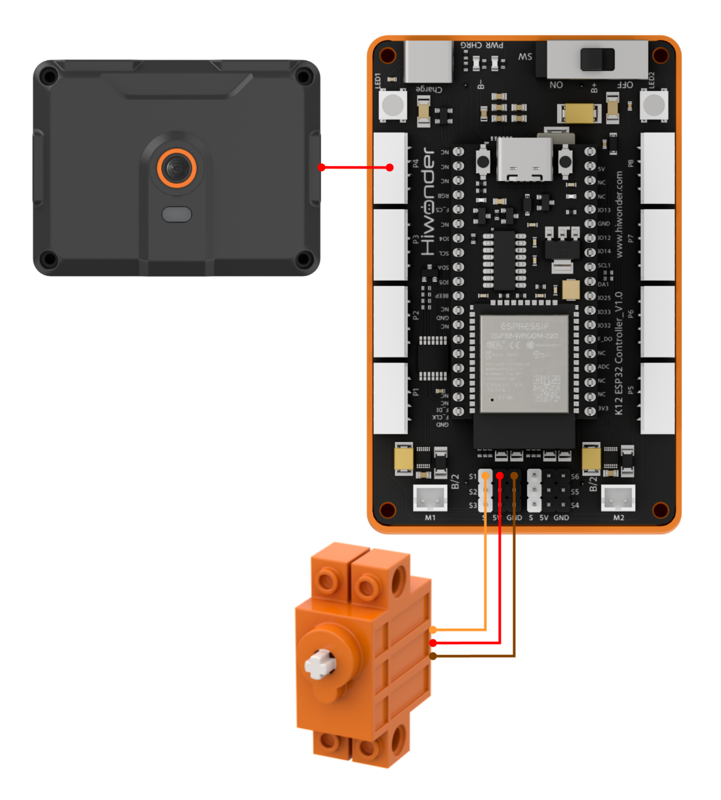
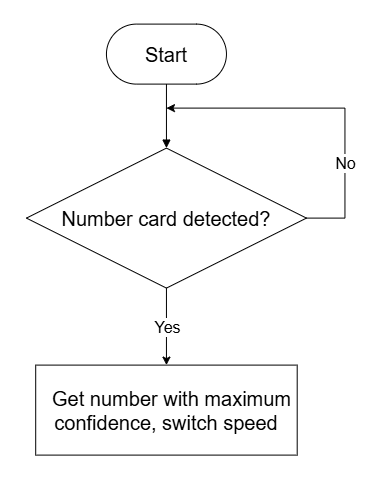
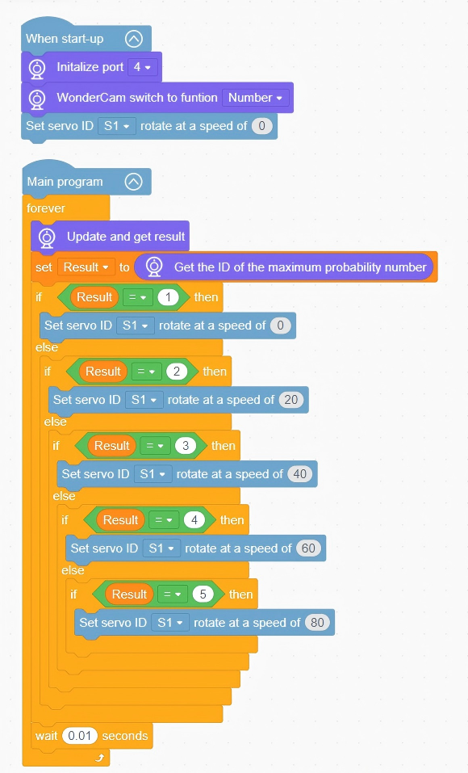

# 3.17 Adjustable Gymnast

## 3.17.1 Lesson Introduction

The AI Adjustable Gymnast Model is a fun interactive building-block desktop model. The main frame features the WonderLens vision camera acting as its "eyes", and the motion joints are driven by a 360° block motor to perform continuous reciprocating gymnastics movements. The overall building-block assembly is straightforward with a clearly separated structure, enabling convenient wiring and debugging. After the camera identifies different number tags, the program modifies the servo rotation speed in real time, switching the model among slow, medium, and fast gymnastic rhythms to achieve the interactive effect of number cards controlling variable-speed motion. It serves as a creative hands-on training project that provides an intuitive demonstration of the linkage between AI number recognition and dynamic servo speed regulation.

## 3.17.2 Learning Objectives

1. Learn to call number card recognition functions using the WonderLens module, and master programming routines for number ID reading and number detection.
2. Proficiently program multi-speed regulation routines for the 360° block motor, switching motion speeds in real time based on recognized numbers.
3. Complete linkage debugging across the entire system of number recognition and servo speed regulation, achieving synchronized real-time speed responses of gymnastics movements after recognizing numbers.
4. Assemble the complete gymnast model and debug the program, gaining the ability to build intelligent projects that control servo variable-speed motion through visual number recognition.

## 3.17.3 Assembly Guide

<pdf src="../../../../docs/_static/shared/pdf/chapter_3/17.pdf" />

## 3.17.4 Hardware Wiring

Connect the WonderLens vision module to port **P4** of the ESP32 controller.

Connect the 360° block motor to port **S1** of the ESP32 controller, ensuring the **orange** wire aligns with the **white** pin of S1.

Wiring diagram:

## 3.17.5 Programming

### (1) Program Schematic

### (2) Adding Extensions

- Click the **Extensions** button and select the **WonderLens** under the **Sensor** category.

### (3) Core Blocks

| Block | Category | Function Description |
| :---: | :---: | :--- |
|  |  | Compares the left value with a specified value and returns a boolean result indicating whether it is greater. |
|  |  | Creates a custom variable to store data. |
|  |  | Reads the value stored inside the custom variable. |
|  |  | Assigns a specified value to the target custom variable. |
|  |  | Controls the servo connected to the specified port to rotate at the set speed. |
|  |  | Switches the AI vision operating mode of the vision module. |
|  |  | Refreshes the camera feed and reads recognition data for the current vision mode. |
|  |  | Returns the number with the highest confidence score in number recognition. |

### (4) Complete Program

1. Initialization: At startup, initialize the WonderLens vision module at port **P4** and switch its mode to number recognition. Set the initial speed of servo **S1** to 0.

2. Main Loop: In the main program loop, continuously refresh camera data to acquire recognition results and store the number with the highest confidence in the variable `Result`.

   - When `Result` equals 1, set the speed of servo **S1** to 0.

   - When `Result` equals 2, set the speed of servo **S1** to 20.

   - When `Result` equals 3, set the speed of servo **S1** to 40.

   - When `Result` equals 4, set the speed of servo **S1** to 60.

   - When `Result` equals 5, set the speed of servo **S1** to 80.

   Each loop cycle pauses for 0.01 s.

> [!NOTE]
>
> **The program source files can be downloaded from [Program Files](https://drive.google.com/drive/folders/1gpd83ho-Cf-T1LV6VETKvwf1mI7A8Bfg?usp=sharing).**

## 3.17.6 Program Upload

## 3.17.7 Expansion and Challenge

**Challenge Task 1: Multi-Tiered Speed Indication with RGB Lighting**

1. Project Goal: Differentiate among slow, medium, and high motion speeds, using dedicated red lighting with distinct flashing rhythms to visually indicate the current gear. When no number card is recognized, the model continuously cycles through baseline gymnastics rhythms while the lighting remains in standby mode. Slow gear: solid red light. Medium gear: slow breathing red gradient. High gear: high-frequency fast flashing red light.

2. Implementation Strategy: Read recognized number IDs to divide speed tiers and construct multi-level conditional branches. Map each tier to the corresponding servo rotation speed and RGB red lighting logic. The branch without number recognition executes constant baseline gymnastics movements and maintains standby lighting.

3. Key Challenges: Ensuring stable number recognition without tier skipping, maintaining smooth speed switching without pauses, and synchronizing lighting flashing rhythms with current motion speeds.

**Challenge Task 2: Motion Cadence Retention After Card Removal**

1. Project Goal: When a number card leaves the camera lens, the model does not immediately switch back to the baseline speed. It maintains current-gear gymnastics movements for 3 seconds, reverts to the default baseline rhythm once the countdown finishes, and switches lighting back to standby.

2. Implementation Strategy: Add a timer variable to start a countdown when the card disappears. Maintain the original speed and lighting effects while the countdown is active. When the countdown reaches zero, switch back to baseline gymnastics and turn off dynamic lighting.

3. Key Challenges: Ensuring timer operation does not interfere with real-time camera recognition of new number cards, and coordinating speed regulation, lighting, and countdown logic without conflicts.

**Challenge Task 3: Creative Extensions of Number Recognition and Servo Speed Regulation**

1. Number Speed-Controlled Rotating Display Stand: Retain the core code for number recognition, use a servo to drive exhibits to rotate, and map different numbers to different display speeds.

2. Multi-Speed Ambient Fan: Remove the gymnastics structure, use the servo to simulate fan rotation, recognize numbers to switch wind speeds between slow and fast, and pair with corresponding lighting prompts.

3. Universal Adaptation Strategy: Keep the core code for camera number recognition unchanged, adjust only servo speed parameters and lighting output logic, and construct diverse multi-speed interactive models based on the logic of recognizing different numbers to match corresponding motion speeds.

## 3.17.8 Q&A

**Question 1: During servo wiring, the orange signal wire must connect to the white pin of port S1. What problems occur if it is wired incorrectly?**

**Answer**: The white pin of port S1 is dedicated to transmitting control signals. The servo relies on this signal to control rotation speeds and reciprocating gymnastics cadences. If the orange signal wire connects to power or ground pins, the mainboard cannot send speed regulation commands to the servo, resulting in two types of faults. First, the servo remains completely motionless, preventing the model from completing gymnastics movements. Second, the servo vibrates continuously and rotates erratically, which may cause overheating and damage in severe cases. Meanwhile, all code in the program for number recognition speed adjustments and cyclic gymnastics rhythms becomes ineffective, making it impossible to realize the interactive speed control function using number cards.

**Question 2: The vision module recognizes various number cards normally, but the gymnast model servo does not move and cannot change speed. What are the most common faults and troubleshooting methods?**

**Answer**: 1. Wiring Fault: The orange signal wire of the servo is not plugged into the white signal pin of S1. Troubleshooting: Disconnect the power, then verify the wiring sequence of the three wires against the diagram.

2. Program Fault: The code for the servo gymnastics loop and multi-tier speed regulation is not placed within the valid loop branch for number recognition. Troubleshooting: Open the program and move the servo reciprocating motion and speed switching instructions into the decision branch for number recognition.

3. Hardware Damage: The servo itself is faulty, or port S1 on the ESP32 is damaged. Troubleshooting: Replace it with a known working servo connected to S1 for testing. If it still does not move, connect to other servo ports on the mainboard for testing.

## 3.17.9 Technical Support and Product Discussion

Share project ideas and connect with other makers on the [Hiwonder Community](https://forum.hiwonder.com):

