# 3.18 Color Tracker

## 3.18.1 Lesson Introduction

The AI Color Tracker is a two-axis pan-tilt smart building-block model. The pan-tilt mount features the WonderLens vision camera acting as its "eyes", with horizontal pan and vertical tilt driven individually by 270° block servos. The overall building-block assembly is straightforward with a clearly separated structure, enabling convenient wiring and debugging. The camera identifies color blocks in real time and retrieves horizontal and vertical offset coordinates from the frame. Dual 270° block servos coordinate synchronously to adjust the pan-tilt angles, continuously aligning with the target for all-around tracking. It serves as a creative hands-on training project that provides an intuitive demonstration of color coordinate sampling and dual-servo two-axis closed-loop tracking control.

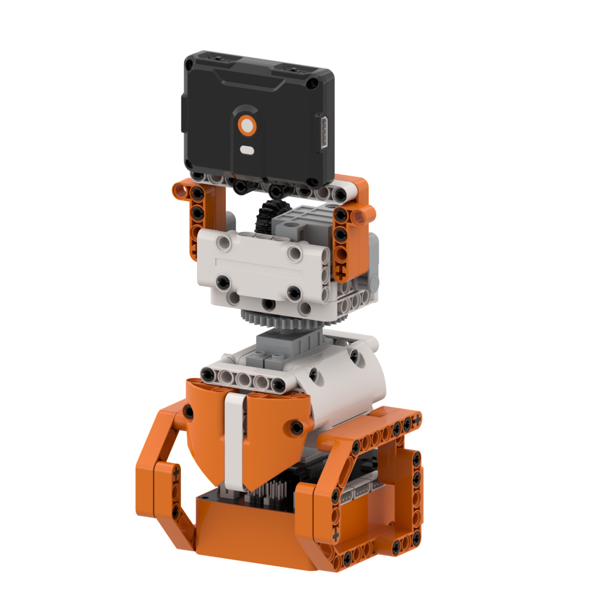

## 3.18.2 Learning Objectives

1. Master color tracking functions using the WonderLens module, and program routines to read horizontal and vertical target coordinates.
2. Master precise angle mapping control of dual 270° block servos to achieve all-around pan-tilt tracking across pitch and yaw directions.
3. Complete joint debugging of color block position detection and the dual-servo pan-tilt system, achieving real-time synchronized tracking during color block movement.
4. Assemble the complete two-axis pan-tilt model and debug tracking algorithms, gaining the ability to build intelligent two-axis vision-following projects.

## 3.18.3 Assembly Guide

<pdf src="../../../../docs/_static/shared/pdf/chapter_3/18.pdf" />

## 3.18.4 Hardware Wiring

Connect the WonderLens vision module cable to port **P4** of the ESP32 controller.

Connect the left 270° block servo cable to port **S1** of the ESP32 controller, and insert the servo's **orange** wire into the **white** pin of S1.

Connect the right 270° block servo cable to port **S2** of the ESP32 controller, and insert the servo's **orange** wire into the **white** pin of S2.

Wiring diagram:

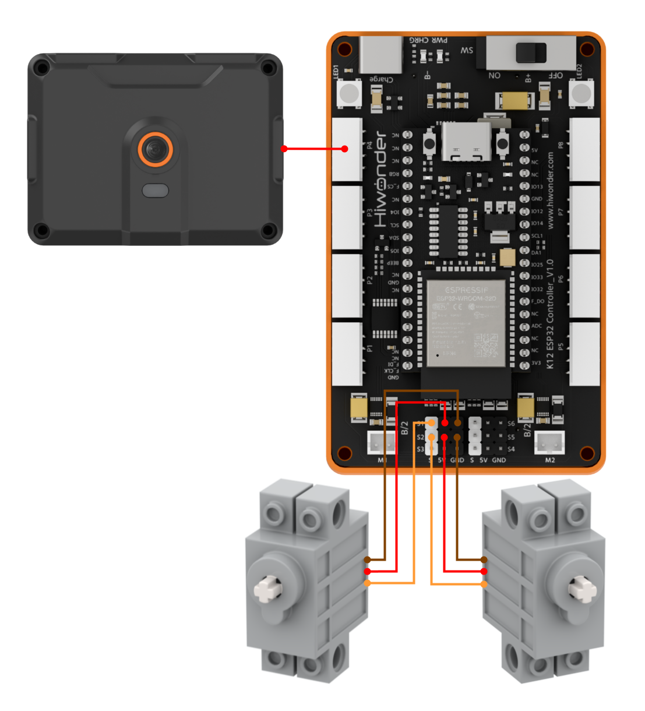

> [!NOTE]
>
> **When conducting a lesson involving the 270° block servo for the first time, first remove the gear along with its attached building blocks from the servo. Then, upload this lesson's program to the ESP32 and wait for the servo to rotate to its initial position, 135°. Finally, reinstall the removed parts. This step can be skipped if a servo reset program has already been executed.**

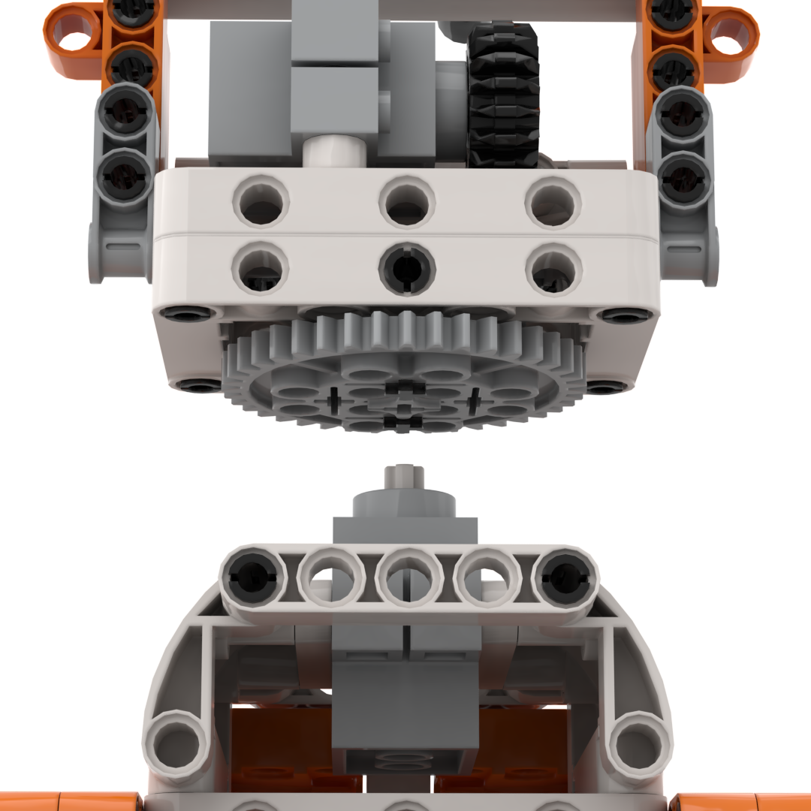

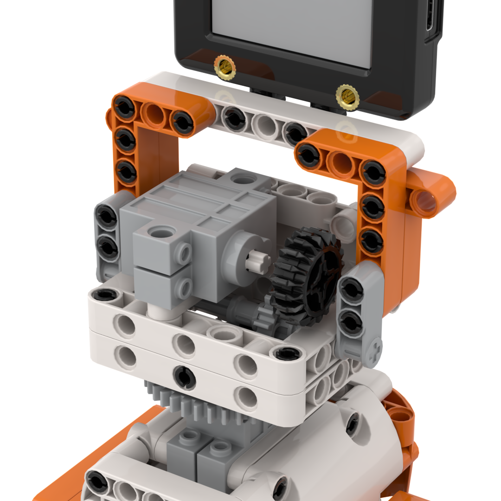

## 3.18.5 Programming

### (1) Program Schematic

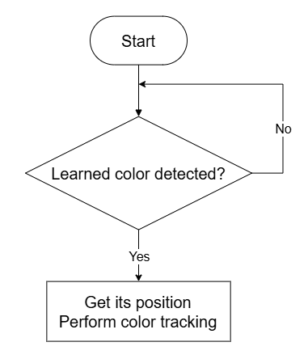

### (2) Adding Extensions

- Click the **Extensions** button and select **WonderLens** under the **Sensor** category.

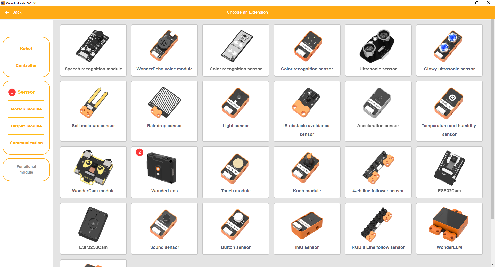

### (3) Core Blocks

| Block | Category | Function Description |
| :---: | :---: | :--- |
| 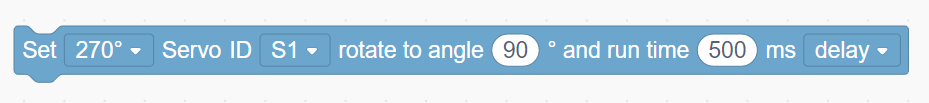 | 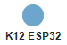 | Commands the 270° block servo connected to the specified port to rotate smoothly to a target angle within a set duration and configures delay mode. |
| 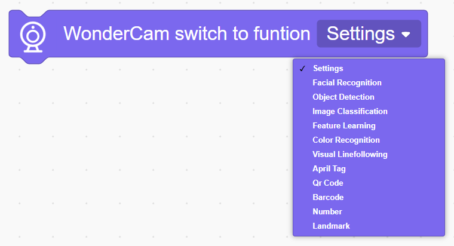 |  | Switches the AI vision operating mode of the vision module. |
|  |  | Refreshes the camera feed and reads recognition data for the current vision mode. |
|  |  | Determines whether the target color with ID 1 appears in the frame and returns a boolean result. |
|  |  | Reads the center coordinates and bounding dimensions of the detected target color block. |

### (4) Complete Program

1. Initialization: At startup, initialize the WonderLens vision module at port P4 and switch its operating mode to color recognition. Initialize the variable `Angle_Up-down` to 135 and initialize `Angle_Left-right` to 135. Command the 270° block servo S1 to rotate to the angle assigned to `Angle_Left-right` and command servo S2 to rotate to the angle assigned to `Angle_Up-down` over 800 ms, then pause for 1 s.

2. Main Loop: In the main program loop, continuously refresh camera data to acquire recognition results. When color ID 1 is recognized, store the center X-coordinate of the detected color block in `Location_Left-right` and store the center Y-coordinate in `Location_Up-down`. Adjust `Angle_Up-down` according to `Location_Up-down`, constraining `Angle_Up-down` within the range of 110° to 160°. Adjust `Angle_Left-right` according to `Location_Left-right`, constraining `Angle_Left-right` within the range of 90° to 180°. Command servos S1 and S2 to rotate to the updated angles over 20 ms. Each loop cycle pauses for 0.01 s.

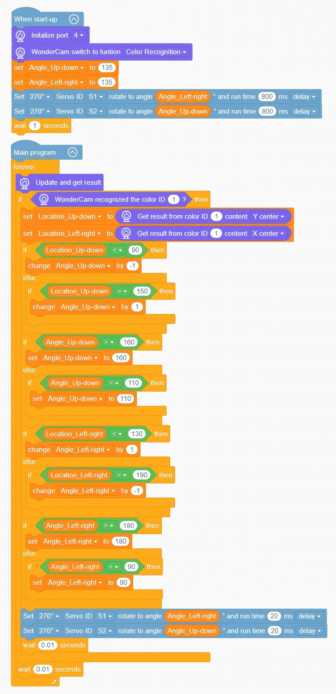

> [!NOTE]
>
> **The program source files can be downloaded from [Program Files](https://drive.google.com/drive/folders/1gpd83ho-Cf-T1LV6VETKvwf1mI7A8Bfg?usp=sharing).**

## 3.18.6 Program Upload

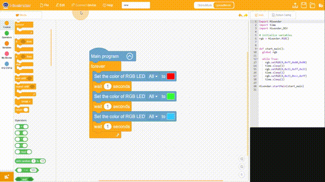

## 3.18.7 Expansion and Challenge

**Challenge Task 1: Multi-State RGB Lighting and Automatic Centering Standby**

1. Project Goal: Use RGB lights to distinguish three tracking states. Automatically return the pan-tilt mechanism to the centered standby position and switch the lighting to white after losing the color block for an extended period. When the color block is locked stably at the center, the light illuminates constantly in the matching target color. When the color block deviates from the center of the frame, the light pulses slowly with a gradient warning. When the color block is completely lost, the light flashes at high frequency as an alert. If the color block is not recaptured within the timeout period, both servos reset to the centered position of 135° and the RGB light switches to white standby.

2. Implementation Strategy: Read the horizontal and vertical offset coordinates of the color block to build multi-branch conditions, distinguishing centered, offset, and lost states while matching the corresponding lighting logic. Add a timeout timer variable, and execute the reset of both pan-tilt servos to center alongside switching the lighting to white when the timing finishes.

3. Key Challenges: Achieving stable real-time reading of color block coordinates, ensuring smooth pan-tilt movement without jitter, maintaining synchronous switching of lighting states, and running timing without interrupting continuous vision detection.

**Challenge Task 2: Multi-Color Target Switching and Dynamic Tracking**

1. Project Goal: Support the recognition of multiple preset color blocks. When switching between different color targets, the pan-tilt mechanism automatically switches tracking and the RGB light changes to the corresponding color synchronously without reconfiguring the program.

2. Implementation Strategy: Input multiple sets of standard color block templates, add branch conditions for color block IDs, automatically switch the tracking baseline upon recognizing different color blocks, and update the RGB lighting scheme synchronously.

3. Key Challenges: Ensuring that recognition of multiple color blocks does not cause mutual interference, maintaining smooth pan-tilt transitions during target switching, and updating the lighting indicators synchronously.

**Challenge Task 3: Creative Extensions of Two-Axis Color Tracking Pan-Tilt Mechanisms**

1. Vision Auto-Tracking Camera: Mount a camera on the dual-servo pan-tilt mechanism to continuously track colored targets and adjust shooting angles automatically.

2. Auto Light-Tracking Fill Light: Mount a fill light source on the pan-tilt mechanism to identify color blocks and continuously follow moving targets for illumination.

3. Universal Modification Strategy: Keep the core code for camera color block coordinate recognition unchanged, adjust only the angle mapping parameters for the dual 270° block servos, and construct diverse two-axis vision-following devices based on the logic of reading color block offset coordinates to correct two-axis pan-tilt angles in real time.

## 3.18.8 Q&A

**Question 1: During servo wiring, the orange signal wire must be connected to the white pin of the corresponding S port. What problems occur if it is wired incorrectly?**

**Answer**: The white pins of ports S1 and S2 are dedicated to transmitting control signals. Two 270° block servos rely on these signals to control the horizontal and vertical rotation angles of the pan-tilt mechanism respectively. If an orange signal wire connects to power or ground pins, the controller cannot send angle control commands to the servo, leading to two types of faults. First, the corresponding servo remains completely motionless, preventing the pan-tilt mechanism from following color blocks horizontally and vertically. Second, the servo vibrates continuously and rotates erratically, which may lead to overheating and damage in severe cases. Meanwhile, all program code for pan-tilt tracking and servo homing to the centered position of 135° becomes ineffective, making it impossible to realize two-axis color block tracking.

**Question 2: The vision module reads color block position coordinates normally, but the pan-tilt mechanism does not move at all. What are the most common faults and troubleshooting methods?**

**Answer**:

1. Wiring Fault: The orange signal wires of the two 270° block servos are not plugged into the white signal pins of S1 and S2 respectively. Troubleshooting: Disconnect the power, then verify the wiring sequence of the three wires on both servos against the diagram.

2. Program Fault: The code for mapping color block coordinates to servo angles is not placed within the main tracking loop, and the 270° block servo homing routine was not executed in advance. Troubleshooting: Complete the servo homing process first, then move the pan-tilt rotation and angle conversion instructions into the valid loop for color block recognition.

3. Hardware Damage: A single-side or dual-side 270° block servo is faulty, or ports S1 and S2 on the ESP32 are damaged. Troubleshooting: Replace each with a known working servo connected to S1 and S2 for testing. If they still do not move, connect to other servo ports on the mainboard for debugging.

## 3.18.9 Technical Support and Product Discussion

Share project ideas and connect with other makers on the [Hiwonder community](https://forum.hiwonder.com):

