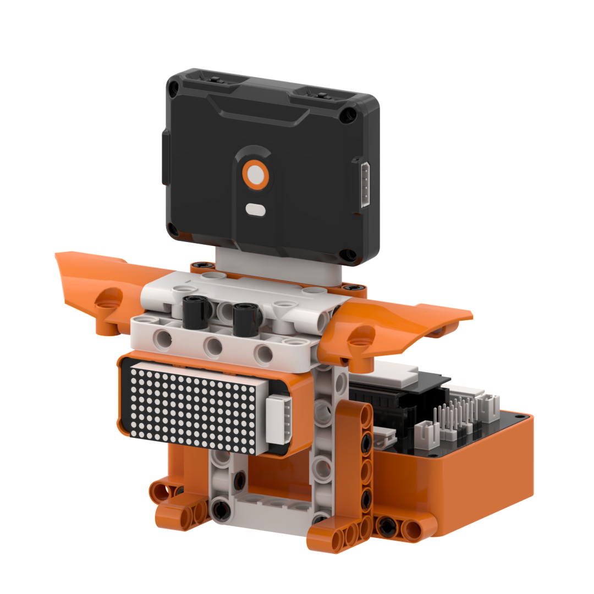
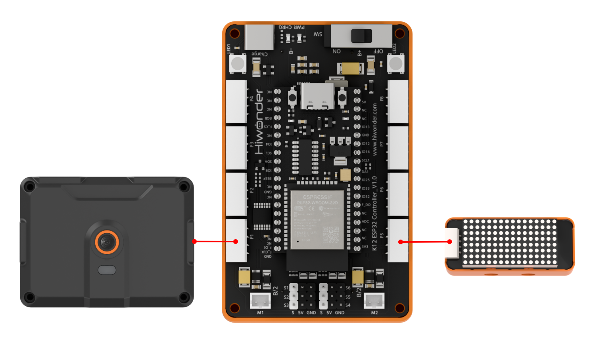
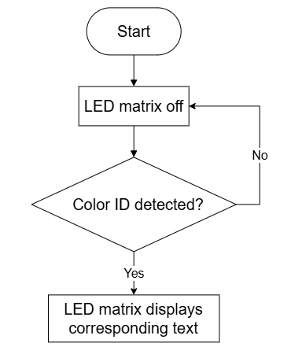
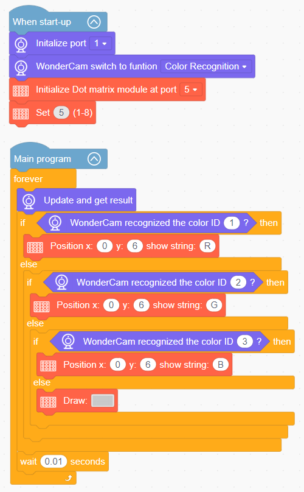

# 3.2 Color Scanner

## 3.2.1 Lesson Introduction

The Color Scanner is a practical robotic vision inspection model. The front of the model is equipped with the WonderLens vision module as its visual sensor, while the body incorporates a dot matrix display to output recognized color text. The modular mechanical structure ensures straightforward assembly and accessible wiring. When the camera captures a color swatch and completes color matching, the display outputs the corresponding color name. This project provides hands-on experience with AI color recognition and synchronized hardware interactions.

## 3.2.2 Learning Objectives

1. Master color recognition using the WonderLens vision module. Learn methods for reading color recognition data and calibrating tolerance parameters.
2. Program character display sequences on the dot matrix module. Master programming logic involving variable counting and multi-branch conditional statements.
3. Establish coordinated programming between the vision module and the dot matrix display. Synchronize color recognition outputs with on-screen text feedback.
4. Assemble the robotic model and debug the program. Develop foundational skills in building and customizing AI visual inspection projects.

## 3.2.3 Assembly Guide

<pdf src="../../../../docs/_static/shared/pdf/chapter_3/2.pdf" />

## 3.2.4 Hardware Wiring

Connect the WonderLens vision module cable to the **P1** port of the ESP32 controller.

Connect the dot matrix module cable to the **P5** port of the ESP32 controller.

Wiring diagram:

## 3.2.5 Programming

### (1) Program Schematic

### (2)  Adding Extensions

- Click the **Extensions** button and select the **WonderLens** under the **Sensor** category.

- Click the **Extensions** button and select **Dot matrix module** under the **Output module** category.

### (3) Core Blocks

| Block | Category | Function Description |
| :---: | :---: | :--- |
|  |  | Adjusts the brightness of the dot matrix display to a specified level from 1 to 8. |
|  |  | Displays custom text at the specified coordinates on the dot matrix display. |
|  |  | Draws the selected pattern on the dot matrix display. |
|  |  | Switches the AI vision operating mode of the vision module. |
|  |  | Refreshes the camera feed and reads recognition data for the current vision mode. |
|  |  | Detects whether the target color appears in the camera frame and returns a boolean result. |

### (4) Complete Program

1. Initialization: At startup, initialize the WonderLens vision module at port **P1** and switch the operating mode to color recognition. Initialize the dot matrix module at port **P5** and set its display brightness.

2. Main Loop: The program continuously updates and retrieves recognition data from the WonderLens vision module, then sequentially evaluates the detected color ID. When ID 1 is recognized, the dot matrix module displays the character "R" at coordinates (0, 6). When ID 2 is recognized, it displays "G". When ID 3 is recognized, it displays "B". If none of the three colors are detected, the dot matrix module displays a default icon. Each loop iteration pauses for 0.01 s.

> [!NOTE]
>
> **The program source files can be downloaded from [Program Files](https://drive.google.com/drive/folders/1gpd83ho-Cf-T1LV6VETKvwf1mI7A8Bfg?usp=sharing).**

## 3.2.6 Program Upload

## 3.2.7 Expansion and Challenge

**Challenge Task 1: Tiered Subtitle Interactive Color Scanner**

1. Project Goal: Differentiate between single color recognition and cumulative recognition scenarios to create tiered subtitle transitions. When recognizing a single color, the display outputs the corresponding color name. Upon consecutively recognizing more than three distinct colors, the display switches to show the cumulative total of recognized colors rather than individual names.

2. Implementation Strategy: Call the block that reads the recognized color, introduce a numerical variable to count distinct colors, and nest multiple conditional statements. Write two separate display routines for the dot matrix module, switching the displayed content based on the variable value.

3. Key Challenges: Accurately filtering duplicate color detections to prevent repetitive counting, avoiding logical conflicts across nested conditions, and eliminating screen flickering during text transitions.

**Challenge Task 2: Sound and Light Synchronized Color Recognition Device**

1. Project Goal: Trigger multi-peripheral synchronized responses upon detecting color blocks. When different colors are detected, the dot matrix module displays corresponding subtitles, the onboard RGB lights illuminate in matching colors, and the buzzer plays distinct audio tones, simulating industrial material sorting alerts.

2. Implementation Strategy: Retain the existing color detection logic, adding blocks inside each color branch to adjust RGB colors and play buzzer tones. Assign unique light parameters and audio feedback to each color, achieving synchronized multi-device responses.

3. Key Challenges: Ensuring fluid camera recognition without frame drops, synchronizing light, audio, and screen output, and keeping acoustic and visual feedback distinct across colors.

**Challenge Task 3: Creative Applications of Color Recognition**

1. Smart Sorting Rover: Retain the core color recognition code and install a servo-driven paddle mechanism. When detecting different colored materials, the servo shifts items into corresponding sorting channels.

2. Intelligent Color Swatch Tester: Mount the sensor on a motorized linear slide to scan multiple color swatches in sequence, automatically tallying and displaying all detected colors on the dot matrix module.

3. Universal Adaptation Strategy: Keep the core color recognition algorithm unchanged and swap out or add output hardware. By implementing new peripheral control blocks under the logic of triggering actions upon detecting specified colors, diverse smart vision applications can be created.

## 3.2.8 Q&A

**Question 1: Which module is responsible for detecting object colors, and how does it work?**

**Answer**: The WonderLens vision module is responsible for detecting object colors. The onboard camera captures images of the scene, extracts RGB color data from detected color swatches, and matches these values against pre-calibrated reference templates. Once the corresponding color is determined, the module transmits the recognition data to the ESP32 controller. The controller reads this data and drives the dot matrix module to display the appropriate subtitle, completing the recognition and feedback loop.

**Question 2: What is the color recognition tolerance parameter, and why does tolerance affect recognition accuracy?**

**Answer**: Tolerance defines the allowable color error range during matching. A smaller tolerance value enforces stricter matching criteria, meaning only color swatches highly similar to the reference template are recognized. A larger tolerance value broadens the matching range, allowing colors with slight variations to be classified as the same color. Setting tolerance too low risks failing to detect target colors, while setting it too high causes false positives from ambient lighting or background interference. During practical operation, calibrate the tolerance according to ambient lighting and background conditions to ensure reliable detection.

## 3.2.9 Technical Support and Product Discussion

Share project ideas and connect with other makers on the [Hiwonder community](https://forum.hiwonder.com):

