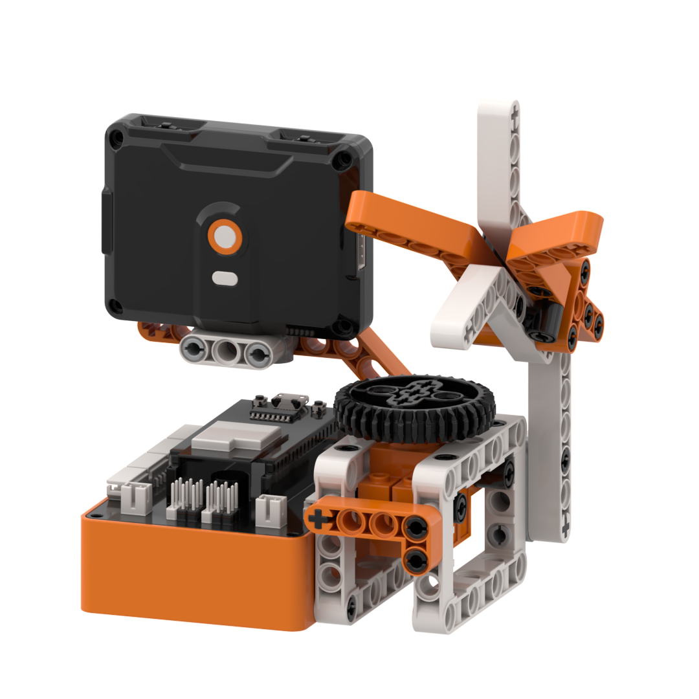
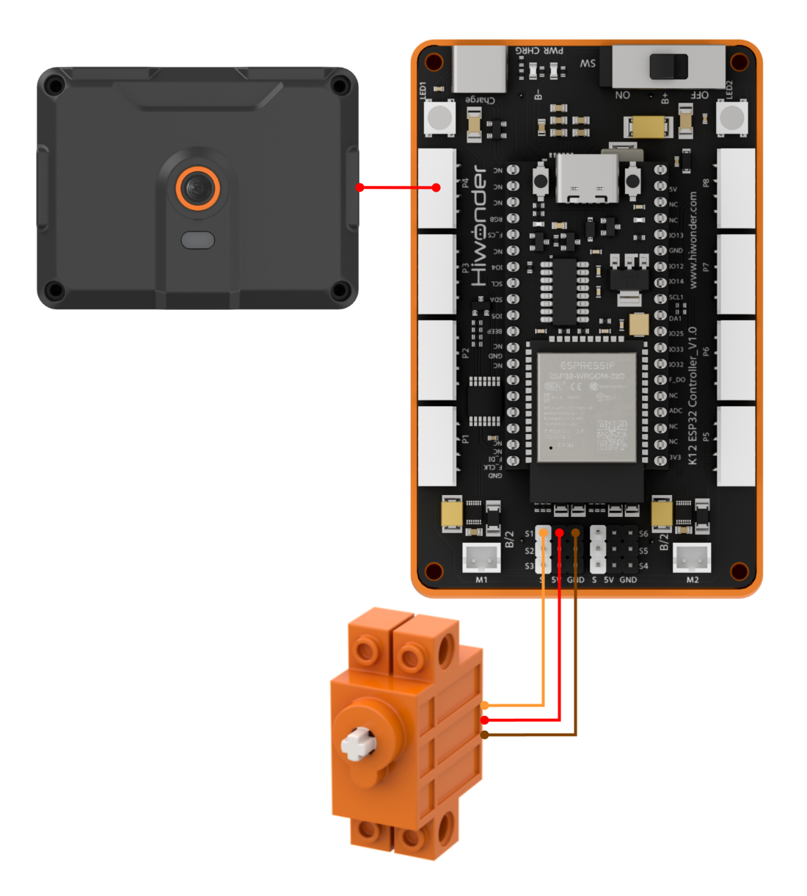
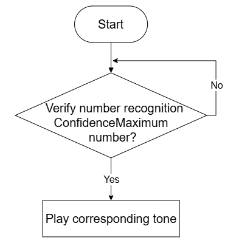
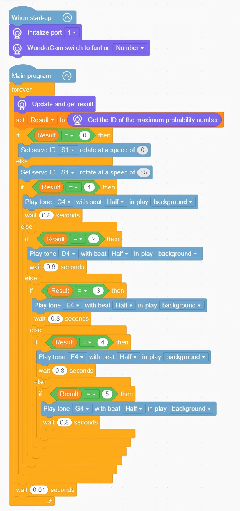

# 3.3 Melodic Music Box

## 3.3.1 Lesson Introduction

The Melodic Music Box is an interactive robotic building block project. The front of the chassis features the WonderLens vision module as its visual sensor, while the base houses an onboard buzzer component. A 360° block motor drives the rotating platform of the music box. The modular mechanical structure ensures straightforward assembly and accessible wiring. When the camera recognizes different number cards, the buzzer plays corresponding musical tones and the servo rotates slowly in synchronization, achieving an interactive performance linking number recognition with audio feedback. This project demonstrates AI number recognition and multi-sensory physical computing.

## 3.3.2 Learning Objectives

1. Master number card recognition using the WonderLens vision module. Learn methods for reading and processing numerical recognition signals.
2. Program buzzer routines for individual tones and full melodies. Master tone and pitch control logic across diverse musical notes.
3. Establish coordinated programming linking number recognition, buzzer playback, and servo rotation. Trigger dedicated musical passages upon recognizing specific numbers.
4. Assemble the robotic model and debug the program. Develop foundational skills in building AI visual and acoustic interactive projects.

## 3.3.3 Assembly Guide

<pdf src="../../../../docs/_static/shared/pdf/chapter_3/3.pdf" />

## 3.3.4 Hardware Wiring

Connect the WonderLens vision module cable to the **P4** port of the ESP32 controller.

Connect the 360° block motor cable to the **S1** port of the ESP32 controller, with the servo's **orange** wire plugged into the **white** pin of S1.

Wiring diagram:

## 3.3.5 Programming

### (1) Program Schematic

### (2) Adding Extensions

- Click the **Extensions** button and select the **WonderLens** under the **Sensor** category.

### (3) Core Blocks

| Block | Category | Function Description |
| :---: | :---: | :--- |
|  |  | Compares the left-hand value with a custom value and returns a boolean result indicating greater than. |
|  |  | Creates a custom variable to store data. |
|  |  | Reads data stored in the specified custom variable. |
|  |  | Assigns a custom value to the specified variable. |
|  |  | Plays audio according to custom pitch, beat duration, and playback mode. |
|  |  | Controls the servo connected to the specified port to rotate at the set speed. |
|  |  | Switches the AI vision operating mode of the vision module. |
|  |  | Refreshes the camera feed and reads recognition data for the current vision mode. |
|  |  | Extracts the number with the highest confidence score from the recognition results. |

### (4) Complete Program

1. Initialization: At startup, initialize the WonderLens vision module at port **P4** and switch the operating mode to number recognition.

2. Main Loop: The program continuously updates and retrieves recognition data from the WonderLens vision module, extracting the number with the highest confidence score and storing it in the variable `Result`. When `Result` equals 0, servo **S1** stops rotating. When `Result` is between 1 and 5, servo **S1** rotates at a speed of 15, sequentially playing tones C4, D4, E4, F4, and G4. Each note is followed by a delay of 0.8 s, and each loop iteration pauses for 0.01 s.

> [!NOTE]
>
> **The program source files can be downloaded from [Program Files](https://drive.google.com/drive/folders/1gpd83ho-Cf-T1LV6VETKvwf1mI7A8Bfg?usp=sharing).**

## 3.3.6 Program Upload

## 3.3.7 Expansion and Challenge

**Challenge Task 1: RGB Light Synchronized Audio-Visual Performance**

1. Project Goal: When recognizing a number card, illuminate the RGB lights in matching colors while the buzzer plays the melody, creating a unified audio-visual performance. Number 1 illuminates red, number 2 illuminates orange, number 3 illuminates yellow, number 4 illuminates blue, and number 5 illuminates purple.

2. Implementation Strategy: Connect the RGB light module to the controller and insert light color adjustment blocks into each number detection branch. Bind each number to its corresponding light color and melody to trigger audio and visual feedback simultaneously.

3. Key Challenges: Ensuring stable number recognition without skipping digits, eliminating light flickering during color transitions, and synchronizing audio output with lighting effects without lag.

**Challenge Task 2: Delayed Stop After Card Removal**

1. Project Goal: When the number card is removed, the music box does not halt immediately. It completes playback for an additional 1 s before muting and gently returning the servo to its center position, simulating the acoustic decay of a mechanical music box.

2. Implementation Strategy: Introduce a timer variable to trigger a playback delay when the card disappears. Sustain the melody and lighting until the delay expires. Mute the buzzer, extinguish the lights, and reset the servo once the timer reaches zero.

3. Key Challenges: Ensuring that the delayed playback routine does not block the camera from detecting new cards, and synchronizing multiple peripherals without system latency.

**Challenge Task 3: Creative Applications of Number Recognition**

1. Digital Combination Lock: Retain the core number recognition code, replace the buzzer with an electric lock mechanism, and automatically unlock the mechanism upon recognizing a specific numerical sequence.

2. Quiz Buzzer Scorekeeper: Pair the system with a dot matrix display to increment scores automatically based on detected number cards, updating total scores in real time on the screen.

3. Universal Adaptation Strategy: Keep the core number recognition algorithm unchanged and swap out the output hardware. By implementing new peripheral control blocks under the logic of triggering actions upon detecting specified numbers, diverse smart interactive projects can be developed.

## 3.3.8 Q&A

**Question 1: During servo wiring, the orange signal wire must connect to the white pin of port S1. What problems occur if it is wired incorrectly?**

**Answer**: The white pin of port **S1** is dedicated to transmitting PWM control signals, which the servo relies on to determine rotation angle and speed. If the orange signal wire connects to the power or ground pins, the controller cannot transmit control instructions. Two primary failures occur: either the servo remains completely motionless so the music box cannot rotate, or the servo vibrates erratically and rotates erratically, potentially overheating and causing hardware damage. Furthermore, all program code designated to control rotation becomes ineffective, preventing synchronized playback and rotation.

**Question 2: The camera recognizes number cards normally and the buzzer sounds, but the servo does not rotate at all. What are the most common causes and troubleshooting steps?**

**Answer**:

1. Wiring Fault: The orange signal wire of the servo is not plugged into the white signal pin of port **S1**. Troubleshooting: Disconnect the power, then verify the three-pin sequence against the wiring diagram.

2. Program Fault: The servo rotation code is placed outside the condition branch for detecting number cards. Troubleshooting: Open the program and verify that the servo rotation and delay blocks reside inside the conditional block that executes when number recognition succeeds.

3. Hardware Damage: The servo itself is defective or port **S1** of the ESP32 controller is damaged. Troubleshooting: Connect a known working servo to port **S1** for testing. If it still fails to move, connect the servo to an alternative servo port on the controller to isolate the issue.

## 3.3.9 Technical Support and Product Discussion

Share project ideas and connect with other makers on the [Hiwonder community](https://forum.hiwonder.com):

