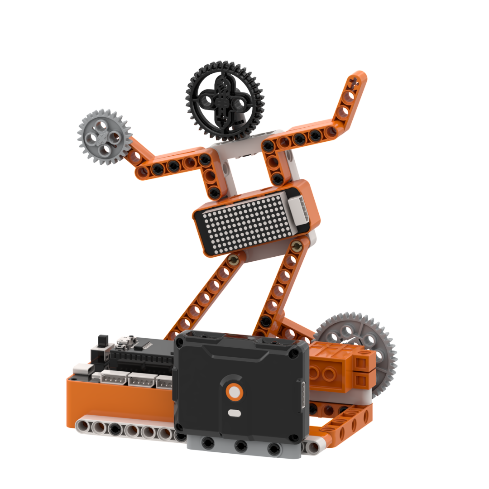
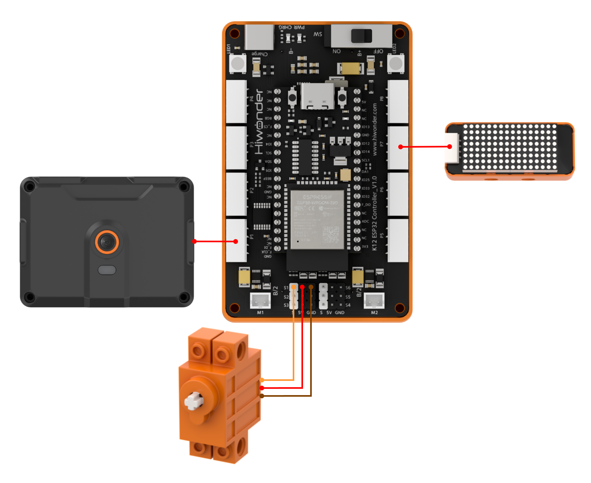
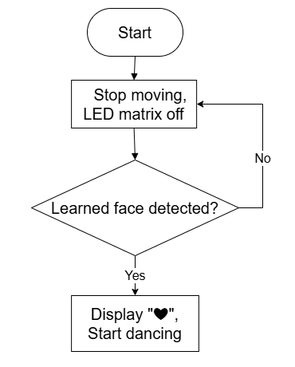
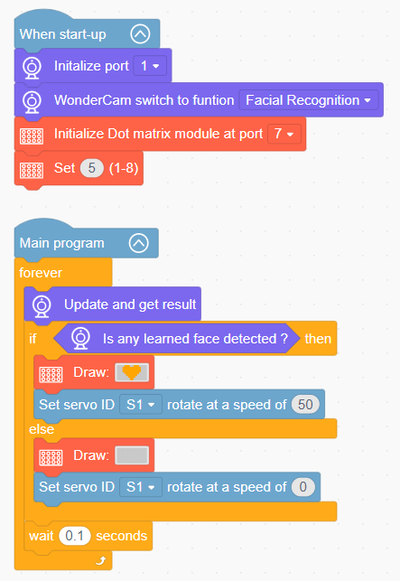

# 3.4 Dance Star

## 3.4.1 Lesson Introduction

The Dance Star model is an interactive robotic building block project. The base features the WonderLens vision module serving as visual "eyes", the torso incorporates a dot matrix display, and the limbs connect to a 360° block motor to drive rhythmic dance movements. The modular mechanical structure ensures straightforward assembly and accessible wiring. When the camera detects a face nearby, the dot matrix module displays a heart pattern, while the servo drives rhythmic dance movements, creating a responsive human-robot interaction. This project provides hands-on exploration of AI face recognition, matrix graphic displays, and servo actuation.

## 3.4.2 Learning Objectives

1. Master face detection using the WonderLens vision module. Learn methods for reading face recognition signals.
2. Program reciprocating motion routines for the 360° block motor to control cyclical dance movements.
3. Master graphic programming for the dot matrix module. Coordinate face detection, heart pattern display, and servo dance routines.
4. Assemble the complete robotic model and debug the program. Develop foundational skills in building AI face-interactive projects.

## 3.4.3 Assembly Guide

<pdf src="../../_static/shared/pdf/chapter_3/4.pdf" />

## 3.4.4 Hardware Wiring

Connect the WonderLens vision module cable to the **P1** port of the ESP32 controller.

Connect the dot matrix module cable to the **P7** port of the ESP32 controller.

Connect the 360° block motor cable to the **S1** port of the ESP32 controller, with the servo's **orange** wire plugged into the **white** pin of S1.

Wiring diagram:

## 3.4.5 Programming

### (1)  Program Schematic

### (2) Adding Extensions

- Click the **Extensions** button and select the **WonderLens** under the **Sensor** category.

- Click the **Extensions** button and select **Dot matrix module** under the **Output module** category.

### (3) Core Blocks

| Block | Category | Function Description |
| :---: | :---: | :--- |
|  |  | Controls the servo connected to the specified port to rotate at the set speed. |
|  |  | Adjusts the brightness level of the dot matrix display within the range of 1 to 8. |
|  |  | Draws selected graphic patterns on the dot matrix display. |
|  |  | Switches the AI vision operating mode of the vision module. |
|  |  | Refreshes the camera feed and reads recognition data for the current vision mode. |
|  |  | Checks whether the camera frame matches a learned face and returns a Boolean result. |

### (4) Complete Program

1. Initialization: At startup, initialize the WonderLens vision module at port **P1** and switch the operating mode to face recognition. Initialize the dot matrix module at port **P7** and set the brightness level to 5.

2. Main Loop: The program continuously updates and retrieves recognition results from the WonderLens vision module to check whether a learned face is detected. If the target face is recognized, the dot matrix module displays a heart pattern and servo **S1** rotates at a speed of 50. If no target face is detected, the dot matrix module displays a blank pattern and the speed of servo **S1** is set to 0. Each loop iteration pauses for 0.1 s.

> [!NOTE]
>
> **The program source files can be downloaded from [Program Files](https://drive.google.com/drive/folders/1gpd83ho-Cf-T1LV6VETKvwf1mI7A8Bfg?usp=sharing).**

### 3.4.6 Program Upload

Connect the ESP32 controller to the computer using a Type-C data cable. Turn on the power switch, select the corresponding serial port in WonderCode, and click the upload button to upload the program to the controller.

## 3.4.7 Expansion and Challenge

**Challenge Task 1: Differentiated Interaction via Face ID**

1. Project Goal: Use the WonderLens vision module to train and register faces, distinguishing between familiar and unfamiliar individuals to trigger two distinct interactive responses. Upon recognizing a registered familiar ID, the dancer dances continuously, the RGB lights flash, and the dot matrix display sustains a heart icon. When detecting an unregistered face, the dancer moves for only 5 s with a heart icon displayed. Once the countdown expires, the dance halts and the dot matrix switches to a smile icon.

2. Implementation Strategy: Use the face enrollment feature to store a unique face ID. Add conditional branches for face ID verification along with a 5 s timer variable. The familiar ID branch continuously triggers servo dancing, flashing lights, and the heart icon. The unfamiliar face branch initiates a countdown, stopping the servo and updating the dot matrix expression once the timer elapses.

3. Key Challenges: Ensuring stable face ID recognition without misidentification, running countdown timers without blocking camera recognition loops, switching screen graphics smoothly without flickering, and coordinating start-stop logic across peripherals.

**Challenge Task 2: Delayed Exit After Face Disappearance**

1. Project Goal: When a person moves out of the camera view, the dancer does not halt immediately. It sustains rhythmic motion and the heart icon for 5 s before the servo resets and the matrix clears, simulating a smooth transition.

2. Implementation Strategy: Introduce a timer variable to trigger a countdown when the face disappears. Maintain servo dancing and matrix graphics until the timer expires. Clear the display and halt the servo once the countdown reaches zero.

3. Key Challenges: Ensuring that the timing routine does not block camera detection loops, and synchronizing multiple peripherals without system lag.

**Challenge Task 3: Creative Applications of Face Recognition**

1. Smart Face-Activated Lantern: Retain the core face detection algorithm, replace the servo with an RGB light strip, and trigger smooth light transitions automatically when a face is detected.

2. Personalized Voice Greeting Bot: Pair the vision module with a buzzer or audio module to play customized greetings upon recognizing specific face IDs.

3. Universal Adaptation Strategy: Keep the core face detection code unchanged and swap out the output hardware. By adding corresponding control blocks under the logic of triggering actions upon face detection, diverse intelligent interactive projects can be developed.

## 3.4.8 Q&A

**Question 1: During servo wiring, the orange signal wire must connect to the white pin of port S1. What problems occur if it is wired incorrectly?**

**Answer**: The white pin of port **S1** is dedicated to transmitting PWM control signals, which the servo relies on to determine rotation angle and speed. If the orange signal wire connects to the power or ground pins, the controller cannot transmit control instructions. Two primary failures occur: either the servo remains completely motionless so the dancer cannot move, or the servo vibrates and rotates erratically, potentially overheating and causing hardware damage. Furthermore, all program code designed to control dance movements becomes ineffective, preventing face-activated interactive dancing.

**Question 2: The dot matrix display shows the heart pattern normally after detecting a face, but the robotic dancer does not move at all. What are the most common causes and troubleshooting steps?**

**Answer**:

1. Wiring Fault: The orange signal wire of the servo is not plugged into the white signal pin of port **S1**. Troubleshooting: Disconnect the power, then verify the three-pin sequence against the wiring diagram.

2. Program Fault: The servo rotation code is placed outside the condition branch for detecting faces. Troubleshooting: Open the program and verify that the servo rotation and delay blocks reside inside the conditional block that executes when face recognition succeeds.

3. Hardware Damage: The servo itself is defective or port **S1** of the ESP32 controller is damaged. Troubleshooting: Connect a known working servo to port **S1** for testing. If it still fails to move, connect the servo to an alternative servo port on the controller to isolate the issue.

## 3.4.9 Technical Support and Product Discussion

Share project ideas and connect with other makers on the [Hiwonder community](https://forum.hiwonder.com):

