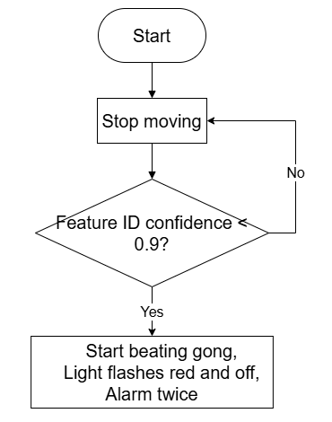
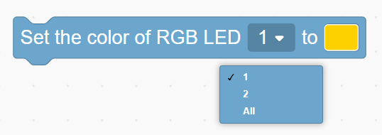
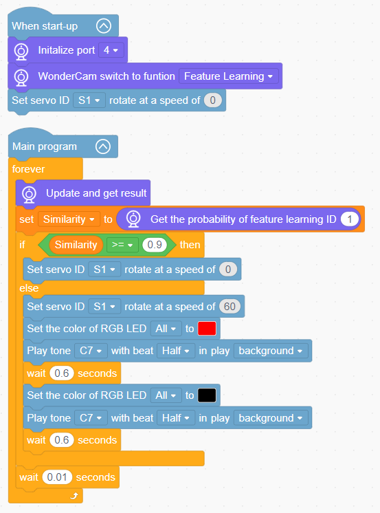

# 3.5 Gong Alarm Bot

## 3.5.1 Lesson Introduction

The Gong Alarm Bot is an intelligent robotic security model. The front of the chassis features the WonderLens vision module as its visual sensor, while the side incorporates a gong mechanism driven by a 360° block motor. The controller houses an onboard buzzer and RGB indicator lights. The modular mechanical structure ensures straightforward assembly and accessible wiring. When the camera detects scene anomalies relative to a baseline reference template, the servo strikes the gong, the buzzer sounds, and the red LED flashes at high frequency, delivering coordinated audio and visual alerts. This project provides practical exploration of AI visual detection and multi-peripheral linked alarm systems.

## 3.5.2 Learning Objectives

1. Master scene feature template training using the WonderLens vision module. Learn methods for reading visual anomalies and feature confidence scores.
2. Program reciprocating striking routines for the 360° block motor, buzzer alarm melodies, and RGB light flashing patterns.
3. Master coordinated programming linking anomaly detection, servo striking, buzzer alerts, and RGB lighting to trigger complete alarm sequences synchronously.
4. Assemble the robotic model and debug the program. Develop foundational skills in building AI visual security and alarm systems.

## 3.5.3 Assembly Guide

<pdf src="../../../../docs/_static/shared/pdf/chapter_3/5.pdf" />

## 3.5.4 Hardware Wiring

Connect the WonderLens vision module cable to the **P4** port of the ESP32 controller.

Connect the 360° block motor cable to the **S1** port of the ESP32 controller, with the servo's **orange** wire plugged into the **white** pin of S1.

Wiring diagram:

## 3.5.5 Programming

### (1) Program Schematic

### (2) Adding Extensions

- Click the **Extensions** button and select the **WonderLens** under the **Sensor** category.

### (3) Core Blocks

| Block | Category | Function Description |
| :---: | :---: | :--- |
|  |  | Compares the value on the left with a custom value and outputs a Boolean result for the greater-than comparison. |
|  |  | Creates a custom variable to store data. |
|  |  | Reads the value stored in the specified variable. |
|  |  | Assigns a custom value to the specified variable. |
|  |  | Plays audio according to custom pitch, beat duration, and playback mode. |
|  |  | Sets the specified onboard RGB light to a custom color. |
|  |  | Controls the servo connected to the specified port to rotate at the set speed. |
|  |  | Switches the AI vision operating mode of the vision module. |
|  |  | Refreshes the camera feed and reads recognition data for the current vision mode. |
|  |  | Reads the confidence score of the learned feature ID in the current frame to determine the match degree. |

### (4) Complete Program

1. Initialization: At startup, initialize the WonderLens vision module at port **P4** and switch the operating mode to feature learning. Set the initial speed of servo **S1** to 0.

2. Main Loop: The program continuously updates and retrieves recognition results from the WonderLens vision module, reading the confidence score of feature ID 1 and storing it in the variable `Similarity`. When `Similarity` is greater than or equal to 0.9, servo **S1** remains stationary. When `Similarity` is less than 0.9, servo **S1** rotates at a speed of 60, the onboard RGB lights illuminate in red, and the buzzer plays tone C7. After a delay of 0.6 s, the lights extinguish, the buzzer plays tone C7 again, and another delay of 0.6 s elapses. Each loop iteration pauses for 0.01 s.

> [!NOTE]
>
> **The program source files can be downloaded from [Program Files](https://drive.google.com/drive/folders/1gpd83ho-Cf-T1LV6VETKvwf1mI7A8Bfg?usp=sharing).**

## 3.5.6 Program Upload

## 3.5.7 Expansion and Challenge

**Challenge Task 1: Multi-Level Alarm via Feature ID Classification**

1. Project Goal: Pre-record two feature template IDs and use recognition confidence scores to distinguish different trigger conditions, producing two tiered audio-visual alarm responses. When feature ID 1 is recognized with a confidence score exceeding 90%, the RGB lights stay solid orange, the buzzer emits a single short beep, and the servo strikes slowly for 5 s. When feature ID 2 is recognized with a confidence score exceeding 90%, the RGB lights flash red at high frequency, the buzzer emits a sustained alarm tone, and the servo strikes continuously at high speed.

2. Implementation Strategy: Use feature recognition and confidence retrieval blocks. Introduce numerical variables to store the detected ID and confidence score, constructing multi-tiered conditional statements. Program distinct servo striking rhythms, buzzer melodies, and RGB lighting patterns for each ID branch.

3. Key Challenges: Reading feature IDs and confidence scores accurately and consistently, isolating multi-level alarm routines to prevent logic interference, and synchronizing lighting, audio, and striking motions without delay.

**Challenge Task 2: Delayed Alarm Deactivation Upon Scene Recovery**

1. Project Goal: When the scene returns to the normal baseline, the bot does not deactivate the alarm immediately. It maintains audio, visual, and striking alerts for an additional 3 s. Once the countdown expires, the lights extinguish, the buzzer mutes, and the servo resets and halts.

2. Implementation Strategy: Introduce a timer variable to start a countdown when the scene returns to normal. Maintain complete alarm routines while the countdown is active. Deactivate all output peripherals once the timer reaches zero.

3. Key Challenges: Ensuring that the countdown routine does not interfere with continuous camera feature detection loops, and synchronizing multiple peripherals without latency.

**Challenge Task 3: Creative Applications of Visual Feature Recognition**

1. Smart Shelf Monitor: Retain the visual feature recognition algorithm, replace the striking servo with a dot matrix display, and display warning text on the screen when shelf items are displaced.

2. Desk Activity Indicator Lamp: Detect changes on a desk surface, automatically illuminate an RGB indicator light, and trigger a brief buzzer notification.

3. Universal Adaptation Strategy: Keep the core feature recognition code unchanged and swap out the output hardware. By adding corresponding peripheral control blocks under the logic of triggering alerts upon detecting scene anomalies or specified features, diverse smart monitoring and security projects can be developed.

## 3.5.8 Q&A

**Question 1: During servo wiring, the orange signal wire must connect to the white pin of port S1. What problems occur if it is wired incorrectly?**

**Answer**: The white pin of port **S1** is dedicated to transmitting PWM control signals, which the servo relies on to determine rotation angle and speed. If the orange signal wire connects to the power or ground pins, the controller cannot transmit control instructions. Two primary failures occur: either the servo remains completely motionless so the hammer cannot strike the gong, or the servo vibrates and rotates erratically, potentially overheating and causing hardware damage. Furthermore, all program code designed to control striking rhythms becomes ineffective, preventing anomaly-triggered gong alarm functionality.

**Question 2: The vision module recognizes scene changes normally and both the buzzer and RGB lights operate, but the striking servo does not move at all. What are the most common causes and troubleshooting steps?**

**Answer**:

1. Wiring Fault: The orange signal wire of the servo is not plugged into the white signal pin of port **S1**. Troubleshooting: Disconnect the power, then verify the three-pin sequence against the wiring diagram.

2. Program Fault: The servo striking code is placed outside the condition branch for detecting scene anomalies. Troubleshooting: Open the program and verify that the servo rotation and delay blocks reside inside the conditional block that executes when scene recognition detects an anomaly.

3. Hardware Damage: The servo itself is defective or port **S1** of the ESP32 controller is damaged. Troubleshooting: Connect a known working servo to port **S1** for testing. If it still fails to move, connect the servo to an alternative servo port on the controller to isolate the issue.

## 3.5.9 Technical Support and Product Discussion

Share project ideas and connect with other makers on the [Hiwonder community](https://forum.hiwonder.com):

