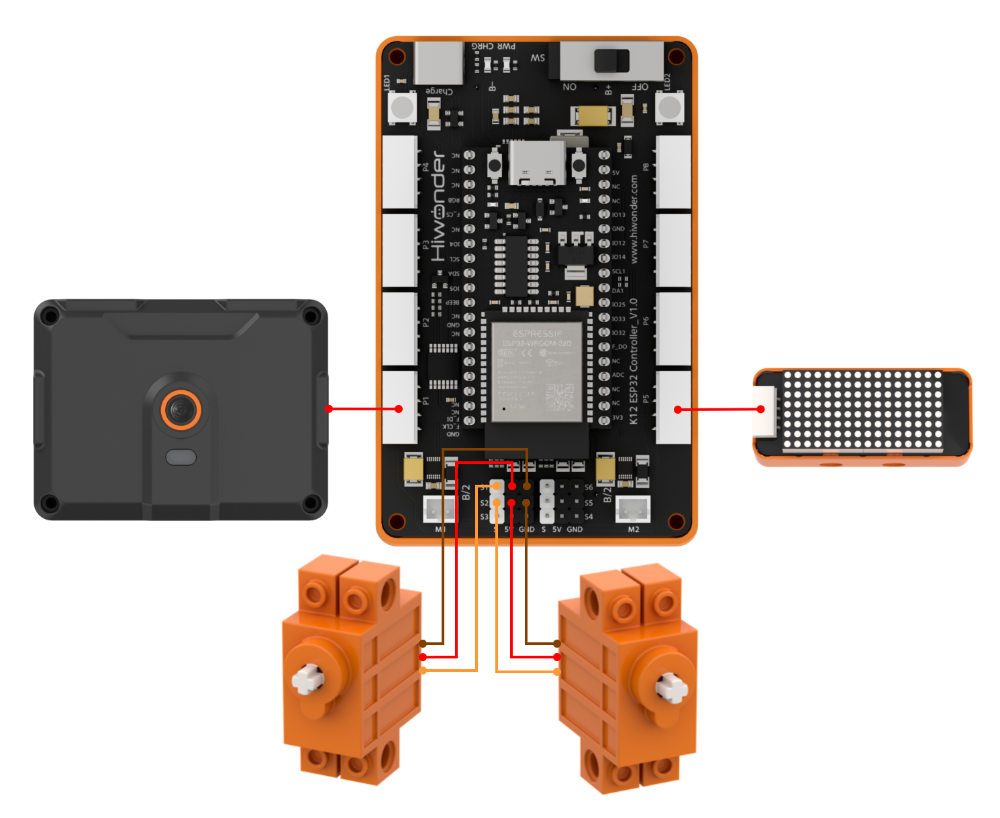
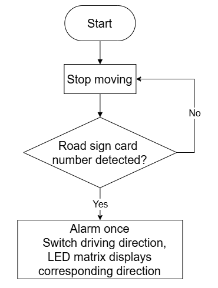
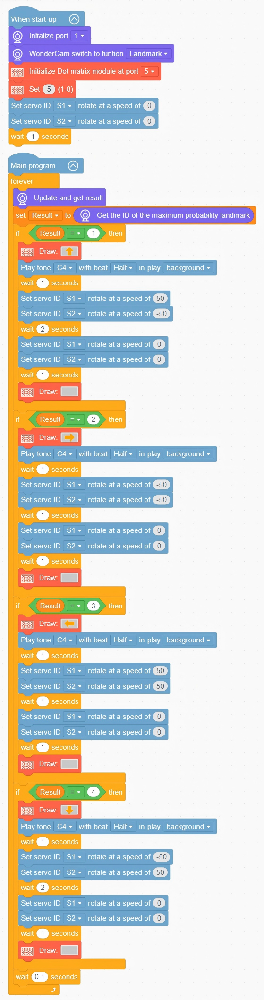

# 3.6 Sign Navigation Car

## 3.6.1 Lesson Introduction

The Sign Navigation Car is an intelligent mobile robotics project. The front of the chassis features the WonderLens vision module serving as visual "eyes", the body incorporates a dot matrix display for directional feedback, and the left and right wheels are driven by two 360° block motors to achieve differential driving. The modular mechanical structure ensures straightforward assembly and accessible wiring. When the camera recognizes traffic sign cards pointing in various directions, the dot matrix display outputs matching directional arrows, and the dual servos execute forward, backward, left turn, and right turn maneuvers. This project demonstrates practical AI traffic sign recognition and dual-servo differential drive locomotion.

## 3.6.2 Learning Objectives

1. Master traffic sign recognition using the WonderLens vision module. Learn methods for reading forward, backward, left turn, and right turn sign signals.
2. Program dual 360° block motor differential drive routines to control fundamental driving maneuvers including forward motion, steering, and reversing.
3. Master directional arrow programming on the dot matrix module. Coordinate traffic sign recognition, directional screen prompts, and dual-servo driving motions.
4. Assemble the robotic car and debug the program. Develop foundational skills in building AI visual navigation mobile robotics.

## 3.6.3 Assembly Guide

<pdf src="../../_static/shared/pdf/chapter_3/6.pdf" />

## 3.6.4 Hardware Wiring

Connect the WonderLens vision module cable to port **P1** of the ESP32 controller.

Connect the dot matrix module cable to port **P5** of the ESP32 controller.

Connect the left 360° block motor cable to port **S1** of the ESP32 controller, with the servo's **orange** wire plugged into the **white** pin of S1.

Connect the right 360° block motor cable to port **S2** of the ESP32 controller, with the servo's **orange** wire plugged into the **white** pin of S2.

Wiring diagram:

## 3.6.5 Programming

### (1) Program Schematic

### (2) Adding Extensions

- Click the **Extensions** button and select the **WonderLens** under the **Sensor** category.

- Click the **Extensions** button and select **Dot matrix module** under the **Output module** category.

### (3) Core Blocks

| Block | Category | Function Description |
| :---: | :---: | :--- |
|  |  | Compares the value on the left with a custom value and outputs a Boolean result for the greater-than comparison. |
|  |  | Creates a custom variable to store data. |
|  |  | Reads the value stored in the specified variable. |
|  |  | Assigns a custom value to the specified variable. |
|  |  | Plays audio according to custom pitch, beat duration, and playback mode. |
|  |  | Controls the servo connected to the specified port to rotate at the set speed. |
|  |  | Adjusts the brightness level of the dot matrix display within the range of 1 to 8. |
|  |  | Draws selected graphic patterns on the dot matrix display. |
|  |  | Switches the AI vision operating mode of the vision module. |
|  |  | Refreshes the camera feed and reads recognition data for the current vision mode. |
|  |  | Extracts the traffic sign ID with the highest confidence score from the recognition results. |

### (4) Complete Program

1. Initialization: At startup, initialize the WonderLens vision module at port **P1** and switch the operating mode to traffic sign recognition. Initialize the dot matrix module at port **P5** and set the brightness level to 5. Set the initial speeds of servos **S1** and **S2** to 0, and pause for 1 s.

2. Main Loop: The program continuously updates and retrieves recognition results from the WonderLens vision module, extracting the traffic sign ID with the highest confidence score and storing it in the variable `Result`. When `Result` equals 1, 2, 3, or 4, the dot matrix display sequentially shows upward, rightward, leftward, or downward arrows, the buzzer plays prompt note C4, and servos **S1** and **S2** rotate at corresponding speeds and durations to execute forward, right turn, left turn, or reverse maneuvers. Upon completing the maneuver, both servos halt, the dot matrix display clears, and each loop iteration pauses for 0.1 s.

> [!NOTE]
>
> **The program source files can be downloaded from [Program Files](https://drive.google.com/drive/folders/1gpd83ho-Cf-T1LV6VETKvwf1mI7A8Bfg?usp=sharing).**

## 3.6.6 Program Upload

## 3.6.7 Expansion and Challenge

**Challenge Task 1: Multi-Sign Navigation Linked with RGB Lighting**

1. Project Goal: Match distinct traffic signs to dedicated RGB lighting effects and driving speeds, stopping the car with a standby prompt when no sign is detected. Forward sign: RGB glows solid green, and the car travels forward at constant speed. Left turn sign: RGB pulses blue, and the car turns left slowly. Right turn sign: RGB pulses orange, and the car turns right slowly. Backward sign: RGB flashes red, and the car reverses at low speed. No valid sign detected: the car pauses in place, and the dot matrix display shows a waiting icon.

2. Implementation Strategy: Retrieve traffic sign recognition results and construct multi-branch conditional statements. Configure corresponding dual-servo differential drive parameters, RGB lighting colors, and dot matrix arrow patterns for each sign branch. Program the empty detection branch to halt the car and display the waiting icon.

3. Key Challenges: Reading traffic signs stably without false triggers, synchronizing locomotion, lighting, and screen graphics smoothly, and maintaining responsive dual-servo execution without system lag.

**Challenge Task 2: Delayed Braking After Sign Disappearance**

1. Project Goal: When a traffic sign moves out of camera view, the car does not halt immediately. It maintains its current motion for 3 s. Once the countdown expires, both servos halt, the RGB lights extinguish, and the dot matrix switches to the waiting icon.

2. Implementation Strategy: Introduce a timer variable to start a countdown when the sign disappears. Maintain ongoing driving motions and lighting effects while the countdown runs. Stop the car, turn off the lights, and display the waiting icon once the timer reaches zero.

3. Key Challenges: Ensuring that the timing routine does not interfere with continuous camera sign detection loops, and synchronizing dual servos, lighting, and display outputs without latency.

**Challenge Task 3: Creative Applications of Traffic Sign Recognition**

1. Smart Directional Signpost: Retain the traffic sign recognition algorithm, omit the drive servos, and pair the system with RGB lights and a dot matrix display to show directional text and change lighting colors upon recognizing signs.

2. Sorting and Classifying Transporter: Recognize distinct marker signs and control a servo-driven paddle to divert items into corresponding sorting zones.

3. Universal Adaptation Strategy: Keep the core traffic sign recognition code unchanged and swap out the output hardware. By adding corresponding peripheral control blocks under the logic of triggering actions upon detecting designated signs, diverse intelligent robotics projects can be developed.

## 3.6.8 Q&A

**Question 1: During servo wiring, the orange signal wire must connect to the white pin of the corresponding S port. What problems occur if it is wired incorrectly?**

**Answer**: The white pins of ports **S1** and **S2** are dedicated to transmitting PWM control signals, which the servos rely on to determine rotation angles and speeds. If the orange signal wire connects to the power or ground pins, the controller cannot transmit control instructions. Two primary failures occur: either the wheel servo on that side remains completely motionless so the car cannot travel straight or steer, or the servo vibrates and rotates erratically, potentially overheating and causing hardware damage. Furthermore, all program code designated to control car driving and steering becomes ineffective, preventing sign-guided autonomous navigation.

**Question 2: The vision module recognizes traffic signs normally and the dot matrix display shows directional arrows, but the car wheels do not move at all. What are the most common causes and troubleshooting steps?**

**Answer**:

1. Wiring Fault: The orange signal wires of the left and right servos are not plugged into the white signal pins of ports **S1** and **S2** respectively. Troubleshooting: Disconnect the power, then verify the three-pin sequence on both sides against the wiring diagram.

2. Program Fault: The dual-servo differential drive code is placed outside the condition branch for detecting valid traffic signs. Troubleshooting: Open the program and verify that the left and right servo control and delay blocks reside inside the conditional block that executes when traffic sign recognition succeeds.

3. Hardware Damage: One or both servos are defective or ports **S1** and **S2** of the ESP32 controller are damaged. Troubleshooting: Connect a known working servo to ports **S1** and **S2** for testing. If it still fails to move, connect the servo to an alternative servo port on the controller to isolate the issue.

## 3.6.9 Technical Support and Product Discussion

Share project ideas and connect with other makers on the [Hiwonder community](https://forum.hiwonder.com):

