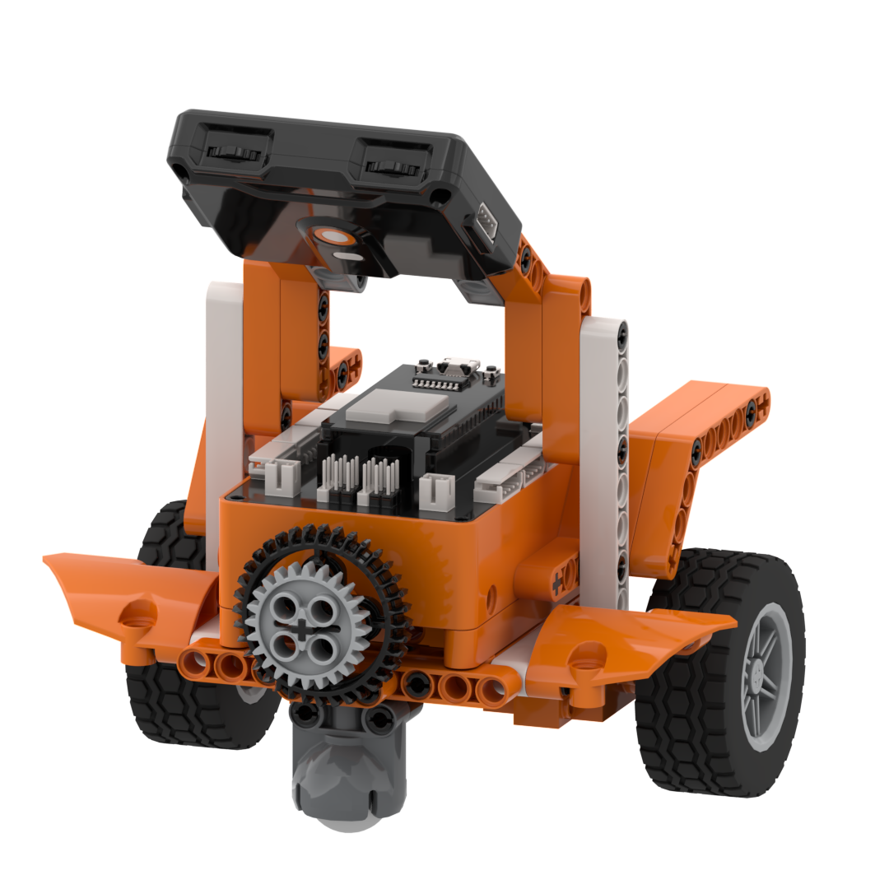
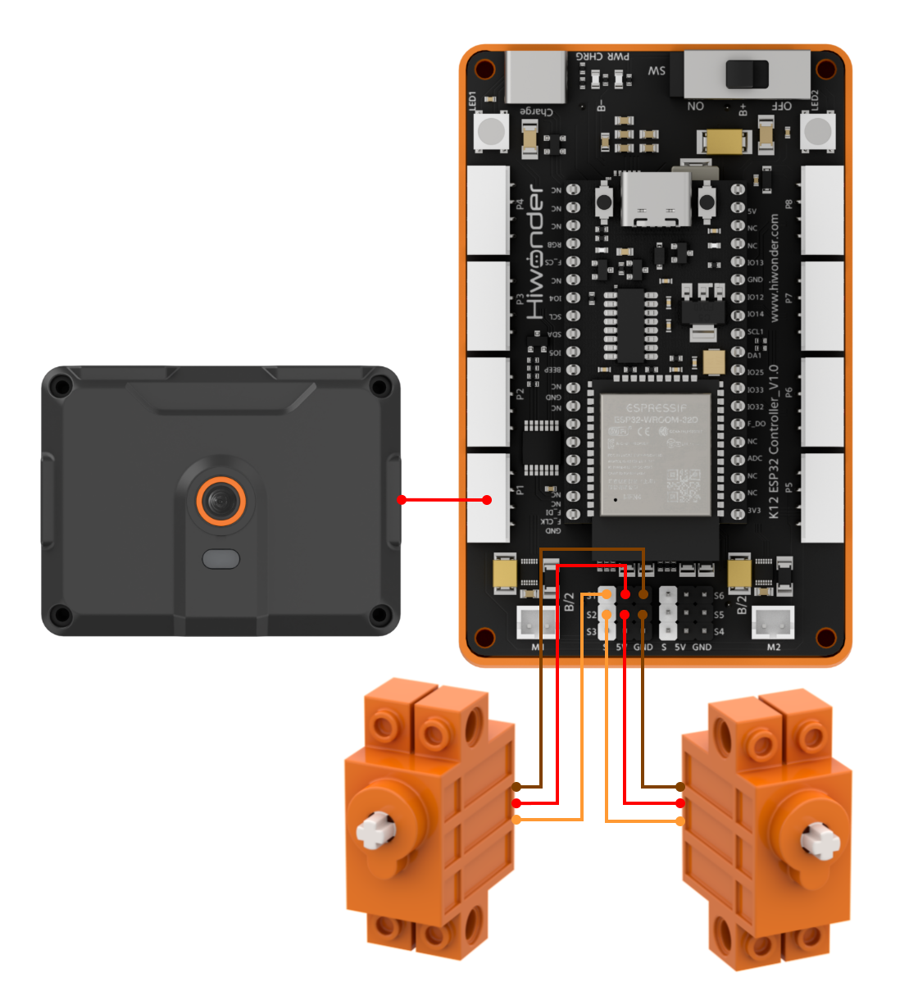
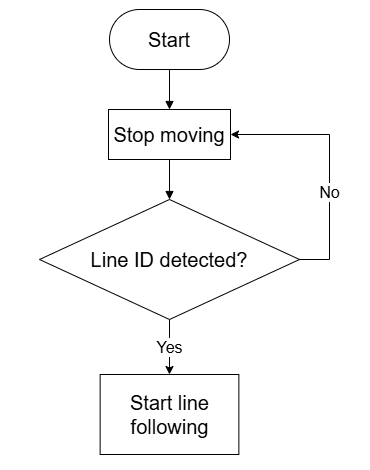
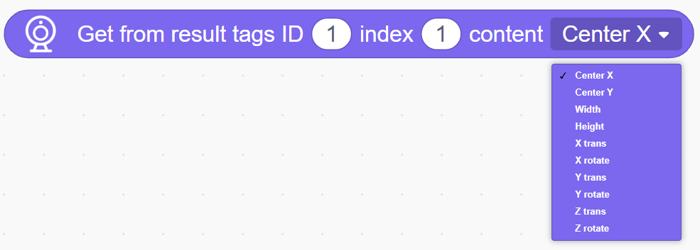
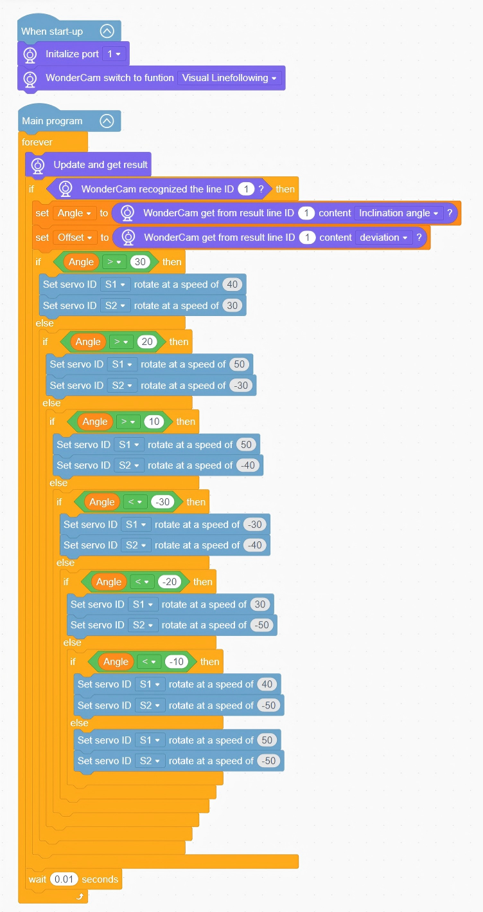

# 3.7 Vision Line Tracker

## 3.7.1 Lesson Introduction

The Vision Line Tracker is an intelligent mobile robotics project built with modular blocks. The front of the chassis features the WonderLens vision module as its visual camera to detect guiding paths, while the left and right wheels are driven by two 360° block motors to achieve differential drive locomotion. The modular mechanical design ensures straightforward assembly and accessible wiring. When the camera captures the black elliptical track and reads track offset values, the program dynamically adjusts dual-servo speeds to correct body posture, guiding the car smoothly along the line. This project demonstrates practical AI visual trajectory detection and closed-loop differential drive control.

## 3.7.2 Learning Objectives

1. Master line following using the WonderLens vision module. Learn methods for reading black line coordinates and offset data.
2. Program dual 360° block motors differential drive routines. Adjust left and right servo rotation speeds to correct driving orientation.
3. Master closed-loop line following logic programming to achieve stable and autonomous navigation along a black elliptical track.
4. Assemble the robotic car model and debug line following algorithms. Develop foundational skills in building AI visual line following projects.

## 3.7.3 Assembly Guide

<pdf src="../../../../docs/_static/shared/pdf/chapter_3/7.pdf" />

## 3.7.4 Hardware Wiring

Connect the WonderLens vision module cable to the **P1** port of the ESP32 controller.

Connect the left 360° block motor cable to the **S1** port of the ESP32 controller, with the servo's **orange** wire plugged into the **white** pin of S1.

Connect the right 360° block motor cable to the **S2** port of the ESP32 controller, with the servo's **orange** wire plugged into the **white** pin of S2.

Wiring diagram:

## 3.7.5 Programming

### (1)  Program Schematic

### (2) Adding Extensions

- Click the **Extensions** button and select the **WonderLens** under the **Sensor** category.

### (3) Core Blocks

| Block | Category | Function Description |
| :---: | :---: | :--- |
|  |  | Compares the value on the left with a custom value and outputs a Boolean result for the greater-than comparison. |
|  |  | Creates a custom variable to store data. |
|  |  | Reads the data stored in a custom variable. |
|  |  | Assigns a custom value to the specified variable. |
|  |  | Controls the servo connected to the specified port to rotate at the set speed. |
|  |  | Switches the AI vision operating mode of the vision module. |
|  |  | Refreshes the camera feed and reads recognition data for the current vision mode. |
|  |  | Detects whether a line appears in the camera frame and returns a Boolean result. |
|  |  | Determines whether a line with the specified ID is recognized and returns a Boolean result. |
|  |  | Reads the selected coordinates, angle, or offset data corresponding to the line with the specified ID. |

### (4)  Complete Program

1. Initialization: At startup, initialize the WonderLens vision module at port **P1** and switch the operating mode to line following.

2. Main Loop: The program continuously updates and retrieves recognition data from the WonderLens vision module. When line ID 1 is recognized, the program stores the detected line angle into the variable `Angle` and the line offset into the variable `Offset`.

   - When `Angle` > 30, servo **S1** rotates at a speed of 40 and servo **S2** rotates at a speed of 30.

   - When 20 < `Angle` <= 30, servo **S1** rotates at a speed of 50 and servo **S2** rotates at a speed of -30.

   - When 10 < `Angle` <= 20, servo **S1** rotates at a speed of 50 and servo **S2** rotates at a speed of -40.

   - When `Angle` < -30, servo **S1** rotates at a speed of -30 and servo **S2** rotates at a speed of -40.

   - When -30 <= `Angle` < -20, servo **S1** rotates at a speed of 30 and servo **S2** rotates at a speed of -50.

   - When -20 <= `Angle` < -10, servo **S1** rotates at a speed of 40 and servo **S2** rotates at a speed of -50.

   - When -10 <= `Angle` <= 10, servo **S1** rotates at a speed of 50 and servo **S2** rotates at a speed of -50.

   Each loop iteration pauses for 0.01 s.

> [!NOTE]
>
> **The program source files can be downloaded from [Program Files](https://drive.google.com/drive/folders/1gpd83ho-Cf-T1LV6VETKvwf1mI7A8Bfg?usp=sharing).**

### (5) Track Preparation

Prepare electrical tape and paste the corresponding line-following track on the desktop according to the diagram. After laying out the track, upload the program to the controller and place the car on the black line for testing and verification.

> [!NOTE]
>
> **Using black electrical tape on a white or light-colored wooden desktop is recommended for optimal contrast.**

## 3.7.6 Program Upload

## 3.7.7 Expansion and Challenge

**Challenge Task 1: RGB Lighting Line Status Alert and Automatic Stop at Finish Line**

1. Project Goal: Match distinct line offset states to dedicated RGB lighting feedback, stopping the car with audio and visual alerts upon recognizing the finish line marker. When the car aligns with the center of the track, the RGB lights glow solid green. When the track offsets to the left, the left RGB light flashes as an alert. When the track offsets to the right, the right RGB light flashes as an alert. When the camera detects the finish line marker, the car halts immediately, the buzzer plays a prompt tone, and the RGB lights glow in full color.

2. Implementation Strategy: Read the line offset coordinates and construct multi-branch conditional statements. Bind corresponding RGB lighting logic to centered, left-offset, and right-offset states. Add a conditional branch for finish marker feature recognition to stop both servos, activate buzzer sound effects, and illuminate the RGB lights upon triggering.

3. Key Challenges: Reading line offset data stably in real time, switching lighting effects synchronously with track deviations, preventing conflicts between finish line detection and line following logic, and running multiple peripherals smoothly without lag.

**Challenge Task 2: Delayed Braking Protection Upon Track Loss**

1. Project Goal: When the car completely deviates from the black track, the wheels do not lock immediately. The car maintains low-speed steering adjustments for 3 s. Once the countdown expires, both servos halt and all RGB lights extinguish to prevent the car from driving off the course.

2. Implementation Strategy: Introduce a timer variable to start a countdown when the camera no longer detects the black line. Maintain low-speed minor directional adjustments while the countdown runs. Stop the servos and turn off the RGB lights once the timer reaches zero.

3. Key Challenges: Ensuring that the timing routine does not interrupt continuous camera line detection, and coordinating speed control, lighting, and timer logic without interference.

**Challenge Task 3: Creative Applications of Track Recognition Beyond the Vision Line Tracker**

1. Track-Sorting Robot: Retain the visual line following recognition code, replace the dual-servo drive mechanism with a sorting paddle, and identify materials along the track to push them into categorized bins.

2. Path-Tracking Indicator: Omit the drive servos, pair the system with a dot matrix display and RGB lights, and track line deviations to display text alerts.

3. Universal Adaptation Strategy: Keep the core black line recognition code unchanged and replace the output hardware. By adding corresponding peripheral control blocks under the logic of adjusting actuator motions based on detected track offsets, diverse intelligent robotics projects can be developed.

## 3.7.8 Q&A

**Question 1: During servo wiring, the orange signal wire must connect to the white pin of the corresponding S port. What problems occur if it is wired incorrectly?**

**Answer**: The white pins of ports **S1** and **S2** are dedicated to transmitting control signals, which the servos rely on to regulate wheel rotation speeds and directions. If the orange signal wire connects to the power or ground pins, the controller cannot transmit control instructions. Two primary failures occur: either the wheel servo on that side remains completely motionless so the car cannot correct its trajectory or follow lines normally, or the servo vibrates and rotates erratically, potentially overheating and causing hardware damage. Furthermore, all program code designed to manage differential speed regulation and trajectory correction becomes ineffective, preventing autonomous line following.

**Question 2: The vision module recognizes the black track normally, but the left and right wheels do not move at all. What are the most common causes and troubleshooting steps?**

**Answer**:

1. Wiring Fault: The orange signal wires of the left and right servos are not plugged into the white signal pins of ports **S1** and **S2** respectively. Troubleshooting: Disconnect the power, then verify the three-pin sequence on both sides against the wiring diagram.

2. Program Fault: The dual-servo differential drive and trajectory correction code is placed outside the loop branch that executes when the black track is detected. Troubleshooting: Open the program and move the left and right servo speed control and delay blocks inside the conditional branch for valid trajectory recognition.

3. Hardware Damage: One or both servos are defective or ports **S1** and **S2** of the ESP32 controller are damaged. Troubleshooting: Connect a known working servo to ports **S1** and **S2** for testing. If it still fails to move, connect the servo to an alternative servo port on the controller to isolate the issue.

## 3.7.9 Technical Support and Product Discussion

Share project ideas and connect with other makers on the [Hiwonder community](https://forum.hiwonder.com):

