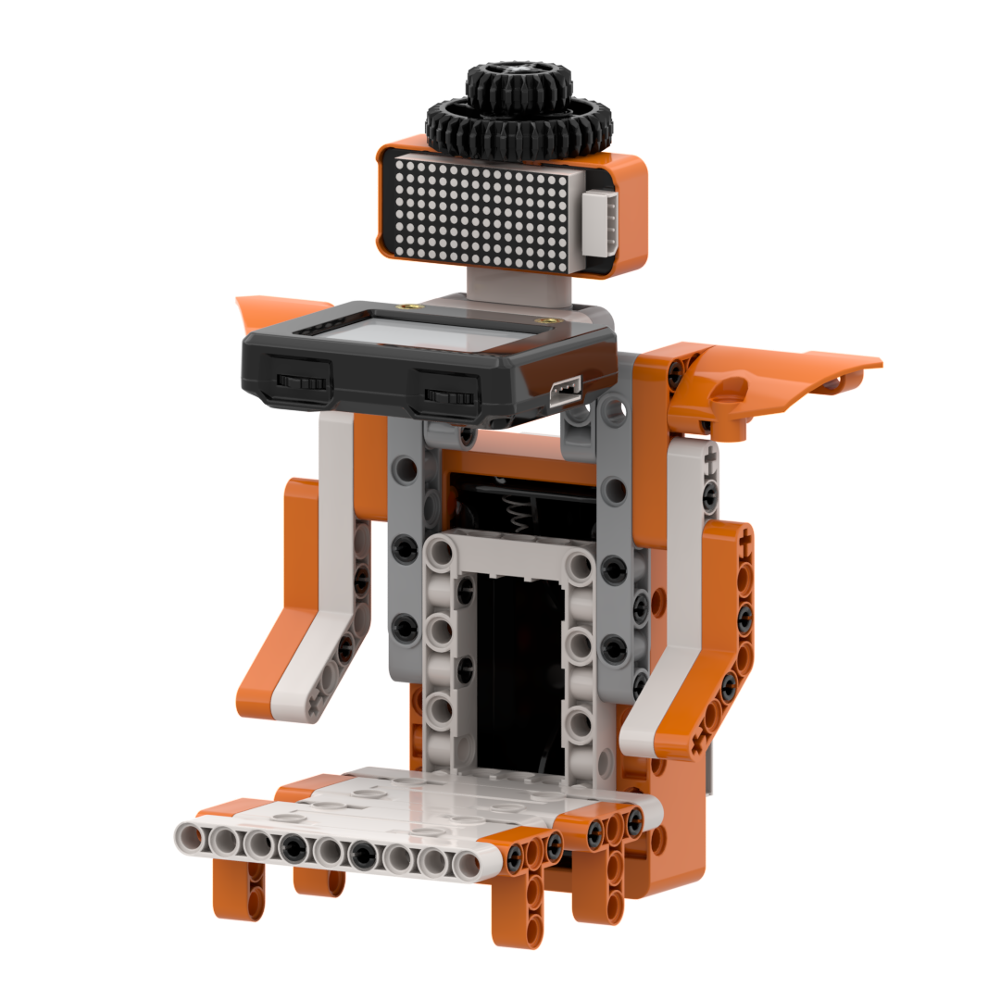
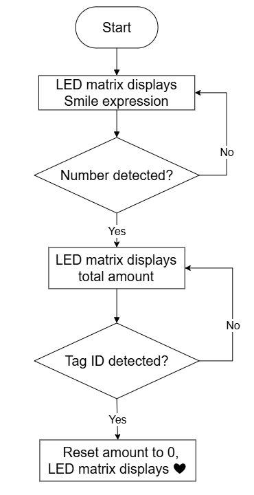
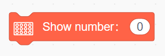
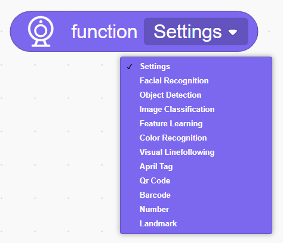
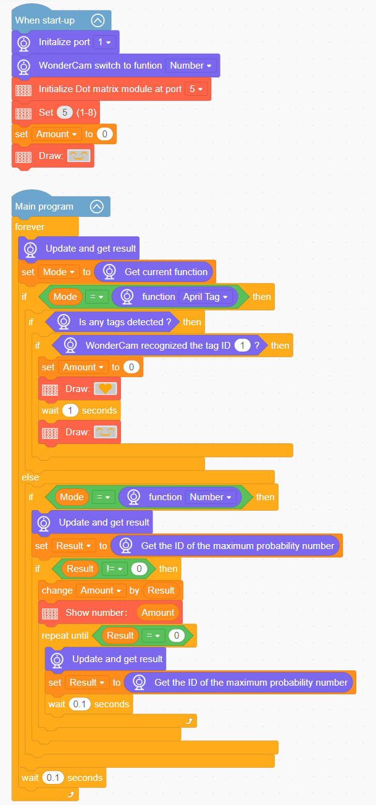

# 3.8 Smart Self-Checkout

## 3.8.1 Lesson Introduction

The Smart Self-Checkout is an intelligent simulated retail model built with modular blocks. The front of the unit incorporates the WonderLens vision module as its visual camera, while the chassis features a dot matrix display to present graphical interactions. The modular mechanical design ensures straightforward assembly and accessible wiring. Upon power-up, the dot matrix display outputs a smiling face icon. When the camera identifies numeric product tags, the system accumulates and displays the total expenditure. Upon recognizing checkout tag ID 1, the bill resets to zero and the screen switches to a heart icon to signify completed payment. This project provides practical exploration of AI tag recognition, variable accumulation, and dynamic screen interaction.

## 3.8.2 Learning Objectives

1. Master number and tag recognition using the WonderLens vision module. Learn methods for reading tag IDs and retrieving recognition data.
2. Program hybrid text and pattern displays on the dot matrix module to alternate among numeric totals, smiling face icons, and heart symbols.
3. Master numerical variable accumulation and multi-mode conditional logic programming, distinguishing between item billing and checkout reset workflows.
4. Assemble the checkout model and debug the program. Develop foundational skills in building interactive AI vision billing systems.

## 3.8.3 Assembly Guide

<pdf src="../../_static/shared/pdf/chapter_3/8.pdf" />

## 3.8.4 Hardware Wiring

Connect the WonderLens vision module cable to the **P1** port of the ESP32 controller.

Connect the dot matrix module cable to the **P5** port of the ESP32 controller.

Wiring diagram:

## 3.8.5 Programming

### (1) Program Schematic

### (2) Adding Extensions

- Click the **Extensions** button and select the **WonderLens** under the **Sensor** category.

- Click the **Extensions** button and select **Dot matrix module** under the **Output module** category.

### (3) Core Blocks

| Block | Category | Function Description |
| :---: | :---: | :--- |
|  |  | Compares the value on the left with a custom value and outputs a Boolean result for the greater-than comparison. |
|  |  | Creates a custom variable to store data. |
|  |  | Reads the data stored in a custom variable. |
|  |  | Assigns a custom value to the specified variable. |
|  |  | Adjusts the brightness of the dot matrix display to a specified level from 1 to 8. |
|  |  | Displays custom numbers on the dot matrix display. |
|  |  | Draws the selected pattern on the dot matrix display. |
|  |  | Switches the AI vision operating mode of the vision module. |
|  |  | Switches the vision module to a custom AI vision recognition mode. |
|  |  | Reads the name of the currently active vision mode. |
|  |  | Refreshes the camera feed and reads recognition data for the current vision mode. |
|  |  | Detects whether a tag appears in the camera frame and returns a Boolean result. |
|  |  | Determines whether a tag with the specified ID is recognized and returns a Boolean result. |
|  |  | Extracts the number with the highest confidence score from the number recognition results. |

### (4) Complete Program

1. Initialization: At startup, initialize the WonderLens vision module at port **P1** and switch the operating mode to number recognition. Initialize the dot matrix module at port **P5** and set its brightness level to 5. Define variable `Amount` and initialize it to 0, then display a smiling face icon on the dot matrix screen.

2. Main Loop: The program continuously updates and retrieves recognition results from the WonderLens vision module, reading the active vision mode into variable `Mode`.

   - When `Mode` is set to tag recognition: If tag ID 1 is recognized, `Amount` is reset to 0, and the dot matrix display sequentially shows a heart icon followed by a smiling face icon.

   - When `Mode` is set to number recognition: The program extracts the number with the highest confidence score into variable `Result`. When `Result` is not equal to 0, `Amount` accumulates this value, and the dot matrix module displays the current `Amount`. Recognition continues until `Result` returns to 0.

   Each loop iteration pauses for 0.1 s.

> [!NOTE]
>
> **The program source files can be downloaded from [Program Files](https://drive.google.com/drive/folders/1gpd83ho-Cf-T1LV6VETKvwf1mI7A8Bfg?usp=sharing).**

## 3.8.6 Program Upload

## 3.8.7 Expansion and Challenge

**Challenge Task 1: Multi-Item Unit Price Automated Billing System**

1. Project Goal: Assign an individual fixed unit price to each numerical item ID. Scanning distinct item tags retrieves the corresponding price and adds it to the running total on the screen, replicating commercial supermarket checkout logic.

2. Implementation Strategy: Establish a lookup association between IDs and unit prices, and introduce a total expenditure variable. When scanning item tags, fetch the matching price, add it to the total, and refresh the dot matrix display. Upon scanning checkout ID 1, clear the total expenditure and show a heart icon to finalize the transaction.

3. Key Challenges: Allowing repeated scans of the same item for successive addition, ensuring flicker-free numerical updates on the screen, and preventing execution conflicts between pricing and checkout branches.

**Challenge Task 2: Inactivity Timeout and Automatic Order Cancellation**

1. Project Goal: If no checkout tag is detected within 10 s after scanning items, the system automatically clears the accumulated amount and switches the dot matrix screen back to the standby smiling face icon, simulating an automated checkout timeout reset.

2. Implementation Strategy: Introduce a timer variable to start a countdown once an item is scanned. Allow additional item scanning to refresh the total and reset the timer during countdown. Once the timer reaches zero without further input, clear the total amount and restore the smiling face standby display.

3. Key Challenges: Automatically resetting the countdown when a new item is scanned, and running timer routines without impeding camera tag detection loops.

**Challenge Task 3: Creative Applications of Tag and Number Recognition Beyond the Self-Checkout**

1. Smart Library Book Return Kiosk: Retain core tag recognition code, pair the system with a dot matrix display, and scan book tags to show titles and increment circulation counts.

2. Inventory Counter: Identify material tags to tally inventory quantities and display live totals on screen.

3. Universal Adaptation Strategy: Keep core tag and number recognition routines intact, update screen outputs, and integrate numerical calculation logic. By applying the principle of executing arithmetic and UI updates upon tag recognition, diverse statistical interactive robotics projects can be constructed.

## 3.8.8 Q&A

**Question 1: The dot matrix display shows nothing while the vision module recognizes tags normally. What are the potential causes and troubleshooting steps?**

**Answer**:

1. Wiring Fault: The dot matrix cable is not connected to port **P5** of the ESP32 controller, or the pins are loose or reversed. Troubleshooting: Disconnect the power, reseat the cable into port **P5** according to the wiring diagram, and verify pin sequence.

2. Program Fault: The dot matrix extension library was omitted, or display blocks are placed outside the main execution loop. Troubleshooting: Verify that the extension is loaded, and ensure that smiling face, amount, and heart display blocks reside inside the active loop.

3. Hardware Damage: The dot matrix module is defective or port **P5** of the controller is damaged. Troubleshooting: Connect a known working dot matrix module to port **P5** for testing. If it still fails to illuminate, test with an alternative output port on the controller.

**Question 2: Scanning product tags accumulates amounts normally, but scanning checkout tag ID 1 fails to reset the total and does not display the heart icon. What are the causes and troubleshooting steps?**

**Answer**:

1. Program Logic Fault: The condition branch for checkout tag ID 1 omits the instructions to reset the amount variable or show the heart icon. Troubleshooting: Locate the tag evaluation block and insert instructions to set `Amount` to 0 and render the heart pattern under the ID 1 branch.

2. Recognition Stability Issue: The checkout tag is positioned at an unfavorable angle or under poor lighting, causing tag ID 1 recognition to fail. Troubleshooting: Adjust tag distance and lighting conditions, then scan multiple times to confirm stable reading by the vision module.

3. Branch Conflict Fault: Product item evaluation precedes and overrides the checkout branch, disrupting execution order. Troubleshooting: Reorder the multi-branch conditional structure so that checkout tag ID evaluation takes priority before item billing routines execute.

## 3.8.9 Technical Support and Product Discussion

Share project ideas and connect with other makers on the [Hiwonder community](https://forum.hiwonder.com):

