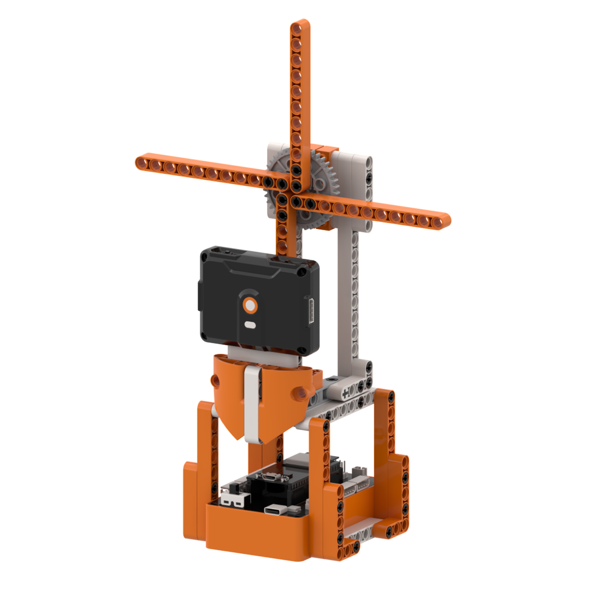
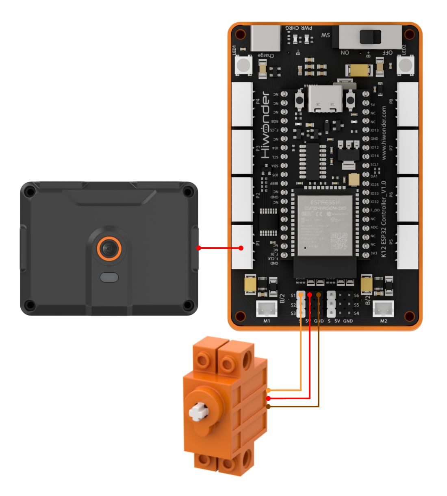
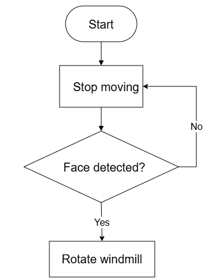
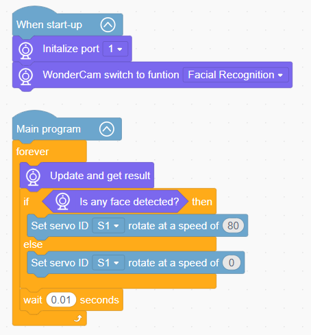

# 3.9 Face Sensing Windmill

## 3.9.1 Lesson Introduction

The Face Sensing Windmill is an engaging interactive robotics project built with modular blocks. The front of the support stand features the WonderLens vision module as its visual camera, while the central rotating shaft connects to a 360° block motor to drive the windmill blades. The modular mechanical design ensures straightforward assembly and accessible wiring. When the camera detects a face in the frame, the servo drives the blades to rotate continuously. When the face moves out of camera view, the windmill halts immediately, implementing responsive face-sensing start-stop interaction. This project provides hands-on exploration of AI face detection and servo speed coordination.

## 3.9.2 Learning Objectives

1. Master face detection using the WonderLens vision module. Learn methods for reading and verifying face position, count, and ID signals.
2. Program speed and direction control routines for the 360° block motor, adjusting rotation parameters and motion patterns.
3. Master closed-loop control linking face detection states with servo motion, dynamically regulating blade speed based on face counts and IDs.
4. Assemble the windmill model and debug the program. Develop foundational skills in creating interactive AI face-activated robotics projects.

## 3.9.3 Assembly Guide

<pdf src="../../../../docs/_static/shared/pdf/chapter_3/9.pdf" />

## 3.9.4 Hardware Wiring

Connect the WonderLens vision module cable to the **P1** port of the ESP32 controller.

Connect the 360° block motor cable to the **S1** port of the ESP32 controller, with the servo's **orange** wire plugged into the **white** pin of S1.

Wiring diagram:

## 3.9.5 Programming

### (1) Program Schematic

### (2) Adding Extensions

- Click the **Extensions** button and select the **WonderLens** under the **Sensor** category.

### (3) Core Blocks

| Block | Category | Function Description |
| :---: | :---: | :--- |
|  |  | Controls the servo connected to the specified port to rotate at the set speed. |
|  |  | Switches the AI vision operating mode of the vision module. |
|  |  | Refreshes the camera feed and reads recognition data for the current vision mode. |
|  |  | Detects whether a face appears in the camera frame and returns a Boolean result. |

### (4) Complete Program

1. Initialization: At startup, initialize the WonderLens vision module at port **P1** and switch the operating mode to face recognition.

2. Main Loop: The program continuously updates and retrieves recognition results from the WonderLens vision module, evaluating whether any face is detected. If a face is detected, servo **S1** rotates at a speed of 80. Otherwise, the speed of servo **S1** is set to 0. Each loop iteration pauses for 0.01 s.

> [!NOTE]
>
> **The program source files can be downloaded from [Program Files](https://drive.google.com/drive/folders/1gpd83ho-Cf-T1LV6VETKvwf1mI7A8Bfg?usp=sharing).**

## 3.9.6 Program Upload

## 3.9.7 Expansion and Challenge

**Challenge Task 1: Multi-Face and Recognized ID Tiered Speed Regulation with RGB Lighting**

1. Project Goal: Match distinct windmill rotation speeds and lighting effects based on face count and identity, stopping the windmill when no face is present. Single face: the servo rotates at low speed. Multiple faces: the servo rotates at high speed. Enrolled familiar face ID: the servo rotates at high speed while RGB lights cycle and flash. No face detected: the servo halts and the lights turn off.

2. Implementation Strategy: Retrieve face count and face ID data, define numeric variables to store values, and construct multi-tiered conditional statements. Configure corresponding servo speeds and RGB lighting programs for single, multiple, and familiar face branches, while assigning stop and power-off logic to the empty detection branch.

3. Key Challenges: Maintaining stable face count and ID readings without jitter, switching speeds smoothly without sudden jerking, and synchronizing lighting effects with windmill motion.

**Challenge Task 2: Delayed Windmill Deceleration Upon Face Disappearance**

1. Project Goal: When a face moves out of camera view, the windmill does not stop abruptly. It continues spinning at its current speed for 3 s. Once the countdown expires, the servo decelerates to a halt and the lights extinguish.

2. Implementation Strategy: Introduce a timer variable to start a countdown when the face disappears. Maintain blade rotation and lighting while the countdown runs. Stop the servo and turn off the lights once the timer reaches zero.

3. Key Challenges: Running the countdown routine without interrupting continuous camera face detection, ensuring that speed control, lighting, and timer logic operate without conflict.

**Challenge Task 3: Creative Applications of Face Detection Beyond the Windmill**

1. Smart Face-Sensing Rotating Display Stand: Retain core face detection routines, drive an exhibition pedestal slowly with a servo, and automatically initiate rotation when a visitor approaches.

2. Face-Activated Ambient Lamp: Omit the servo, pair the system with RGB LED light strips, and automatically switch lighting gradient modes upon detecting individuals.

3. Universal Adaptation Strategy: Keep core face detection routines unchanged and swap out output hardware. By adding corresponding peripheral control blocks under the principle of triggering specific actions upon detecting faces, diverse interactive smart robotics projects can be constructed.

## 3.9.8 Q&A

**Question 1: During servo wiring, the orange signal wire must connect to the white pin of port S1. What problems occur if it is wired incorrectly?**

**Answer**: The white pin of port **S1** is dedicated to transmitting control signals, which the servo relies on to regulate blade rotation speed and start-stop behavior. If the orange signal wire connects to the power or ground pins, the controller cannot transmit control instructions. Two primary failures occur: either the servo remains completely motionless so the windmill cannot spin, or the servo vibrates and rotates erratically, potentially overheating and causing hardware damage. Furthermore, all program code designed to manage windmill rotation and speed regulation becomes ineffective, preventing face-sensing operation.

**Question 2: The camera recognizes faces normally, but the windmill servo does not rotate at all. What are the most common causes and troubleshooting steps?**

**Answer**:

1. Wiring Fault: The orange signal wire of the servo is not plugged into the white signal pin of port **S1**. Troubleshooting: Disconnect the power, then verify the three-pin sequence against the wiring diagram.

2. Program Fault: The servo rotation and speed control blocks are placed outside the conditional branch that executes when a face is detected. Troubleshooting: Open the program and move the servo speed control and delay blocks inside the branch for successful face recognition.

3. Hardware Damage: The servo is defective or port **S1** of the ESP32 controller is damaged. Troubleshooting: Connect a known working servo to port **S1** for testing. If it still fails to move, connect the servo to an alternative servo port on the controller to isolate the issue.

## 3.9.9 Technical Support and Product Discussion

Share project ideas and connect with other makers on the [Hiwonder community](https://forum.hiwonder.com):

