# 4. Software and Hardware Guide

## 4.1 ESP32 Controller

### 4.1.1 ESP32 Controller Overview

This smart controller is powered by an ESP32 core and supports both graphical programming and Python programming. Encased in a PC plastic shell, it integrates onboard PWM servo ports, motor ports, programmable buttons, a buzzer, and other electronic modules. It also reserves multiple sensor interfaces, offering high expandability. Standardized with 4-pin anti-reverse connectors, it is compatible with the full range of Hiwonder sensors for safe and convenient use.

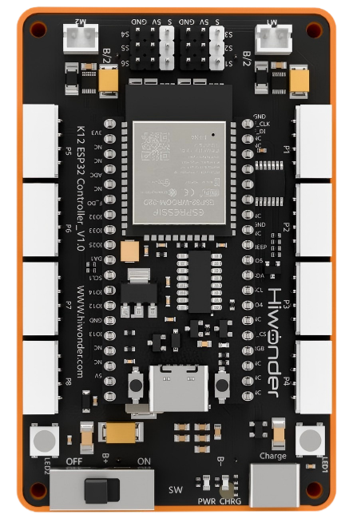

### 4.1.2 Port and Feature Layout

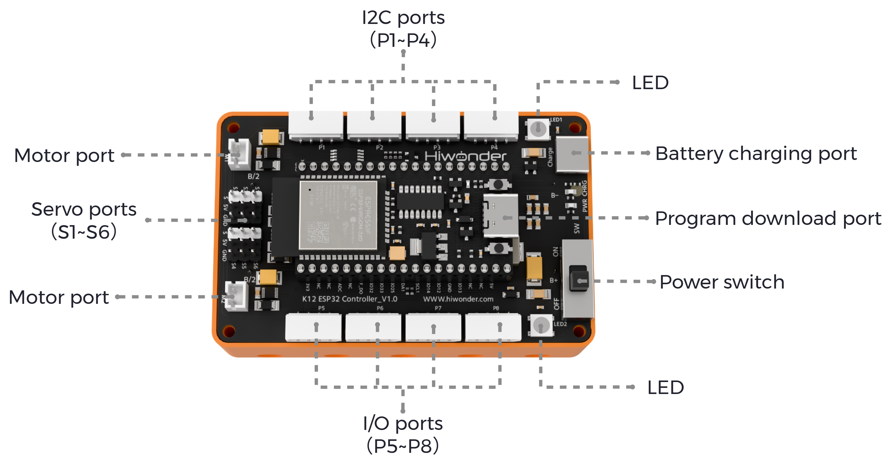

### 4.1.3 Technical Specifications

| Parameter | Specification |
| :---: | :---: |
| Product name | ESP32 controller |
| Dimensions | 88.0 × 55.5 × 42.5 mm |
| Charging voltage | 5 V |
| Charging current | 1,500 mA |
| Charging time | 3.5 h |
| Battery capacity | 1,200 mAh, 3.7 V lithium battery × 2 |
| Maximum operating voltage | 8.4 V |
| Rated operating voltage | 7.4 V |

## 4.2 WonderCode Programming Software

### 4.2.1 Platform Overview

WonderCode is a dedicated Scratch-based programming software tool for Hiwonder products. The software supports automatic conversion between graphical blocks and Python code. Dragging and dropping instruction blocks enables program development, making the platform ideal for beginners learning to code.

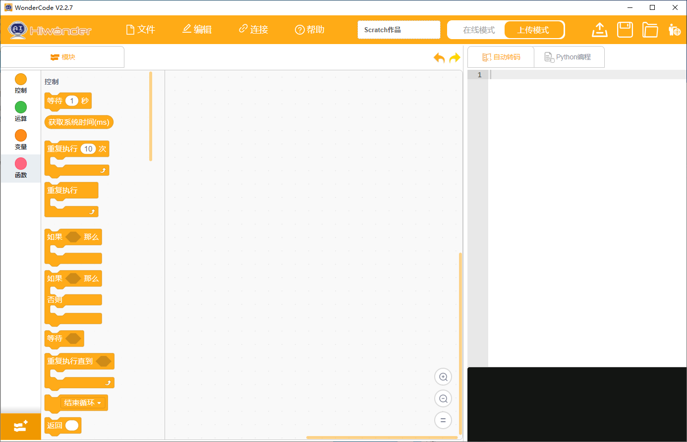

### 4.2.2 Downloading the Programming Software

- [WonderCode (Windows Version)](https://hiwonder.com.cn/download/pcSoftware?get_pc=1&os=windows)

- [WonderCode (Mac Version)](https://hiwonder.com.cn/download/pcSoftware?get_pc=1&os=mac)

### 4.2.3 Platform Interface

The following diagram illustrates the functional areas of the WonderCode software: ① Menu Bar, ② Block Palette, ③ Script Area, ④ Code Display and Upload Area.

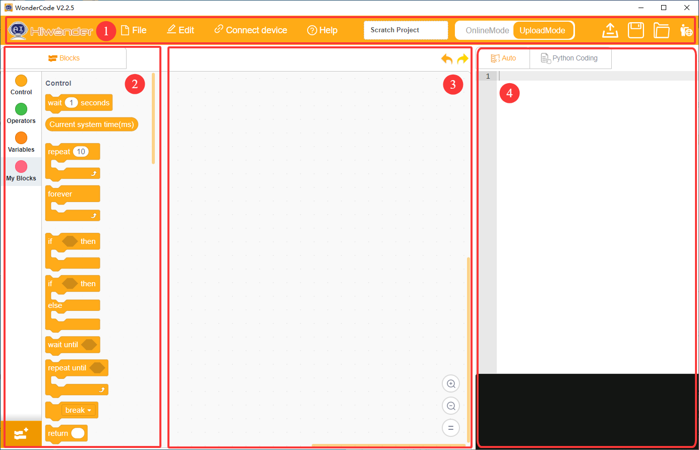

The corresponding functions are detailed in the table below:

| Icon | Function |
| :---: | :--- |
|  | Create, save, and open project files. |
|  | Used for Online Mode. Provided for reference only, no mastery required. |
|  | Manage connection between device and software, and select the serial port. |
|  | Access help documentation, check for software updates, and install device drivers. |
|  | Displays the project file name. When no project has been started or the file is unsaved, displays "Scratch Project". |
|  | Mode toggle button. Switches between Online Mode and Upload Mode. |
|  | Selects the interface display language, supporting English. |
|  | Undo or redo operations during programming. |
|  | Code mode switch. Auto automatically converts block programs into Python code. Switching to Python Coding allows direct program editing in Python. |
|  | Saves the project as a Python code file. |
|  | Opens an existing Python file. |
|  | Facilitates device interaction and uploads the program to the controller board. |
|  | Adds device hardware extension packages. |
|  | Controls zooming in, zooming out, and resetting the default zoom level of the code editing area from top to bottom. |

### 4.2.4 Basic Blocks

| Block | Category | Function |
| :---: | :---: | :--- |
| 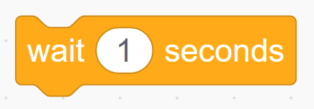 |  | Pauses program execution for a specified duration before continuing to subsequent code, providing action intervals and timing buffers. |
|  |  | Reads the total elapsed milliseconds since device power-on, used for timing and delay logic. |
| 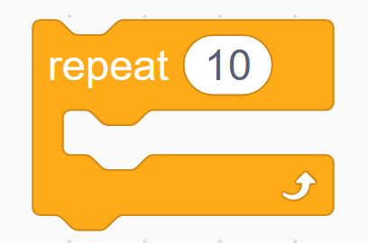 |  | Executes internal code for a specified number of iterations before exiting the loop. |
|  |  | Executes internal nested blocks continuously in an infinite loop. |
| 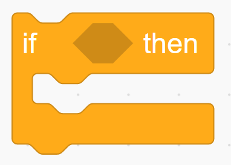 |  | Basic conditional block. Executes internal code when the condition is met, and skips it otherwise. |
| 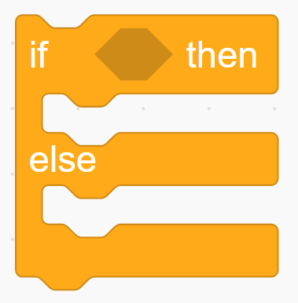 |  | Dual-branch conditional block. Executes code under "then" if the condition is true, and executes code under "else" otherwise. |
|  |  | Delays program execution by a custom duration in milliseconds. |
|  |  | Loops internal code until the specified condition becomes true, then exits the loop. |
|  |  | Terminates the current loop early, exiting immediately to execute subsequent code. |
|  |  | Used inside custom functions to return specified data to the function caller. |
|  |  | Performs addition on two numbers and returns the result. |
| 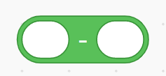 |  | Performs subtraction on two numbers and returns the result. |
|  |  | Performs multiplication on two numbers and returns the result. |
|  |  | Performs division on two numbers and returns the result. |
|  |  | Compares numerical values, returning a boolean true or false. |
|  |  | Logical AND operation. Returns true only when all conditions are true simultaneously. |
|  |  | Logical OR operation. Returns true when at least one condition is true. |
|  |  | Logical NOT operation. Inverts the boolean condition. |
| 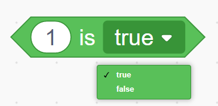 |  | Boolean constant block, outputting true or false for logical evaluations. |
|  |  | Checks whether a specified element exists within a list, tuple, or dictionary, returning a boolean result. |
|  |  | Extracts the value associated with a specified key from a dictionary. |
| 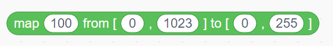 |  | Linearly maps an input value from an original numerical range to a target range, completing value range conversion. |
|  |  | Inputs or calls custom text, generating string data for concatenation, comparison, or display. |
|  |  | Concatenates two text strings into a combined string. |
|  |  | Converts a numeric value into string format for text display or string concatenation. |
|  |  | Creates a custom named variable container to store a single value such as a number or text. |
|  |  | Reads data stored in a created variable for operations, conditions, or output. |
|  |  | Assigns a value to a specified variable, overwriting previous data. |
|  |  | Increments a numeric variable by a specified amount. |
| 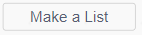 |  | Creates a custom named empty list for storing multiple data entries. |
|  |  | Generates an empty list container for storing numbers, strings, and other data types for subsequent operations. |
|  |  | Clears all elements from a target list, resetting it to an empty list. |
|  |  | Inserts an item before the specified index in a list. |
| 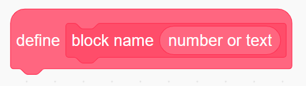 |  | Defines a custom function block with a function name and numeric or text input parameters to encapsulate reusable logic. |
| 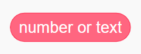 |  | Provides number or text parameter inputs to a custom function for internal processing. |
| 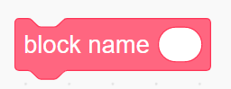 |  | Invokes a defined custom function block, executing all code encapsulated within it. |
|  |  | Defines a basic custom function block to encapsulate reusable program logic. |
|  |  | Invokes a defined custom function, executing all code encapsulated within it. |

### 4.2.5 ESP32 Controller Extension Library

| Block | Category | Function |
| :---: | :---: | :--- |
|  |  | Main program loop container, executing internal blocks continuously after power-on initialization finishes. |
|  |  | Executes once upon device power-on, used for hardware initialization, parameter configuration, and startup routines. |
|  |  | Drives the buzzer to play a melody with specified notes and beats. Running in background mode avoids blocking subsequent code execution. |
| 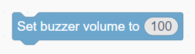 |  | Adjusts buzzer playback volume from 0 to 100, where higher values yield louder output. |
| 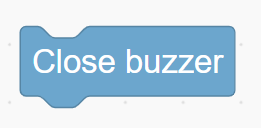 |  | Immediately stops buzzer sound output, terminating any actively playing tone or melody. |
|  |  | Sets a specified RGB LED or all RGB LEDs to illuminate in a selected color. |
| 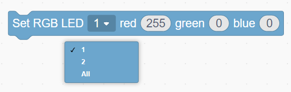 |  | Customizes RGB LED color using three-channel RGB values, controlling the LED to emit mixed light colors. |
| 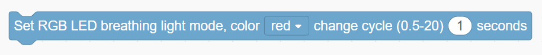 |  | Sets a specified RGB LED to execute a smooth breathing brightness cycle in a selected color with a custom period. |
| 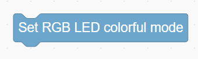 |  | Activates a dynamic flowing rainbow lighting effect that cycles smoothly through multiple colors. |
| 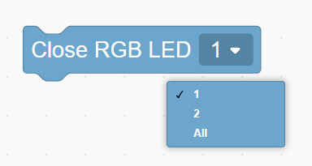 |  | Turns off a specified RGB LED or all RGB LEDs, extinguishing the light output. |
| 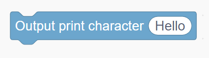 |  | Prints a custom text string to the computer over the serial port for information debugging. |
| 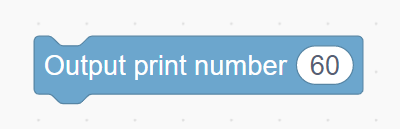 |  | Prints a specified numeric value to the computer over the serial port for data debugging. |
| 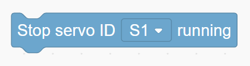 |  | Immediately stops the rotation of the 360° servo connected to the specified port. |
|  |  | Drives the 360° servo on the specified port to rotate continuously at a set speed. |
|  |  | Drives the 270° servo on the specified port to smoothly rotate to a target angle over a set duration, automatically waiting for the action to finish. |

## 4.3 Electronic Module Tutorials

### 4.3.1 360° Block Motor

#### (1) Overview

This servo is compatible with various LEGO-style building block components. Pulse width modulation, also known as PWM, is typically used for control. As a continuous rotation servo, PWM signals regulate its rotation speed and direction, though specific rotation angles cannot be controlled.

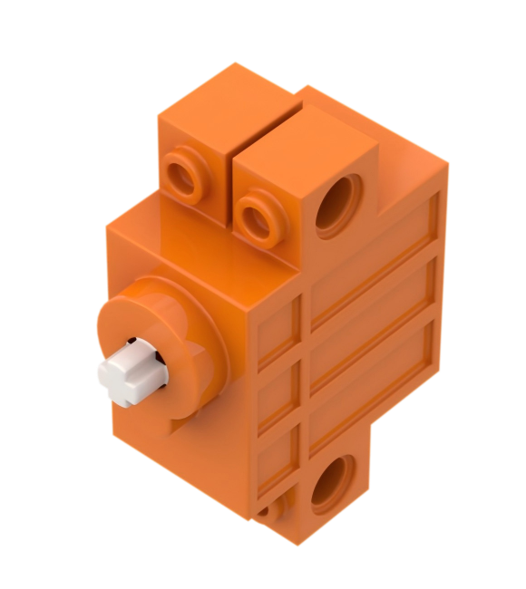

#### (2) Technical Specifications

| Parameter | Specification |
| :---: | :---: |
| Operating voltage | DC 4.8 V ~ 6 V |
| Rated torque | 1 N·m |
| Rotation range | 0°~360° |
| Cable length | 25 cm |
| Dimensions | 40 × 16 mm |

#### (3) Wiring Diagram

Connect the 360° block motor to ports **S1~S6** of the controller using a 3-pin servo cable. Ensure the **orange** wire connects to **S**, the **red** wire connects to **5 V**, and the **brown** wire connects to **GND**, as shown below:

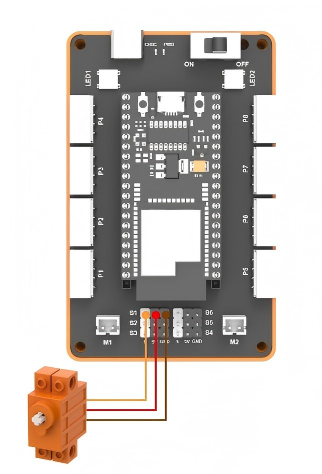

#### (4) Hands-On Example

Case 1: Servo Timed Forward and Reverse Rotation

Program Logic: After uploading the program, the 360° block motor rotates forward at a speed of 50 for 2 seconds, rotates in reverse for 2 seconds, and then stops.

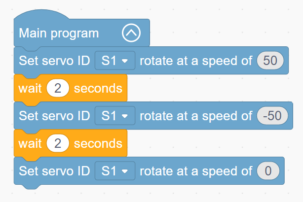

Program Upload Instructions:

Click **Connect device**, select the serial port, then click the **upload** button to complete the program transfer and test the execution results.

> [!NOTE]
>
> * **The program uses `Set Servo S1 to Rotate at Speed 50` because PWM signals are required to control the rotation of the 360° block motor. Because the PWM output ports of the controller are S1~S6, port S1 is used here to send signals to the 360° block motor.**
>
> * **The source files are available for download under [Program Files](https://drive.google.com/drive/folders/1gpd83ho-Cf-T1LV6VETKvwf1mI7A8Bfg?usp=sharing).**

### 4.3.2 Dot Matrix Module

#### (1) Overview

This LED dot matrix display module features high brightness, flicker-free display, and straightforward wiring. The module displays numbers, text, and custom graphic patterns. Integrated LEGO-compatible mounting holes support versatile creative designs.

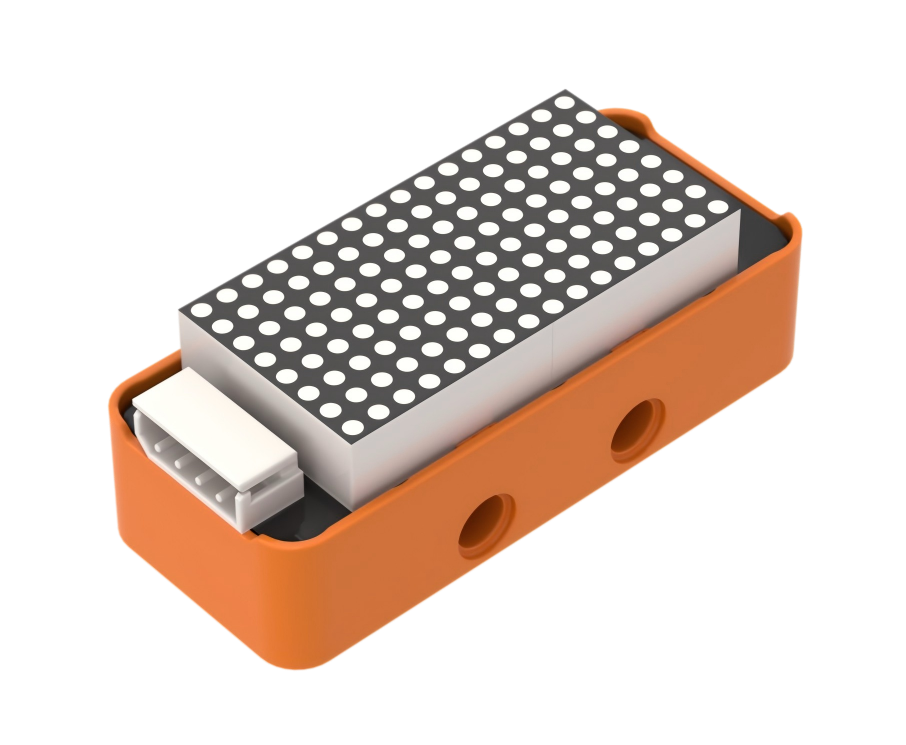

#### (2) Technical Specifications

| Parameter | Specification |
| :---: | :---: |
| Operating voltage | DC 5 V |
| Operating current | 45 mA |
| Dot matrix pixels | 8 × 16 dot matrix |
| Brightness levels | 8 adjustable brightness levels |
| Connector type | 5264-4AW |
| Dimensions | 55.5 × 23.5 × 18.1 mm |

#### (3) Wiring Diagram

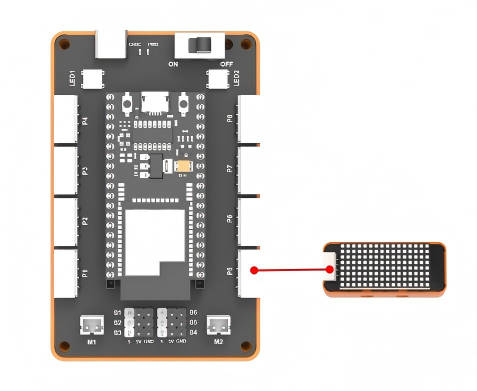

* **It supports connecting to ports 5, 6, 7, or 8 on the main controller.**

#### (4) Hands-On Example

Case 1: Dot Matrix Cyclical Graphic and Text Display

Program Logic: After uploading the program, the dot matrix displays "Hi", "123", and a heart pattern in sequence.

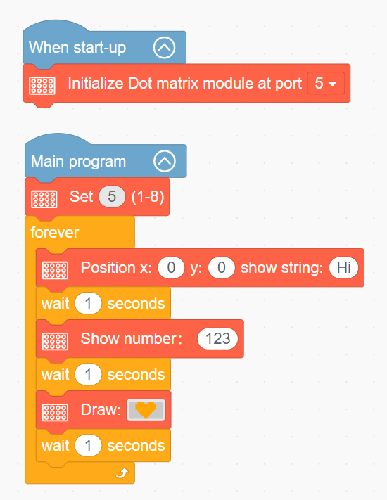

Program Upload Instructions:

Click **Connect device**, select the serial port, then click the **upload** button to complete the program transfer and test the execution results.

> [!NOTE]
>
> * **When using the dot matrix module, initialize the dot matrix port during program startup.**
> * **The source files are available for download under [Program Files](https://drive.google.com/drive/folders/1gpd83ho-Cf-T1LV6VETKvwf1mI7A8Bfg?usp=sharing).**

### 4.3.3 270° Block Servo

#### (1) Overview

This servo is compatible with various LEGO-style building block components. Pulse width modulation, also known as PWM, is typically used for control. As a limited-rotation servo, it controls precise rotation angles within a limited range of 0° to 270°.

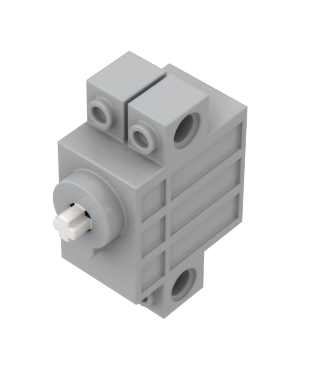

#### (2) Technical Specifications

| Parameter | Specification |
| :---: | :---: |
| Operating voltage | DC 4.8 V ~ 6 V |
| Rated torque | 1 N·m |
| Rotation range | 0°~270° |
| Cable length | 25 cm |
| Dimensions | 40 × 16 mm |

#### (3) Wiring Diagram

Connect the 270° servo to port **S1–S6** on the main controller. Ensure the **orange** wire connects to **S**, the **red** wire connects to **5 V**, and the **brown** wire connects to **GND**, as shown in the figure below:

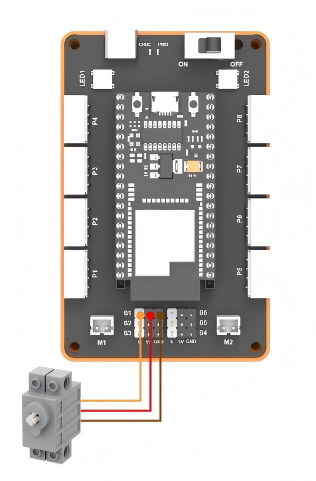

#### (4) Hands-On Example

Case 1: 270° Servo Multi-Angle Timed Rotation

Program Logic: After uploading the program, the 270° block servo rotates to 135°, waits 2 seconds, rotates to 0°, waits 2 seconds, rotates to 270°, waits 2 seconds, and then stops.

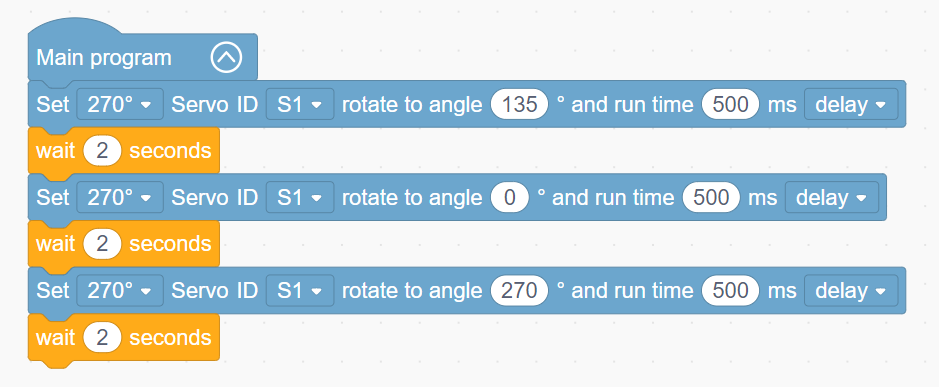

Program Upload Instructions:

Click **Connect device**, select the serial port, then click the **upload** button to complete the program transfer and test the execution results.

> [!NOTE]
>
> * **The 270° block servo must perform an initial reset before operation.**
>
> * **The source files are available for download under [Program Files](https://drive.google.com/drive/folders/1gpd83ho-Cf-T1LV6VETKvwf1mI7A8Bfg?usp=sharing).**

### 4.3.4 Glowy Ultrasonic Sensor

#### (1) Overview

This is an glowy ultrasonic ranging module powered by an industrial-grade ultrasonic chip. The chip integrates ultrasonic transmitting, receiving, and digital processing circuits, among others. Featuring an I2C communication interface, the module allows the measured distance to be read via I2C. Additionally, the sensor is compatible with LEGO hole patterns, enabling more creative DIY designs.

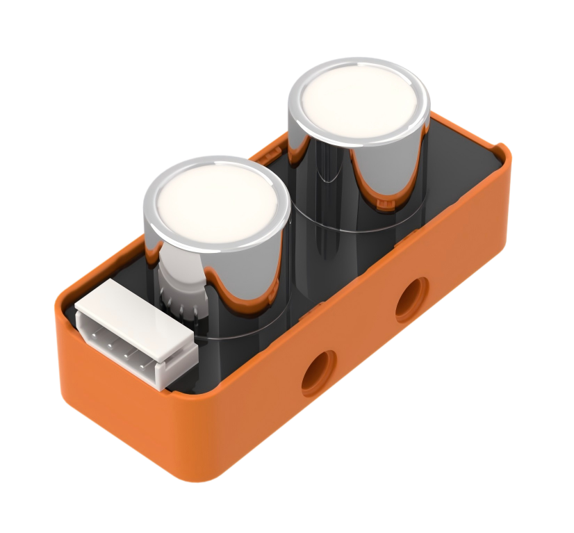

#### (2) Technical Specifications

| Parameter | Specification |
| :---: | :---: |
| Operating voltage | DC 5 V |
| Operating current | 2 mA |
| Operating frequency | 40 Hz |
| Effective range | 2 ~ 400 cm |
| Communication method | I2C |
| Connector type | 5264-4AW |
| Dimensions | 55.5 × 23.5 × 23.8 mm |

#### (3) Wiring Diagram

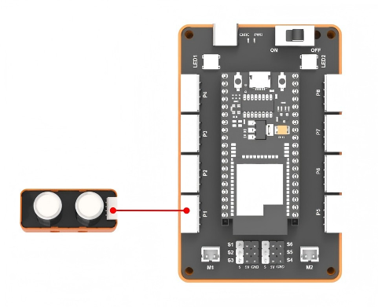

* **It supports connecting to ports 1, 2, 3, or 4 on the main controller.**

#### (4) Hands-On Example

Case 1: Ultrasonic Distance-Sensing LED Control

Program Logic: After uploading the program, when the ultrasonic sensor detects an obstacle at a distance of 15 cm or less, both RGB lights on the ultrasonic sensor illuminate red. When the distance exceeds 15 cm, both RGB lights turn off. The detection state refreshes every 0.1 seconds to maintain rapid responsiveness.

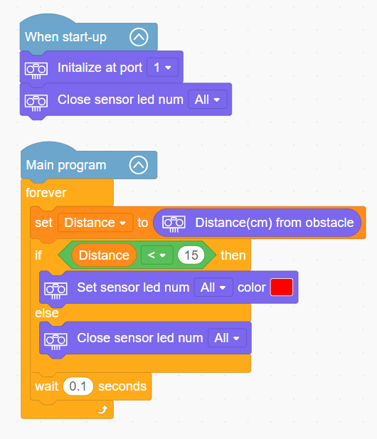

Program Upload Instructions:

Click **Connect device**, select the serial port, then click the **upload** button to complete the program transfer and test the execution results.

> [!NOTE]
>
> * **When using the ultrasonic sensor, initialize the ultrasonic sensor port during startup. The program executes `Turn Off Glowing Ultrasonic RGB Lights, All` at startup because the ultrasonic sensor illuminates blue upon power-on.**
>
> * **The source files are available for download under [Program Files](https://drive.google.com/drive/folders/1gpd83ho-Cf-T1LV6VETKvwf1mI7A8Bfg?usp=sharing).**

### 4.3.5 4-Channel Line Follower Sensor

#### (1) Overview

The 4-channel line follower sensor can be used for line tracking and identification. The sensor is compatible with LEGO hole patterns, enabling more creative DIY designs.

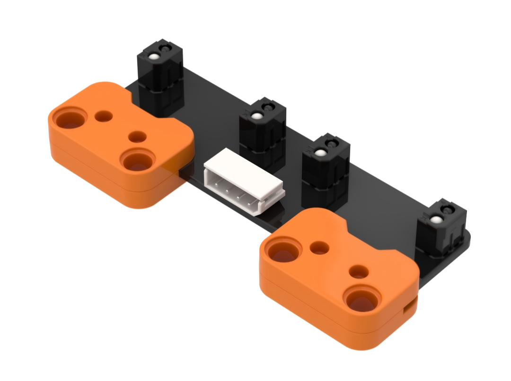

#### (2) Technical Specifications

| Parameter | Specification |
| :---: | :---: |
| Operating voltage | DC 5 V |
| Effective range | 8 ~ 16 mm |
| Communication type | I2C |
| Connector type | 5264-4AW |
| Dimensions | 71.7 × 31.2 × 9.0 mm |

#### (3) Wiring Diagram

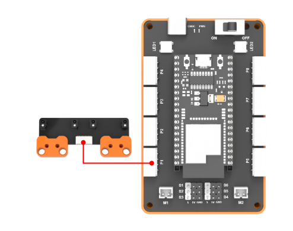

* It supports connecting to ports 1, 2, 3, or 4 on the main controller.

#### (4) Learning Mode

The 4-channel line follower sensor learns the map background and the line track by pressing the button on the sensor. Complete the learning process with the following steps:

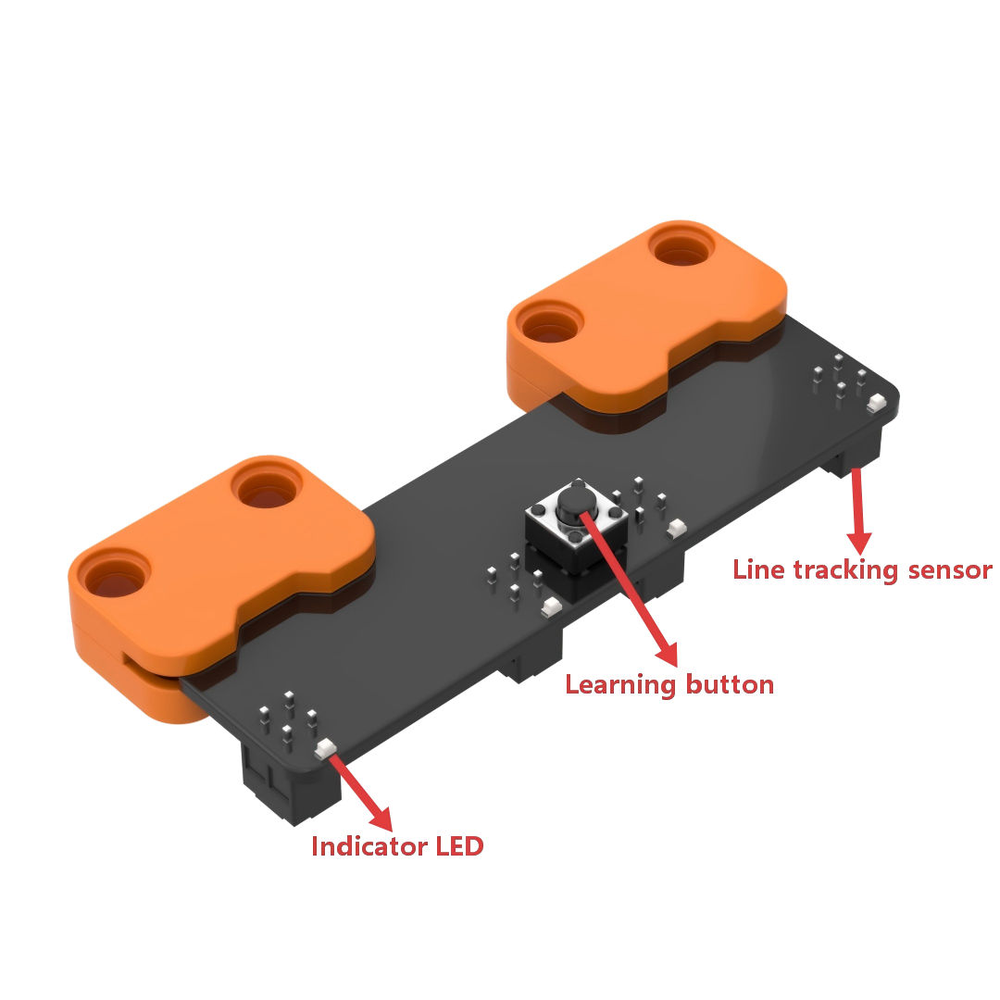

① Point the probes of the 4-channel line follower sensor directly toward the map background area and long-press the learning button. The indicator LEDs for probes 1 to 4 flash simultaneously, indicating that background learning is complete.

②  Point the probes directly toward the line track to follow and short-press the learning button once. The indicator LEDs for probes 1 to 4 flash simultaneously, indicating that line learning is complete.

③  When the center two probe indicator LEDs flash, the line follower sensor has completed learning.

> [!NOTE]
>
> **During operation, maintain the probe height between 8 mm and 16 mm above the ground. After successful learning, the center two probe LEDs flash. When a probe detects the track line, its corresponding indicator LED illuminates.**

#### (5) Hands-On Example

Case 1: 4-Channel Line Follower State Monitoring and Display

Program Logic: After uploading the program, each line follower probe is tested individually. When a black line is detected, the corresponding probe number is output.

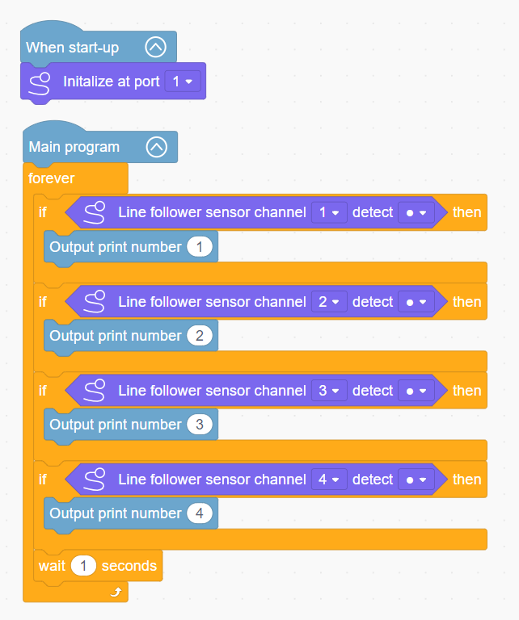

Program Upload Instructions:

Click **Connect device**, select the serial port, then click the **upload** button to complete the program transfer and test the execution results.

> [!NOTE]
>
> * **When using the 4-channel line follower sensor, initialize its port during startup.**
>
> * **The source files are available for download under [Program Files](https://drive.google.com/drive/folders/1gpd83ho-Cf-T1LV6VETKvwf1mI7A8Bfg?usp=sharing).**

## 4.4 WonderLens Vision Module

### 4.4.1 Module Overview

This easy-to-use AI vision sensor integrates 8 functions: color recognition, face recognition, tag recognition, line following, number recognition, traffic sign recognition, image classification, and feature learning.

Eliminating complex training workflows and vision algorithms, onboard one-button AI training enables effortless implementation of diverse AI vision projects.

### 4.4.2 Technical Specifications

| Parameter | Specification |
| :---: | :---: |
| Operating voltage | DC 5 V |
| Communication type | I2C |
| Connector type | 5264-4AW |
| Dimensions | 31.0 × 24.0 × 8.0 mm |

### 4.4.3 Feature Diagram

**The WonderLens vision module features two joysticks located on the left and right sides. Each joystick supports pushing left, pushing right, and pressing down.** Functionally, these are divided into the **navigation joystick** and the **function joystick**. The joystick at the upper left of the screen serves as the navigation joystick, while the joystick at the upper right serves as the function joystick, as shown below:

| Action | Navigation Joystick | Function Joystick |
| :---: | :---: | :---: |
| Push left | Switch menu items left | Enter learning mode |
| Press down | Collapse taskbar / Exit | Confirm / Settings |
| Push right | Switch menu items right | Fill light switch / Delete |

### 4.4.4 Feature Overview

#### (1) Color Recognition

- **Basic Color Recognition Functionality**

1. **Entering the Mode**

   - Upon initial power-on, the screen displays the Color Recognition function bar.

   - Return to the main interface and push the **navigation joystick** until the top of the screen displays the Color Recognition menu bar.

2. **Learning and Recognizing New Colors**

   To use the color recognition feature, colors must first be learned. Complete learning through the following steps:

   (1) On the Color Recognition main interface, push the **function joystick** toward the pen icon  to enter the learning interface.

   

   (2) Align the crosshair at the center of the screen with the color swatch to learn. The selected color swatch is highlighted with a white bounding box.

   

   (3) Push the joystick to the left, then press the camera icon  on the **function joystick** to start learning. Once learning succeeds, a confirmation prompt appears on the screen.

   

   (4) After successful learning, when the vision module detects the learned color in the frame, it immediately outlines the largest object matching that color and displays the corresponding color ID.

   

   

3. **Deleting Colors**

   Enter the Color Recognition learning interface. Use the **function joystick** to select the color ID to delete, then press the **function joystick** button corresponding to the trash can icon  to complete the deletion.

   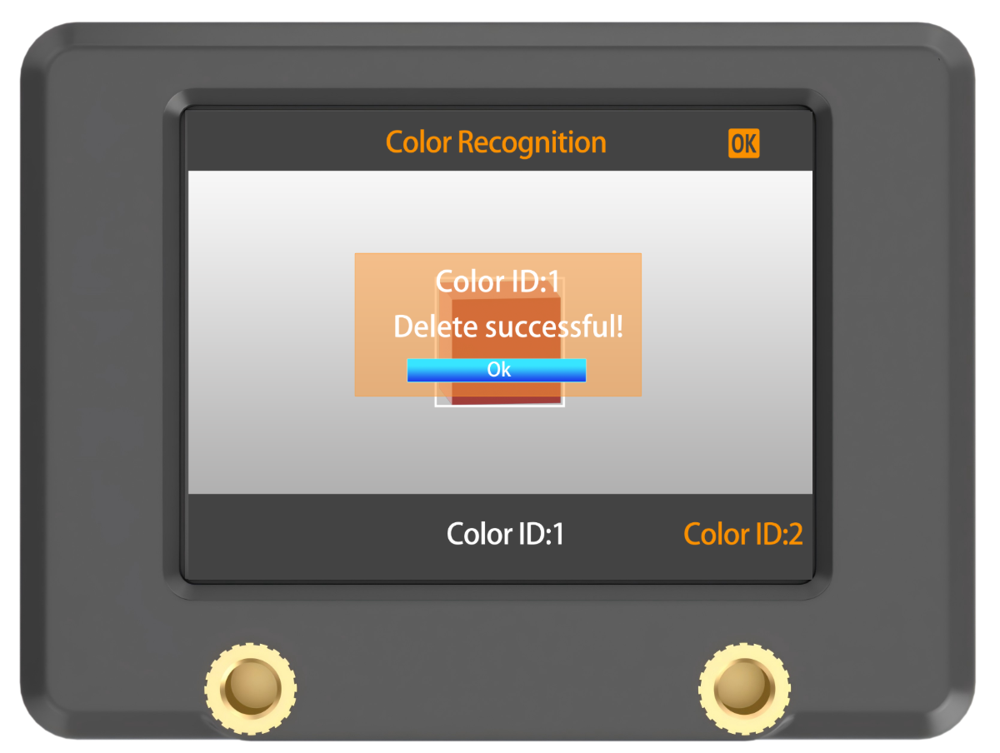

- **Color Recognition Parameter Descriptions**

  Under the Color Recognition main menu, press down the **function joystick** gear icon  to enter the parameter settings interface.

  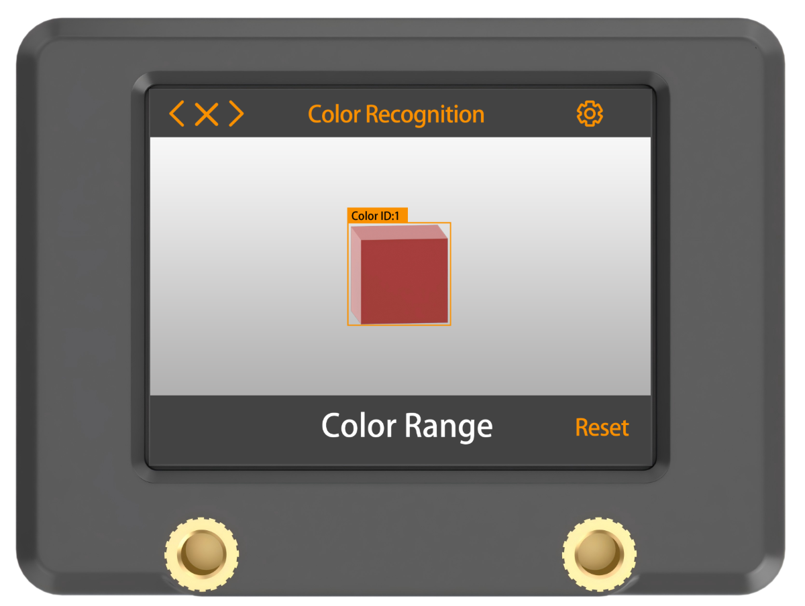

  Color recognition parameter settings include "Color Range" and "Reset Parameters".

  - **Color Range:** Controls the recognition scope during color learning. Appropriate settings assist in accurately identifying the target color and avoid selecting irrelevant regions.

    A value of 20 is typically appropriate, achieving optimal recognition performance across most conditions. Excessively high values may cause the white learning bounding box to cover the entire screen. Excessively low values may enclose only a fraction of the target color, compromising recognition accuracy.

    Learned color IDs retain the color range configured at the time of learning and remain unaffected by subsequent changes to the "Color Range" setting. Relearn the color to adjust the recognition range of an existing color ID.

  - **Reset Parameters:** Restores color recognition parameters to factory default settings. Save the new settings when exiting the settings interface. Otherwise, the reset parameters will not be saved.

#### (2) Face Recognition

- **Detecting Faces**

1. **Entering the Mode**

   Return to the main interface and push the **navigation joystick** until the top of the screen displays the Face Recognition menu bar.

2. **Detecting Faces**

   Upon entering this mode, face detection starts running automatically. When detection succeeds, a white bounding box outlines the detected face.

   

   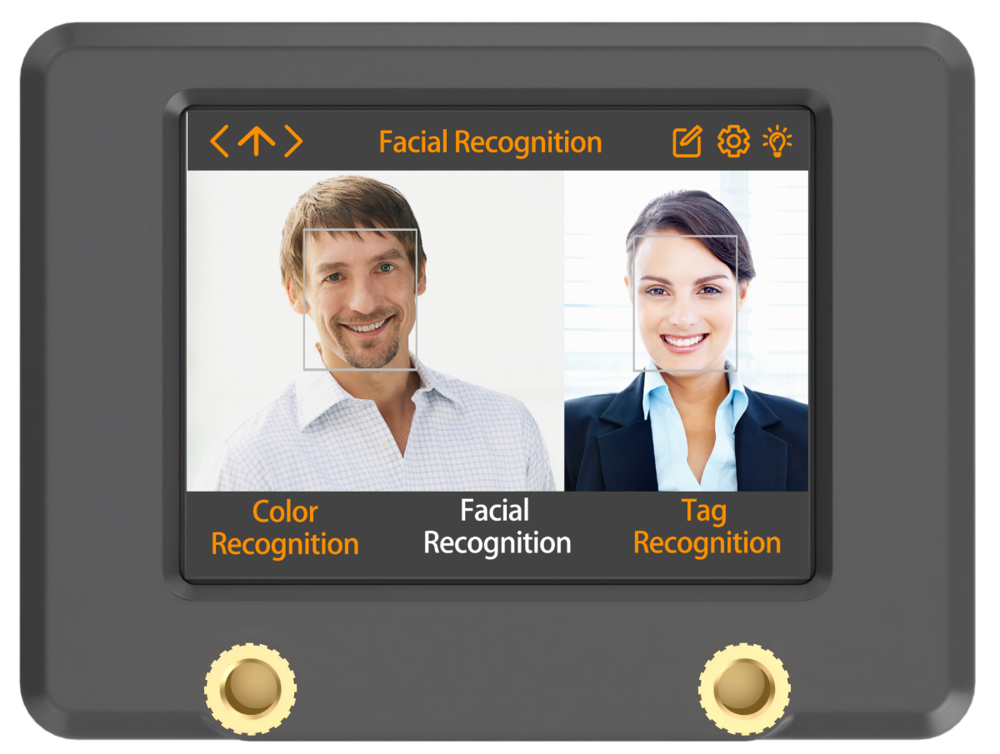

- **Learning Specific Faces**

  To recognize specific individuals, detected faces must first be learned.

  - **Learning a Single Face**

  1. Push the **function joystick** to the left toward the pen icon  to enter face learning mode.

     

  2. Upon entering face learning mode, the center of the screen displays a "+" crosshair, and the menu bar displays items such as "Face ID:1" and "Face ID:2". Here, Face ID functions like a file name on a computer, storing data and indexing different faces. Align the center "+" crosshair with the center of the face. 

     > [!NOTE]
     >
     > **To achieve better learning results, please strictly adhere to the requirements of this step. Failure to do so may result in ineffective learning! **

     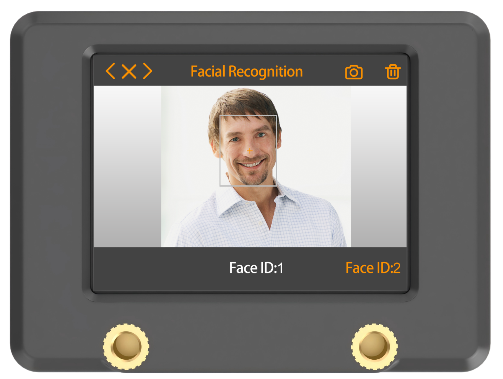

  3. Once aligned, push the **function joystick** to the left toward the camera icon  to perform face learning. After learning completes, press OK to close the prompt dialog. A dialog box pops up indicating the learning outcome upon success or failure. After successful learning, a checkmark appears after the corresponding Face ID in the menu bar, indicating that face learning is complete.

     

  - **Learning Multiple Faces**

    For example, after learning Face ID:1, to learn multiple faces, push the **navigation joystick** to the right in face learning mode to navigate to another face ID, such as "Face ID:2". Then follow the steps used previously for ID 1.

    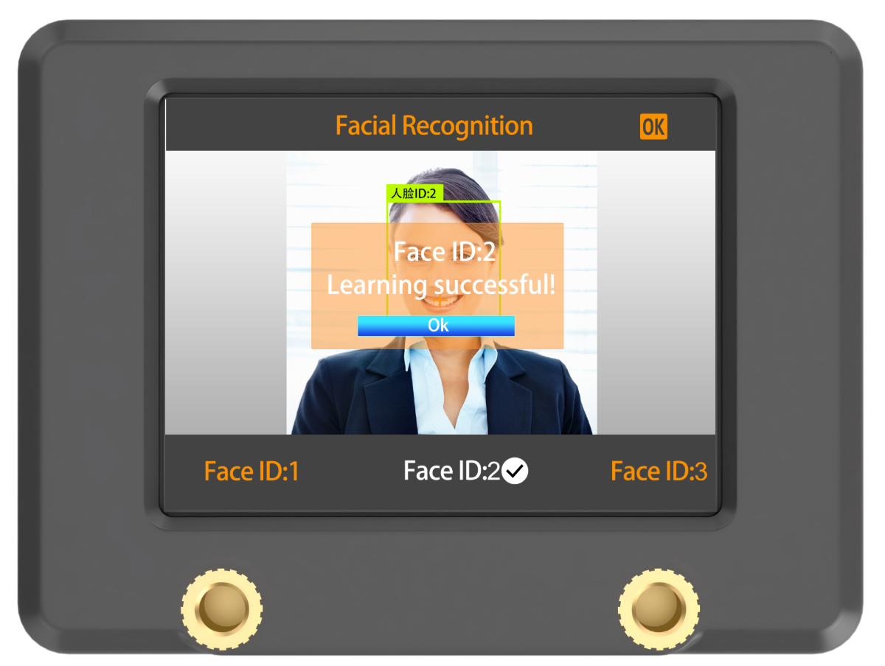

- **Recognizing Specific Faces**

  After completing learning, when the same face is detected, the screen outlines the face with a distinct colored bounding box and displays the corresponding face ID.

  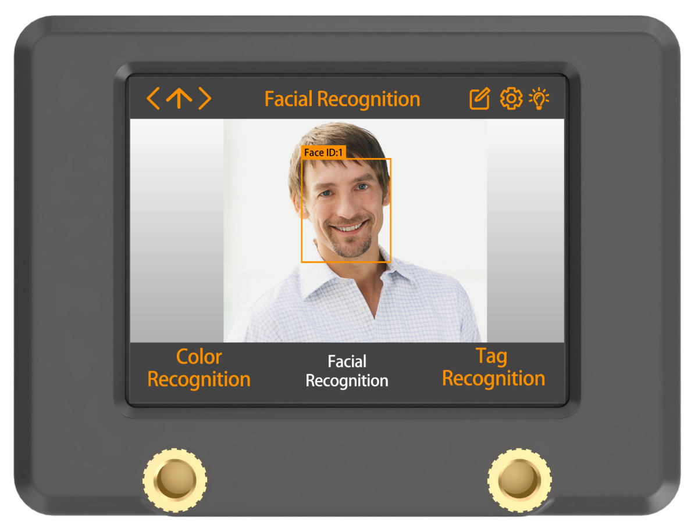

  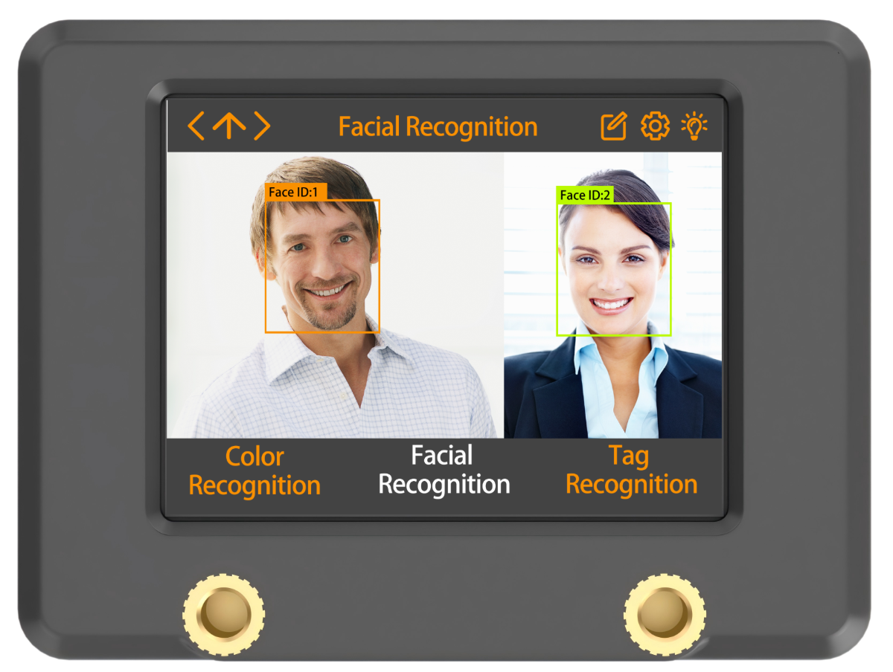

- **Deleting Faces**

  If recognition of a specific face ID is no longer needed, learned faces can be deleted. In the face learning interface, use the **navigation joystick** to navigate to the face ID to delete, then push the **function joystick** to the right toward the trash can icon  to delete it.

  

- **Face Recognition Parameter Descriptions**

  Under the Face Recognition main menu, press down the **function joystick** gear icon to enter the parameter settings interface. Face recognition settings include "Detection Threshold", "NMS Threshold", "Recognition Threshold", and "Reset Parameters".

  

  1. **Detection Threshold:** Configures the sensitivity threshold for face detection. Higher values yield greater precision and reduce false positives, but excessively high values decrease the detection rate or prevent faces from being detected.

  2. **NMS Threshold:** Non-maximum suppression threshold. Maintain the default setting under standard conditions.

  3. **Recognition Threshold:** Configures the threshold for recognizing specific faces. Higher values improve accuracy and prevent false matches. Excessively low thresholds cause incorrect faces to match the learned ID, while excessively high thresholds cause detection failures or require strict positions and angles for successful recognition.

  4. **Reset Parameters:** Restores all face recognition parameters to default values. Save the new settings when exiting the settings interface. Otherwise, the reset parameters will not be saved.

#### (3) Tag Recognition

1. **Entering the Mode**

   Return to the main interface and push the **navigation joystick** until the top of the screen displays the Tag Recognition menu bar.

2. **Recognizing Tags**

   Point the camera toward TAG36H11 AprilTags. The screen outlines the tag with an orange bounding box and displays a crosshair at the center.

   

   The WonderLens AI vision module can recognize multiple tags with identical or different IDs simultaneously.

   

   > [!NOTE]
   >
   > **Maintain an appropriate distance from the tag. The tag is recognized as long as the module outlines it with a bounding box. If the tag is positioned too far from the WonderLens AI vision module and appears too small in the frame, the module cannot perform recognition.**

#### (4) Line Following

- **Basic Line Following Functionality**

1. **Entering the Mode**

   Return to the main interface and push the **navigation joystick** to the right until the top of the screen displays the "Visual Linefollowing" menu bar.

2. **Learning and Recognizing New Lines**

   Similar to color recognition, line following requires learning the track line prior to use. Follow the learning steps below:

   (1) On the Line Following main interface, push the **function joystick** to the left, then short-press the function button corresponding to the pen icon .

   

   (2) Align the crosshair at the center of the screen with the line to learn. Ensure the line appears as straight or vertical as possible within the frame, and adjust the white arrow on the screen to align with the direction of the target line.

   

   (3) Short-press the function button corresponding to the camera icon  to begin learning. Adjust lighting and angles to ensure the white arrow remains steady without jittering, then await the learning result prompt. **If learning fails, adjust lighting conditions or use a more vivid color to stabilize the arrow before attempting to learn again.**

   

   (4) After successful learning, when the corresponding line color appears in the frame, the WonderLens AI vision module calculates the color region and renders a directional tracking arrow.

   

   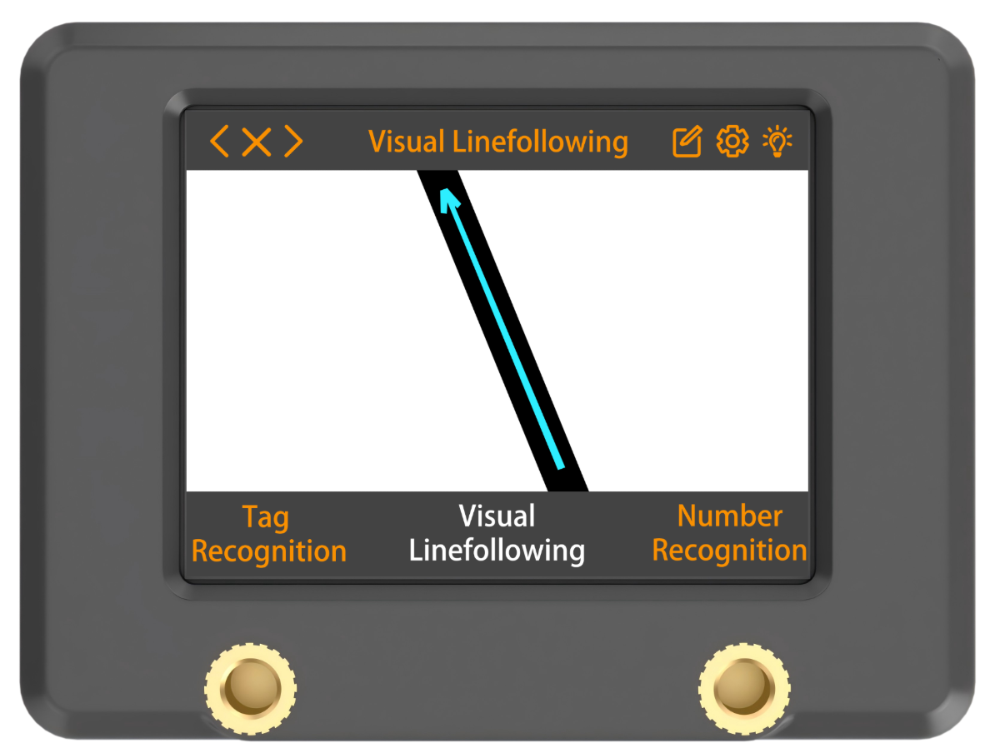

3. **Deleting Lines**

   Enter the Line Following learning interface. Use the **navigation joystick** to select the line ID to delete, then short-press the **function joystick** button corresponding to the trash can icon  to complete the deletion.

   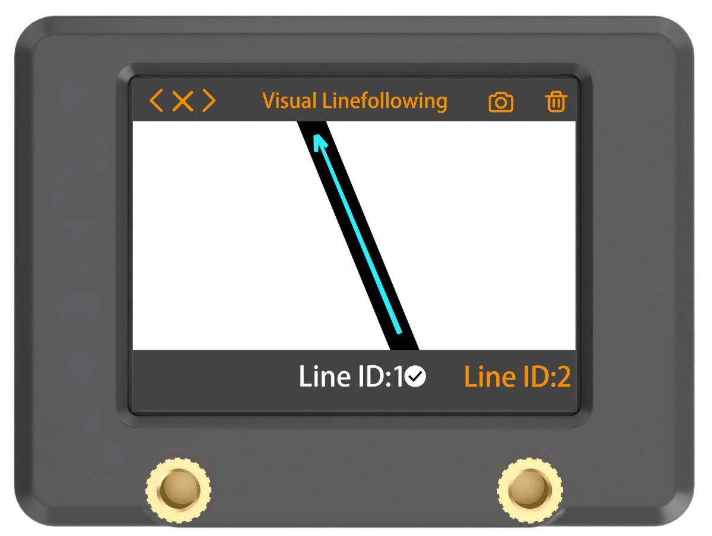

   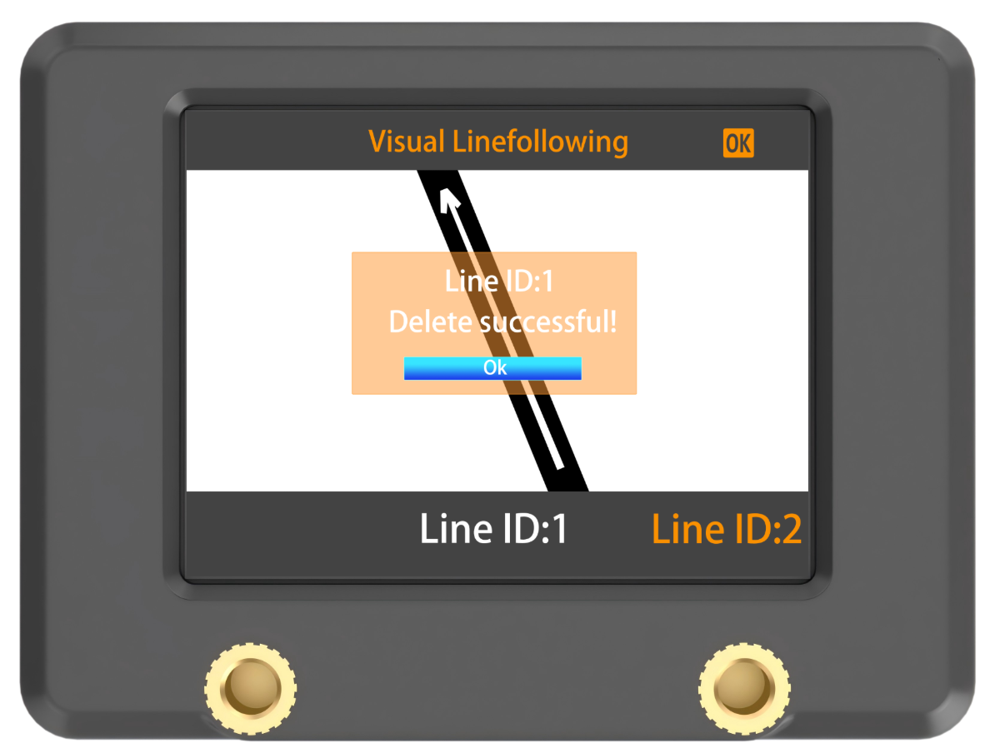

- **Line Following Parameter Descriptions**

  Under the Line Following main menu, press down the **function joystick** gear icon to enter the parameter settings interface.

  

  Recognition parameter settings include "Color Range" and "Reset Parameters".

  - **Color Range:** Controls the recognition scope during color learning. Appropriate settings assist in accurately identifying the target line color and avoid selecting irrelevant regions.

  - **Reset Parameters:** Restores line following parameters to factory default settings.

#### (5) Number Recognition

1. **Entering the Mode**

   Return to the main interface and push the **navigation joystick** to the right until the top of the screen displays the "Number Recognition" menu bar.

2. **Recognizing Numbers**

   Point the camera toward the number cards for classification testing. Each card corresponds to a specific number. During operation, the screen displays the number with the highest confidence along with its confidence value. A confidence value closer to 1.0 indicates greater recognition reliability.

   

   | Number Card | Number | Number Card | Number |
   | :---: | :---: | :---: | :---: |
   |  | 1 |  | 2 |
   |  | 3 |  | 4 |
   |  | 5 | | |

   > [!NOTE]
   >
   > **Maintain an optimal distance of 15 cm to 20 cm between the card and the camera. Avoid dim ambient lighting, as a solid white background provides optimal recognition performance.**

#### (6) Traffic Sign Recognition

1. **Entering the Mode**

   Return to the main interface and push the **navigation joystick** to the right until the top of the screen displays the "Landmark Recognition" menu bar.

2. **Recognizing Traffic Signs**

   Point the camera toward the traffic sign cards for classification testing. Each card corresponds to a distinct ID. During operation, the screen displays the ID with the highest confidence along with its confidence value. A confidence value closer to 1.0 indicates greater recognition reliability.

   

   | Landmark Card | Number | Landmark Card | Number |
   | :---: | :---: | :---: | :---: |
   |  | 1 |  | 2 |
   |  | 3 |  | 4 |
   |  | 5 | | |

#### (7) Image Classification

1. **Entering the Mode**

   Return to the main interface and push the **navigation joystick** to the right until the top of the screen displays the "Image Classification" menu bar.

2. **Classifying Images**

   After launching the image classification function, test classification using the included waste classification cards. Each card corresponds to a distinct ID. During operation, the screen displays the ID with the highest confidence along with its confidence value. A confidence value closer to 1.0 indicates greater recognition reliability.

   

   | Waste Classification Card | ID | Waste Classification Card | ID |
   | :---: | :---: | :---: | :---: |
   | White background | 1 |  | 2 |
   |  | 3 |  | 4 |
   |  | 5 |  | 6 |
   |  | 7 |  | 8 |
   |  | 9 |  | 10 |
   |  | 11 |  | 12 |
   |  | 13 | | |

#### (8) Feature Learning

1. **Entering the Mode**

   Return to the main interface and push the **navigation joystick** to the right until the top of the screen displays the "Feature Learning" menu bar.

2. **Learning Features**

   (1) On the Feature Learning main interface, push the **function joystick** to the left toward the pen icon  to enter the learning interface. **If no images have been learned, the result area displays ID:0 P:0.00.**

   

   (2) Move the WonderLens AI vision module to frame the target object, then press the camera icon  on the **function joystick** to await completion of learning.

   

   (3) After learning completes, the result area displays non-zero values for both ID and P.

   - The parameter P represents confidence, indicating the similarity between the current camera frame and the learned reference image. A value closer to 1.0 indicates higher similarity.

   - The parameter ID identifies the learned image with the closest match to the current frame.

   

3. **Deleting Features**

   Enter the Feature Learning interface. Use the **navigation joystick** to navigate to the feature ID to delete, then press the button corresponding to the trash can icon  on the **function joystick** to delete it.

   

   

### 4.4.5 Firmware Flashing

1. Connect the Type-C port on the right side of the WonderLens AI vision module to a computer using a USB cable.

   

2. Open the **kflash_gui** application located in the [**Appendix/WonderLens Flashing Tool/kflash_gui**](https://drive.google.com/drive/folders/1GF2DEHD2dRL7SDX1qQQ3Yhc0Mivt6p88?usp=sharing) folder.

   

3. Once the tool opens, click **Open File** to select the firmware package to flash: open the **WonderLens_v2.2.2.kfpkg** file located in the [**Appendix/WonderLens Firmware Files**](https://drive.google.com/drive/folders/1QSboFu073_WDaCPontq_HvGattm3OuoO?usp=sharing) folder.

   

   

4. Select the COM port corresponding to the connected module, keeping all other parameters at their default values.

   

5. Click **Download** to flash the selected firmware. Wait for the progress bar to complete, finishing the firmware flashing process.

   
